**Universidad Mariano Gálvez de Guatemala**

**Ingeniería en Sistemas de Información y Ciencias de la Computación**

**Curso: Seminario de Tecnologías de Información**

**Catedrático: Erick Aguilar**

&nbsp;

# Delta ERP Contable (DEC)

## Propuesta e implementación de la transformación digital del control contable de Delta

Borrador integrado final del proyecto

&nbsp;

| Carné | Integrante | Rol en el equipo |
|---|---|---|
| 0900-22-2697 | David Edgar Recinos García | Product Owner y líder de grupo |
| 0900-22-9094 | Alejandro Rocael Ochoa Pérez | Scrum Master |
| 0900-22-15963 | José Rodolfo López y López | Equipo de desarrollo |
| 0900-15-3121 | Luis David Reyes Mijangos | Equipo de desarrollo |

&nbsp;

Guatemala, 18 de octubre de 2026

---

# Índice

- [Índice de capturas](#índice-de-capturas)
- [Índice de figuras](#índice-de-figuras)
- [Índice de tablas](#índice-de-tablas)
- [Resumen ejecutivo](#resumen-ejecutivo)
  - [Guía de lectura](#guía-de-lectura)
- [Capítulo 1. Propuesta de transformación digital](#capítulo-1-propuesta-de-transformación-digital)
  - [1.1 Introducción](#11-introducción)
  - [1.2 Antecedentes](#12-antecedentes)
  - [1.3 Objetivos](#13-objetivos)
    - [1.3.1 Objetivo general](#131-objetivo-general)
    - [1.3.2 Objetivos específicos](#132-objetivos-específicos)
  - [1.4 Justificación](#14-justificación)
  - [1.5 Planteamiento del problema](#15-planteamiento-del-problema)
  - [1.6 Alcance](#16-alcance)
    - [1.6.1 Módulos en alcance](#161-módulos-en-alcance)
    - [1.6.2 Fuera de alcance o pendiente](#162-fuera-de-alcance-o-pendiente)
  - [1.7 Herramientas tecnológicas](#17-herramientas-tecnológicas)
    - [1.7.1 Herramientas por capa](#171-herramientas-por-capa)
    - [1.7.2 Evolución de la plataforma a .NET 10 LTS](#172-evolución-de-la-plataforma-a-net-10-lts)
- [Capítulo 2. Modelo de negocio digital](#capítulo-2-modelo-de-negocio-digital)
  - [2.1 Contexto de la empresa](#21-contexto-de-la-empresa)
  - [2.2 Necesidad de transformación](#22-necesidad-de-transformación)
  - [2.3 Modelo de negocio seleccionado](#23-modelo-de-negocio-seleccionado)
  - [2.4 Justificación del modelo](#24-justificación-del-modelo)
  - [2.5 Componentes del modelo](#25-componentes-del-modelo)
  - [2.6 Procesos clave](#26-procesos-clave)
  - [2.7 Herramientas recomendadas por proceso](#27-herramientas-recomendadas-por-proceso)
  - [2.8 Impacto organizacional](#28-impacto-organizacional)
- [Capítulo 3. Información y estrategia empresarial](#capítulo-3-información-y-estrategia-empresarial)
  - [3.1 Antecedentes](#31-antecedentes)
  - [3.2 Misión](#32-misión)
  - [3.3 Visión](#33-visión)
  - [3.4 Valores](#34-valores)
  - [3.5 Objetivos estratégicos](#35-objetivos-estratégicos)
  - [3.6 Organigrama](#36-organigrama)
  - [3.7 Modelo de negocio digital propuesto](#37-modelo-de-negocio-digital-propuesto)
- [Capítulo 4. Requerimientos y planificación](#capítulo-4-requerimientos-y-planificación)
  - [4.1 Requerimientos funcionales y no funcionales](#41-requerimientos-funcionales-y-no-funcionales)
    - [4.1.1 Requerimientos funcionales por módulo](#411-requerimientos-funcionales-por-módulo)
    - [4.1.2 Requerimientos no funcionales](#412-requerimientos-no-funcionales)
  - [4.2 Objetivos SMART](#42-objetivos-smart)
  - [4.3 Canvas de modelo de negocio](#43-canvas-de-modelo-de-negocio)
  - [4.4 Factibilidad integral](#44-factibilidad-integral)
    - [4.4.1 Factibilidad técnica](#441-factibilidad-técnica)
    - [4.4.2 Factibilidad económica](#442-factibilidad-económica)
    - [4.4.3 Factibilidad operativa](#443-factibilidad-operativa)
    - [4.4.4 Factibilidad legal y fiscal](#444-factibilidad-legal-y-fiscal)
  - [4.5 Presupuesto](#45-presupuesto)
    - [4.5.1 Premisas](#451-premisas)
    - [4.5.2 Talento humano](#452-talento-humano)
    - [4.5.3 Infraestructura y software](#453-infraestructura-y-software)
    - [4.5.4 Capacitación, gestión del cambio y otros costos directos](#454-capacitación-gestión-del-cambio-y-otros-costos-directos)
    - [4.5.5 Resumen de la inversión](#455-resumen-de-la-inversión)
    - [4.5.6 Análisis costo-beneficio](#456-análisis-costo-beneficio)
  - [4.6 Planificación con PERT probabilístico](#46-planificación-con-pert-probabilístico)
    - [4.6.1 Actividades del proyecto](#461-actividades-del-proyecto)
    - [4.6.2 Duraciones estimadas](#462-duraciones-estimadas)
    - [4.6.3 Ruta crítica](#463-ruta-crítica)
    - [4.6.4 Cronograma planificado](#464-cronograma-planificado)
  - [4.7 Cronograma: diagrama de Gantt](#47-cronograma-diagrama-de-gantt)
  - [4.8 Matriz de trazabilidad](#48-matriz-de-trazabilidad)
  - [4.9 Matriz de riesgos](#49-matriz-de-riesgos)
- [Capítulo 5. Diseño del sistema](#capítulo-5-diseño-del-sistema)
  - [5.1 Arquitectura general y contexto](#51-arquitectura-general-y-contexto)
  - [5.2 Casos de uso](#52-casos-de-uso)
  - [5.3 Diagrama de clases](#53-diagrama-de-clases)
  - [5.4 Diagramas de secuencia](#54-diagramas-de-secuencia)
  - [5.5 Diagrama de componentes](#55-diagrama-de-componentes)
  - [5.6 Diagramas de actividades](#56-diagramas-de-actividades)
  - [5.7 Diagramas de estados](#57-diagramas-de-estados)
  - [5.8 Interfaz de programación y navegación](#58-interfaz-de-programación-y-navegación)
  - [5.9 Diagrama de despliegue](#59-diagrama-de-despliegue)
  - [5.10 Red y seguridad](#510-red-y-seguridad)
  - [5.11 Modelo entidad-relación](#511-modelo-entidad-relación)
  - [5.12 Modelo relacional y diccionario de datos](#512-modelo-relacional-y-diccionario-de-datos)
  - [5.13 Motor de base de datos: PostgreSQL 16](#513-motor-de-base-de-datos-postgresql-16)
  - [5.14 Scripts de base de datos](#514-scripts-de-base-de-datos)
- [Capítulo 6. Gestión ágil del proyecto con Scrum](#capítulo-6-gestión-ágil-del-proyecto-con-scrum)
  - [6.1 Product Backlog](#61-product-backlog)
  - [6.2 Roles Scrum](#62-roles-scrum)
  - [6.3 Planificación de los sprints](#63-planificación-de-los-sprints)
  - [6.4 Sprint 1 (08/09/2026 al 21/09/2026)](#64-sprint-1-08092026-al-21092026)
  - [6.5 Sprints 2, 3 y 4](#65-sprints-2-3-y-4)
  - [6.6 Creación de la base de datos](#66-creación-de-la-base-de-datos)
  - [6.7 Equipo de trabajo](#67-equipo-de-trabajo)
  - [6.8 Comunicación del equipo](#68-comunicación-del-equipo)
  - [6.9 Seguimiento del proyecto](#69-seguimiento-del-proyecto)
- [Capítulo 7. DevOps y despliegue en la nube](#capítulo-7-devops-y-despliegue-en-la-nube)
  - [7.1 Herramientas y arquitectura de despliegue](#71-herramientas-y-arquitectura-de-despliegue)
  - [7.2 Control de versiones y protección de ramas](#72-control-de-versiones-y-protección-de-ramas)
  - [7.3 Despliegue del backend en Azure Container Apps](#73-despliegue-del-backend-en-azure-container-apps)
  - [7.4 Dockerfile en dos etapas](#74-dockerfile-en-dos-etapas)
  - [7.5 Conexión del código con el pipeline](#75-conexión-del-código-con-el-pipeline)
  - [7.6 Pipelines de integración y despliegue continuo](#76-pipelines-de-integración-y-despliegue-continuo)
  - [7.7 Ejecución del pipeline y resultados](#77-ejecución-del-pipeline-y-resultados)
  - [7.8 Pruebas y plan de pruebas](#78-pruebas-y-plan-de-pruebas)
  - [7.9 Calidad con SonarCloud](#79-calidad-con-sonarcloud)
  - [7.10 Monitoreo](#710-monitoreo)
- [Capítulo 8. Cierre del proyecto](#capítulo-8-cierre-del-proyecto)
  - [8.1 Reflexión sobre la aplicación de Scrum](#81-reflexión-sobre-la-aplicación-de-scrum)
  - [8.2 Conclusión por módulo](#82-conclusión-por-módulo)
  - [8.3 Trabajo futuro y pendientes](#83-trabajo-futuro-y-pendientes)
- [Anexos](#anexos)
  - [Anexo A. Definición de las tablas del esquema en PostgreSQL 16](#anexo-a-definición-de-las-tablas-del-esquema-en-postgresql-16)
    - [A.1 Tabla perfil](#a1-tabla-perfil)
    - [A.2 Tabla usuario](#a2-tabla-usuario)
    - [A.3 Tabla bitacoraauditoria](#a3-tabla-bitacoraauditoria)
    - [A.4 Tabla moneda](#a4-tabla-moneda)
    - [A.5 Tabla historialtipocambio](#a5-tabla-historialtipocambio)
    - [A.6 Tabla periodocontable](#a6-tabla-periodocontable)
    - [A.7 Tabla contraparte](#a7-tabla-contraparte)
    - [A.8 Tabla cuentacontable](#a8-tabla-cuentacontable)
    - [A.9 Tabla centrocosto](#a9-tabla-centrocosto)
    - [A.10 Tabla asientocontable](#a10-tabla-asientocontable)
    - [A.11 Tabla lineaasiento](#a11-tabla-lineaasiento)
    - [A.12 Tabla plantillaasiento](#a12-tabla-plantillaasiento)
    - [A.13 Tabla lineaplantillaasiento](#a13-tabla-lineaplantillaasiento)
    - [A.14 Tabla documentocxc](#a14-tabla-documentocxc)
    - [A.15 Tabla lineadocumentocxc](#a15-tabla-lineadocumentocxc)
    - [A.16 Tabla recibopagocliente](#a16-tabla-recibopagocliente)
    - [A.17 Tabla aplicacionpagocliente](#a17-tabla-aplicacionpagocliente)
    - [A.18 Tabla documentocxp](#a18-tabla-documentocxp)
    - [A.19 Tabla lineadocumentocxp](#a19-tabla-lineadocumentocxp)
    - [A.20 Tabla pagoproveedorcabecera](#a20-tabla-pagoproveedorcabecera)
    - [A.21 Tabla aplicacionpagoproveedor](#a21-tabla-aplicacionpagoproveedor)
    - [A.22 Tabla cuentabancaria](#a22-tabla-cuentabancaria)
    - [A.23 Tabla movimientotesoreria](#a23-tabla-movimientotesoreria)
    - [A.24 Tabla conciliacionbancaria](#a24-tabla-conciliacionbancaria)
    - [A.25 Tabla detalleconciliacion](#a25-tabla-detalleconciliacion)
    - [A.26 Tabla saldocuentaperiodo](#a26-tabla-saldocuentaperiodo)
    - [A.27 Tabla impuesto](#a27-tabla-impuesto)
    - [A.28 Tabla configuracionfiscal](#a28-tabla-configuracionfiscal)
    - [A.29 Tabla parametroretencion](#a29-tabla-parametroretencion)
    - [A.30 Tabla retencion](#a30-tabla-retencion)
    - [A.31 Tabla constanciaretencion](#a31-tabla-constanciaretencion)
    - [A.32 Tabla revaluacion](#a32-tabla-revaluacion)
    - [A.33 Tabla revaluacionpartida](#a33-tabla-revaluacionpartida)
    - [A.34 Tabla enteramiento](#a34-tabla-enteramiento)
    - [A.35 Tabla ajuste_retencion](#a35-tabla-ajuste_retencion)
    - [A.36 Tabla feriado](#a36-tabla-feriado)
  - [Anexo B. Reglas de negocio RN-01 a RN-36](#anexo-b-reglas-de-negocio-rn-01-a-rn-36)
  - [Anexo C. Diccionario de datos](#anexo-c-diccionario-de-datos)
    - [C.1 perfil](#c1-perfil)
    - [C.2 usuario](#c2-usuario)
    - [C.3 bitacoraauditoria](#c3-bitacoraauditoria)
    - [C.4 moneda](#c4-moneda)
    - [C.5 historialtipocambio](#c5-historialtipocambio)
    - [C.6 periodocontable](#c6-periodocontable)
    - [C.7 contraparte](#c7-contraparte)
    - [C.8 cuentacontable](#c8-cuentacontable)
    - [C.9 centrocosto](#c9-centrocosto)
    - [C.10 asientocontable](#c10-asientocontable)
    - [C.11 lineaasiento](#c11-lineaasiento)
    - [C.12 plantillaasiento](#c12-plantillaasiento)
    - [C.13 lineaplantillaasiento](#c13-lineaplantillaasiento)
    - [C.14 documentocxc](#c14-documentocxc)
    - [C.15 lineadocumentocxc](#c15-lineadocumentocxc)
    - [C.16 recibopagocliente](#c16-recibopagocliente)
    - [C.17 aplicacionpagocliente](#c17-aplicacionpagocliente)
    - [C.18 documentocxp](#c18-documentocxp)
    - [C.19 lineadocumentocxp](#c19-lineadocumentocxp)
    - [C.20 pagoproveedorcabecera](#c20-pagoproveedorcabecera)
    - [C.21 aplicacionpagoproveedor](#c21-aplicacionpagoproveedor)
    - [C.22 cuentabancaria](#c22-cuentabancaria)
    - [C.23 movimientotesoreria](#c23-movimientotesoreria)
    - [C.24 conciliacionbancaria](#c24-conciliacionbancaria)
    - [C.25 detalleconciliacion](#c25-detalleconciliacion)
    - [C.26 saldocuentaperiodo](#c26-saldocuentaperiodo)
    - [C.27 impuesto](#c27-impuesto)
    - [C.28 configuracionfiscal](#c28-configuracionfiscal)
    - [C.29 parametroretencion](#c29-parametroretencion)
    - [C.30 retencion](#c30-retencion)
    - [C.31 constanciaretencion](#c31-constanciaretencion)
    - [C.32 revaluacion](#c32-revaluacion)
    - [C.33 revaluacionpartida](#c33-revaluacionpartida)
    - [C.34 enteramiento](#c34-enteramiento)
    - [C.35 ajuste_retencion](#c35-ajuste_retencion)
    - [C.36 feriado](#c36-feriado)
  - [Anexo D. Resumen de pruebas](#anexo-d-resumen-de-pruebas)
  - [Anexo E. Datos de demostración](#anexo-e-datos-de-demostración)
  - [Anexo F. Manual de usuario condensado por perfil](#anexo-f-manual-de-usuario-condensado-por-perfil)
  - [Anexo G. Índice de evidencias](#anexo-g-índice-de-evidencias)

# Índice de capturas

Las capturas 1 a 33 se listan con su número y una descripción breve en el [Anexo G. Índice de evidencias](#anexo-g-índice-de-evidencias).

# Índice de figuras

Las figuras 1 a 40 se listan con su número y su título.

- **Figura 1.** Diagrama de causa y efecto del planteamiento del problema.
- **Figura 2.** Módulos del sistema agrupados por función.
- **Figura 3.** Arquitectura y flujo del modelo SaaS propuesto para Delta.
- **Figura 4.** Flujo del proceso desde el registro de la factura hasta el cierre del periodo.
- **Figura 5.** Organigrama de Delta.
- **Figura 6.** Business Model Canvas del ERP SaaS de Delta.
- **Figura 7.** Distribución de la inversión por rubro (quetzales).
- **Figura 8.** Cronograma del proyecto: actividades planificadas e hitos ejecutados.
- **Figura 9.** Diagrama de Gantt del proyecto: ruta crítica planificada y sprints ejecutados en Azure Boards.
- **Figura 10.** Trazabilidad del módulo M2 (ejemplo para el módulo M2).
- **Figura 11.** Contexto del sistema y servicios externos.
- **Figura 12.** Casos de uso del núcleo contable, la seguridad y el control.
- **Figura 13.** Casos de uso de la operación comercial, la tesorería y las obligaciones fiscales.
- **Figura 14.** Diagrama de clases del núcleo contable y de seguridad.
- **Figura 15.** Diagrama de clases de cuentas por cobrar y por pagar.
- **Figura 16.** Diagrama de clases de tesorería, conciliación bancaria y enteramiento.
- **Figura 17.** Diagrama de clases fiscal y multimoneda.
- **Figura 18.** Diagrama de secuencia del registro de un asiento contable.
- **Figura 19.** Diagrama de secuencia de la reversión de un asiento.
- **Figura 20.** Secuencia del inicio de sesión con JWT.
- **Figura 21.** Secuencia de la factura de compra con retención de ISR.
- **Figura 22.** Secuencia del pago a un proveedor no residente.
- **Figura 23.** Secuencia del enteramiento de retenciones a la SAT.
- **Figura 24.** Diagrama de componentes del sistema.
- **Figura 25.** Diagrama de componentes por módulo funcional.
- **Figura 26.** Actividades del registro de una factura de compra con IVA y retención.
- **Figura 27.** Actividades del cierre de periodo contable.
- **Figura 28.** Estados del periodo contable.
- **Figura 29.** Estados del asiento contable.
- **Figura 30.** Estados de la conciliación bancaria.
- **Figura 31.** Estados de la constancia de retención.
- **Figura 32.** Estados del enteramiento.
- **Figura 33.** Estados del ajuste de retención.
- **Figura 34.** Despliegue y flujo de entrega continua.
- **Figura 35.** Límites de confianza L1 a L4.
- **Figura 36.** Modelo entidad-relación de las tablas núcleo.
- **Figura 37.** Épicas del Product Backlog por estado (17/10/2026).
- **Figura 38.** Línea de tiempo de los sprints.
- **Figura 39.** Historias (PBI) cerradas por sprint.
- **Figura 40.** Flujo esquemático de ramas: dev, Pull Request y main.

Los diagramas se elaboraron con Mermaid 12.2.0; los tipos marcados como beta requieren esa versión o posterior para su visualización.

# Índice de tablas

Las tablas 1 a 104 se listan con su número y su título.

- **Tabla 1.** Relación entre los componentes del proyecto y los capítulos del documento.
- **Tabla 2.** Objetivos específicos y módulos que los materializan.
- **Tabla 3.** Problemas identificados y respuesta implementada.
- **Tabla 4.** Módulos en alcance.
- **Tabla 5.** Elementos fuera de alcance o pendientes.
- **Tabla 6.** Tecnologías por capa del sistema.
- **Tabla 7.** Dimensiones del contexto de la empresa.
- **Tabla 8.** Componentes del modelo de negocio: módulos funcionales.
- **Tabla 9.** Herramientas recomendadas por proceso.
- **Tabla 10.** Perfiles de usuario y restricciones relevantes.
- **Tabla 11.** Valores de Delta.
- **Tabla 12.** Objetivos estratégicos y módulos que los materializan.
- **Tabla 13.** Requerimientos funcionales del módulo M1 (E1).
- **Tabla 14.** Requerimientos funcionales del módulo M2 (E2).
- **Tabla 15.** Requerimientos funcionales del módulo M3 (E3).
- **Tabla 16.** Requerimientos funcionales del módulo M4 (E4).
- **Tabla 17.** Requerimientos funcionales del módulo M5 (E5).
- **Tabla 18.** Requerimientos funcionales del módulo M6 (E6).
- **Tabla 19.** Requerimientos funcionales del módulo M7 (E7).
- **Tabla 20.** Requerimientos funcionales del módulo M8 (E8).
- **Tabla 21.** Requerimientos funcionales del módulo M9 (E9).
- **Tabla 22.** Capacidades del módulo M10.
- **Tabla 23.** Requerimientos no funcionales por categoría.
- **Tabla 24.** Objetivos SMART.
- **Tabla 25.** Factibilidad técnica: capacidades y brechas.
- **Tabla 26.** Factibilidad económica: indicadores y dictamen.
- **Tabla 27.** Obligaciones legales y fiscales y su tratamiento en el sistema.
- **Tabla 28.** Presupuesto de talento humano.
- **Tabla 29.** Presupuesto de infraestructura y software en la planificación.
- **Tabla 30.** Servicios utilizados en la ejecución.
- **Tabla 31.** Presupuesto de capacitación, gestión del cambio y otros costos directos.
- **Tabla 32.** Resumen de la inversión.
- **Tabla 33.** Flujo neto y valor presente a cinco años.
- **Tabla 34.** Actividades del proyecto y entregables asociados.
- **Tabla 35.** Duraciones estimadas de las actividades.
- **Tabla 36.** Cronograma planificado de las actividades.
- **Tabla 37.** Comparación entre lo planificado y lo ejecutado.
- **Tabla 38.** Matriz de trazabilidad por módulo.
- **Tabla 39.** Matriz de riesgos.
- **Tabla 40.** Capas de la arquitectura.
- **Tabla 41.** Clases representativas por capa.
- **Tabla 42.** Interfaces y dependencias de los componentes por módulo.
- **Tabla 43.** Recursos de la API y rutas de la aplicación por área.
- **Tabla 44.** Límites de confianza y controles.
- **Tabla 45.** Grupos de tablas del esquema relacional.
- **Tabla 46.** Capacidades de PostgreSQL utilizadas en el sistema.
- **Tabla 47.** Migraciones de base de datos.
- **Tabla 48.** Estado del backlog en Azure Boards (17/10/2026).
- **Tabla 49.** Épicas, características e historias.
- **Tabla 50.** Roles y responsabilidades.
- **Tabla 51.** Iteraciones en Azure Boards y resultados.
- **Tabla 52.** Tareas del Sprint Backlog y estado al 19/09/2026 (día 8 de 10).
- **Tabla 53.** Burndown del Sprint 1 (horas restantes).
- **Tabla 54.** Retrospectiva del Sprint 1.
- **Tabla 55.** Evolución del esquema por migración.
- **Tabla 56.** Indicadores de seguimiento al 18/10/2026.
- **Tabla 57.** Herramientas por capa.
- **Tabla 58.** Flujos de trabajo de GitHub Actions.
- **Tabla 59.** Última ejecución por flujo.
- **Tabla 60.** Cobertura del plan de pruebas.
- **Tabla 61.** Conteo de pruebas automatizadas.
- **Tabla 62.** Métricas de SonarCloud en la rama `main` (consulta del 17/10/2026).
- **Tabla 63.** Estado de los módulos al 18/10/2026.
- **Tabla 64.** Reglas de negocio RN-01 a RN-36.
- **Tabla 65.** Diccionario de datos de la tabla perfil.
- **Tabla 66.** Diccionario de datos de la tabla usuario.
- **Tabla 67.** Diccionario de datos de la tabla bitacoraauditoria.
- **Tabla 68.** Diccionario de datos de la tabla moneda.
- **Tabla 69.** Diccionario de datos de la tabla historialtipocambio.
- **Tabla 70.** Diccionario de datos de la tabla periodocontable.
- **Tabla 71.** Diccionario de datos de la tabla contraparte.
- **Tabla 72.** Diccionario de datos de la tabla cuentacontable.
- **Tabla 73.** Diccionario de datos de la tabla centrocosto.
- **Tabla 74.** Diccionario de datos de la tabla asientocontable.
- **Tabla 75.** Diccionario de datos de la tabla lineaasiento.
- **Tabla 76.** Diccionario de datos de la tabla plantillaasiento.
- **Tabla 77.** Diccionario de datos de la tabla lineaplantillaasiento.
- **Tabla 78.** Diccionario de datos de la tabla documentocxc.
- **Tabla 79.** Diccionario de datos de la tabla lineadocumentocxc.
- **Tabla 80.** Diccionario de datos de la tabla recibopagocliente.
- **Tabla 81.** Diccionario de datos de la tabla aplicacionpagocliente.
- **Tabla 82.** Diccionario de datos de la tabla documentocxp.
- **Tabla 83.** Diccionario de datos de la tabla lineadocumentocxp.
- **Tabla 84.** Diccionario de datos de la tabla pagoproveedorcabecera.
- **Tabla 85.** Diccionario de datos de la tabla aplicacionpagoproveedor.
- **Tabla 86.** Diccionario de datos de la tabla cuentabancaria.
- **Tabla 87.** Diccionario de datos de la tabla movimientotesoreria.
- **Tabla 88.** Diccionario de datos de la tabla conciliacionbancaria.
- **Tabla 89.** Diccionario de datos de la tabla detalleconciliacion.
- **Tabla 90.** Diccionario de datos de la tabla saldocuentaperiodo.
- **Tabla 91.** Diccionario de datos de la tabla impuesto.
- **Tabla 92.** Diccionario de datos de la tabla configuracionfiscal.
- **Tabla 93.** Diccionario de datos de la tabla parametroretencion.
- **Tabla 94.** Diccionario de datos de la tabla retencion.
- **Tabla 95.** Diccionario de datos de la tabla constanciaretencion.
- **Tabla 96.** Diccionario de datos de la tabla revaluacion.
- **Tabla 97.** Diccionario de datos de la tabla revaluacionpartida.
- **Tabla 98.** Diccionario de datos de la tabla enteramiento.
- **Tabla 99.** Diccionario de datos de la tabla ajuste_retencion.
- **Tabla 100.** Diccionario de datos de la tabla feriado.
- **Tabla 101.** Resumen de los casos de prueba.
- **Tabla 102.** Usuarios de demostración.
- **Tabla 103.** Lotes de datos de demostración.
- **Tabla 104.** Capacidades por perfil.

---

# Resumen ejecutivo

Delta es una empresa guatemalteca fundada en 1991 que diseña, desarrolla e implementa sistemas de información para más de 200 clientes. Pese a esa trayectoria, el control contable interno de la propia empresa se llevaba mediante hojas de cálculo independientes, correo electrónico y documentos en papel. Esa práctica fragmentaba la información, elevaba el riesgo de errores y no escalaba con el crecimiento de la operación.

El presente documento integra la propuesta, el análisis, el diseño, la construcción y la puesta en operación de Delta ERP Contable (DEC). El sistema constituye la Fase 1 de una estrategia de transformación digital: un ERP contable de uso interno concebido desde su origen para evolucionar hacia un modelo de servicio en línea (SaaS). La Fase 2, de comercialización a terceros, permanece como línea futura y no forma parte de lo construido.

El sistema se organiza en diez módulos funcionales (M1 a M10), gestionados en Azure Boards como diez épicas (E1 a E10). Nueve módulos están operativos en lo esencial: catálogo contable, registro de asientos, libros y auxiliares, cuentas por cobrar, cuentas por pagar, tesorería y bancos, reportes financieros, seguridad y auditoría, y cumplimiento fiscal y multimoneda. El módulo M9, de carga inicial e importación, se encuentra diseñado y pendiente de construcción. Quedan además pendientes las notificaciones por correo electrónico y varios requerimientos marcados como parciales o no incorporados en la sección 4.1, entre ellos el estado de flujo de efectivo, el control de cheques y la administración de usuarios desde la aplicación.

La solución se apoya en una API REST en ASP.NET Core sobre .NET 10 LTS, una aplicación web en React 18 con Vite, y una base de datos PostgreSQL 16 en Neon. El backend se ejecuta como contenedor en Azure Container Apps y el frontend se publica en Vercel. El código se gestiona en GitHub, con integración y despliegue continuos en GitHub Actions y análisis de calidad en SonarCloud. El modelo de datos comprende 36 tablas creadas mediante 19 migraciones versionadas. Treinta y seis reglas de negocio (RN-01 a RN-36) gobiernan el comportamiento del sistema; 35 están aplicadas en la base de datos o en la API, y la regla RN-11 depende del módulo M9 pendiente.

El trabajo se desarrolló con la metodología Scrum en iteraciones de dos semanas. La planificación original contemplaba tres sprints (del 8 de septiembre al 19 de octubre de 2026). Azure Boards registra cuatro iteraciones: Sprint 1 (8 al 21 de septiembre), Sprint 2 (22 de septiembre al 5 de octubre), Sprint 3 (6 al 19 de octubre) y Sprint 4 (20 de octubre al 2 de noviembre), este último sin iniciar a la fecha del documento.

## Guía de lectura

La tabla siguiente relaciona cada componente del proyecto con el capítulo donde se desarrolla.

**Tabla 1. Relación entre los componentes del proyecto y los capítulos del documento.**

| Componente del proyecto | Capítulo |
|---|---|
| Propuesta de transformación digital: introducción, objetivos, justificación, problema, alcance y herramientas | 1 |
| Modelo de negocio digital: contexto, modelo seleccionado, procesos clave e impacto organizacional | 2 |
| Información y estrategia empresarial: misión, visión, valores, objetivos estratégicos y organigrama | 3 |
| Requerimientos, objetivos medibles, Canvas, factibilidad, presupuesto, planificación y riesgos | 4 |
| Análisis y diseño: diagramas UML, modelo relacional, diccionario de datos y scripts de base de datos | 5 |
| Gestión del desarrollo ágil: backlog, roles, sprints, creación de la base de datos y seguimiento | 6 |
| DevOps y nube: herramientas, recursos, contenedor, flujos de integración, pruebas, calidad y monitoreo | 7 |
| Cierre: reflexión, conclusiones y trabajo futuro | 8 |
| Anexos: definición de tablas, reglas de negocio, diccionario de datos, resumen de pruebas, datos de demostración, manual de usuario condensado e índice de evidencias | A a G |

La identificación de módulos (M1 a M10) y de épicas (E1 a E10) se mantiene constante en todo el documento. La cadena de trazabilidad que ordena la lectura es: objetivo, módulo, requerimiento y regla de negocio, diseño, tabla y migración, historia de usuario, caso de prueba y flujo de integración continua.

---

# Capítulo 1. Propuesta de transformación digital

## 1.1 Introducción

El presente documento describe el proyecto de transformación digital del control contable de Delta, una empresa guatemalteca dedicada desde 1991 al análisis, diseño y desarrollo de sistemas de información. La empresa digitaliza los procesos de sus clientes. Sin embargo, su propio control contable dependía de herramientas manuales que no ofrecían una fuente única de información ni garantías de trazabilidad.

El proyecto responde a esa contradicción con el desarrollo de Delta ERP Contable (DEC), un sistema de uso interno que centraliza el registro contable, el control de cuentas por cobrar y por pagar, la tesorería, el cumplimiento fiscal guatemalteco y la generación de reportes financieros. El sistema se construyó con la metodología Scrum y se despliega en servicios de nube.

El documento recoge el diagnóstico inicial, el modelo de negocio adoptado, los requerimientos, el diseño, la construcción y las prácticas de integración y entrega continuas. En cada apartado se distingue lo planificado de lo ejecutado y se declara como pendiente lo que no se completó.

## 1.2 Antecedentes

Delta cuenta con más de 45 colaboradores y ha atendido a más de 200 clientes, con más de 2,000 usuarios en los sectores público, privado y no gubernamental. Su portafolio incluye módulos de administración, producción, gestión comercial (CRM) y recursos humanos, así como capacidades analíticas y desarrollo de aplicaciones móviles. La empresa trabaja con plataformas Windows y Linux, con motores de bases de datos relacionales como SQL Server, Oracle, MySQL y PostgreSQL, y con tecnologías como .NET, ASP.NET, PHP y Java.

La empresa desarrolló y comercializa un módulo de administración contable para terceros. Esa experiencia aporta la lógica funcional de referencia para el sistema interno. No obstante, los requerimientos del control contable propio de Delta no estaban documentados: residían en la práctica diaria del personal administrativo y en sus hojas de cálculo.

[Captura 1: página de inicio del sitio corporativo de Delta, donde se aprecian su identidad y su portafolio de servicios. Perfil: acceso público, sin autenticación. Acción previa: abrir el sitio corporativo en un navegador y capturar la página completa. Demuestra: la identidad, la trayectoria y el giro de negocio de la empresa. Enlace: sitio corporativo de Delta; archivo de referencia en docs/entregables/Captura de pantalla 2026-09-17 231443.png]

## 1.3 Objetivos

### 1.3.1 Objetivo general

Diseñar, construir y poner en operación un sistema ERP orientado al control contable interno de Delta, que centralice el registro de las transacciones financieras y sustituya el manejo manual y fragmentado en hojas de cálculo, correo electrónico y documentación en papel. El sistema persigue mejorar la trazabilidad, la confiabilidad y la oportunidad de la información financiera utilizada en la toma de decisiones.

### 1.3.2 Objetivos específicos

Cada objetivo específico se vincula con los módulos que lo materializan.

**Tabla 2. Objetivos específicos y módulos que los materializan.**

| N.º | Objetivo específico | Módulos y épicas |
|---|---|---|
| 1 | Establecer un catálogo contable parametrizable (cuentas, centros de costo y periodos) y un registro de asientos con partida doble verificada por la base de datos | M1 (E1), M2 (E2) |
| 2 | Generar libros contables y auxiliares en tiempo real a partir de los asientos, sin saldos editables | M3 (E3) |
| 3 | Controlar las cuentas por cobrar y por pagar con facturas, notas de crédito, cobros y pagos que generan su asiento contable de forma automática | M4 (E4), M5 (E5) |
| 4 | Administrar la tesorería, las cuentas bancarias y la conciliación bancaria | M6 (E6) |
| 5 | Producir el balance general y el estado de resultados con información actualizada | M7 (E7) |
| 6 | Garantizar el acceso por perfil y la trazabilidad de las operaciones mediante una bitácora de auditoría inmutable | M8 (E8) |
| 7 | Cumplir las obligaciones fiscales guatemaltecas relevantes para Delta: IVA, registro de datos de documentos tributarios electrónicos (DTE de FEL), retenciones de ISR e IVA, retención a no residentes, enteramiento y multimoneda con tipo de cambio de Banguat | M10 (E10) |
| 8 | Incorporar la carga inicial de catálogos y saldos desde hojas de cálculo con validación previa de consistencia | M9 (E9), pendiente |
| 9 | Aplicar prácticas de integración y entrega continuas con puertas de calidad automatizadas | Transversal (7) |

## 1.4 Justificación

La digitalización del control contable responde a cuatro necesidades.

1. **Coherencia institucional.** Delta ofrece transformación digital a sus clientes. Operar su propia contabilidad con herramientas manuales debilita su credibilidad comercial. El sistema interno genera además un caso de referencia demostrable.
2. **Confiabilidad.** La fragmentación de datos en hojas independientes produce duplicidad y errores. Una base de datos centralizada, con reglas de integridad en el motor, reduce ese riesgo.
3. **Sostenibilidad ante el crecimiento.** El esfuerzo manual crece con el número de transacciones, mientras que la confiabilidad de la información disminuye.
4. **Cumplimiento fiscal.** La operación en Guatemala exige el cálculo del IVA, el registro de los datos del documento tributario electrónico, las retenciones de ISR e IVA, el tratamiento de pagos a no residentes y el uso del tipo de cambio de referencia del Banco de Guatemala (Banguat). El sistema incorpora estas reglas en la base de datos y en la API.

La solución utiliza tecnologías que el equipo y la empresa dominan en gran medida (C#, ASP.NET Core y bases de datos relacionales), lo cual limita el costo de desarrollo y evita la adquisición de licencias de un ERP comercial.

## 1.5 Planteamiento del problema

Delta opera su control contable interno sin una fuente única de información. La tabla siguiente resume los seis problemas identificados y la respuesta que el sistema incorpora.

**Tabla 3. Problemas identificados y respuesta implementada.**

| N.º | Problema | Efecto | Respuesta implementada |
|---|---|---|---|
| 1 | Procesos manuales y herramientas no integradas (hojas de cálculo, correo y papel) | Dependencia de personas y pérdida de control | Aplicación web única con módulos integrados (M1 a M10) |
| 2 | Fragmentación de datos por departamento o colaborador | Ausencia de una única fuente de verdad | Base de datos PostgreSQL centralizada con integridad referencial |
| 3 | Riesgo de errores y pérdida de trazabilidad | Duplicidad de registros y asientos descuadrados | Trigger de partida doble (RN-01), bitácora de auditoría inmutable (RN-08) y reversión en lugar de eliminación (RN-03) |
| 4 | Dificultad para generar reportes oportunos | Decisiones con información tardía | Libros y reportes calculados en tiempo real sobre vistas (M3, M7) |
| 5 | Insostenibilidad ante el crecimiento de clientes y transacciones | Esfuerzo creciente con confiabilidad decreciente | Procesamiento automatizado de facturas, pagos y asientos (M4, M5, M6) |
| 6 | Contradicción operativa: Delta digitaliza a terceros pero no a sí misma | Pérdida de coherencia comercial | Sistema propio en producción como caso de referencia |

La Figura 1 organiza los seis problemas como causas del efecto central: un control contable sin fuente única de información.

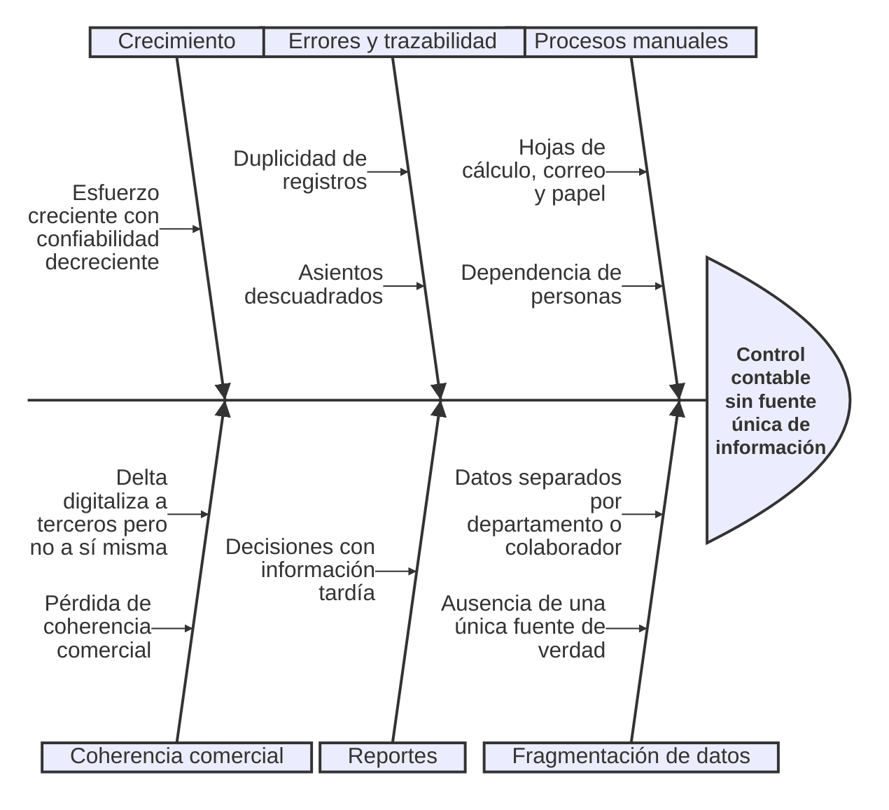

**Figura 1. Diagrama de causa y efecto del planteamiento del problema.**

## 1.6 Alcance

La Fase 1 abarca el control contable interno de una sola empresa. La tabla siguiente delimita lo que se encuentra dentro y fuera del alcance, con el estado verificado al cierre de este documento.

### 1.6.1 Módulos en alcance

**Tabla 4. Módulos en alcance.**

| Módulo | Épica | Descripción | Estado |
|---|---|---|---|
| M1 Catálogo y parametrización contable | E1 | Cuentas contables jerárquicas, centros de costo y periodos contables | Implementado |
| M2 Registro de transacciones | E2 | Asientos con partida doble (RN-01), bloqueo de periodos cerrados (RN-02) y reversión formal (RN-03) | Implementado |
| M3 Libros y auxiliares | E3 | Balance de saldos, libro diario y libro mayor jerárquicos, calculados en tiempo real | Implementado |
| M4 Cuentas por cobrar | E4 | Facturas con asiento automático, notas de crédito, recibos y aplicación de pagos con límite RN-05 | Implementado |
| M5 Cuentas por pagar | E5 | Facturas con asiento automático, notas de crédito, pagos y aplicación con límite RN-05 | Implementado |
| M6 Tesorería y bancos | E6 | Cuentas bancarias, movimientos, transferencias y conciliación bancaria (RN-10) | Implementado |
| M7 Reportes y estados financieros | E7 | Balance general y estado de resultados | Implementado |
| M8 Seguridad y auditoría | E8 | Inicio de sesión, JWT, perfiles y bitácora de auditoría | Implementado |
| M10 Cumplimiento fiscal y multimoneda | E10 | Parámetros fiscales e IVA, registro de DTE, libro de compras y ventas, retenciones de ISR e IVA, retención a no residentes, enteramiento, ajuste por nota de crédito, calendario de feriados, multimoneda con tipo de cambio de Banguat, diferencial cambiario y revaluación | Implementado |

### 1.6.2 Fuera de alcance o pendiente

**Tabla 5. Elementos fuera de alcance o pendientes.**

| Elemento | Situación | Observación |
|---|---|---|
| M9 Carga inicial e importación (E9, RN-11) | Pendiente | Diseñado, sin construcción; los casos de prueba TC-17 y TC-18 están en estado Design |
| Notificaciones por correo electrónico (SMTP) | Pendiente | Previstas en el diseño; no implementadas |
| Retención de IVA como agente de retención | Fuera de alcance | Delta no es agente de retención de IVA; el sistema solo advierte si la configuración la marca como agente (RN-20) |
| Certificación de DTE y conexión con SAT | Fuera de alcance | Los datos del DTE se registran, no se certifican (RN-12) |
| Fase 2: comercialización SaaS multiempresa | Pendiente | Línea futura; el sistema opera para una sola empresa |
| Plan formal de comunicación | Pendiente | Solo existe la comunicación propia de las ceremonias de Scrum |
| Monitoreo avanzado (APM) | Pendiente | Se dispone de verificación de salud posterior al despliegue y de registros de ejecución |
| Migración definitiva de datos históricos de hojas de cálculo | Pendiente | Depende del módulo M9 |
| Requerimientos funcionales y no funcionales marcados «Parcial» o «No incorporado» en la sección 4.1 | Pendiente | Entre ellos: flujo de efectivo, cheques, programación de pagos, reportes comparativos, administración de usuarios y bitácora desde la aplicación, política de contraseñas y bloqueo por intentos fallidos |

[Captura 2: tablero de Azure Boards con las diez épicas E1 a E10 y su estado. Perfil: miembro del equipo con acceso al proyecto de Azure Boards. Acción previa: abrir Boards > Backlogs, seleccionar el nivel Epics y expandir todas las épicas. Demuestra: la correspondencia entre los módulos M1 a M10 y las épicas E1 a E10, y el estado de cada una. Enlace: URL del proyecto en Azure DevOps]

## 1.7 Herramientas tecnológicas

### 1.7.1 Herramientas por capa

**Tabla 6. Tecnologías por capa del sistema.**

| Capa | Tecnología | Función |
|---|---|---|
| Frontend | React 18.3 con Vite 5.4 (aplicación de página única) | Interfaz de usuario; validación de forma; sin reglas contables |
| Backend | C# con ASP.NET Core 10 sobre .NET 10 LTS (API REST) | Reglas de negocio, autenticación por token y acceso a datos |
| Acceso a datos | Entity Framework Core con proveedor Npgsql | Mapeo objeto-relacional y consultas SQL |
| Base de datos | PostgreSQL 16 en Neon (ramas `production` y `development`) | Persistencia, disparadores, procedimientos y vistas |
| Contenedor | Docker (imagen en dos etapas) y registro GHCR | Empaquetado y versionado del backend |
| Hosting del backend | Azure Container Apps (plan Consumption) | Ejecución del contenedor con escalado a cero |
| Hosting del frontend | Vercel | Publicación de la aplicación estática con vista previa por rama |
| Integración y entrega continuas | GitHub Actions (cinco flujos de trabajo; Node 24 en el entorno de integración) | Compilación, pruebas, puertas de calidad, migraciones y despliegue |
| Calidad de código | SonarCloud, `diff-cover` y `jscpd` | Análisis estático, cobertura de líneas modificadas y control de duplicación |
| Gestión del proyecto | Azure Boards (con casos de prueba como work items) | Épicas, historias, iteraciones y casos de prueba |
| Control de versiones | GitHub (ramas `main` y `dev`, solicitudes de extracción) | Código fuente y revisión |
| Editor | Visual Studio Code | Desarrollo |

### 1.7.2 Evolución de la plataforma a .NET 10 LTS

El proyecto se planificó y se inició sobre .NET 8. El 17 de octubre de 2026 el backend se migró a .NET 10 LTS, la versión con soporte de largo plazo vigente. La actualización comprendió el cambio de plataforma de los proyectos, la actualización de los paquetes a su última versión y la adaptación de las pruebas automatizadas. La compilación y las pruebas se verificaron en el flujo de integración continua. A partir de este punto, el documento se refiere exclusivamente a .NET 10.


---

# Capítulo 2. Modelo de negocio digital

## 2.1 Contexto de la empresa

Delta es una organización de más de tres décadas de trayectoria con capacidad técnica reconocida. El análisis FODA del modelo digital propuesto identificó los elementos siguientes.

**Tabla 7. Dimensiones del contexto de la empresa.**

| Dimensión | Elementos identificados |
|---|---|
| Fortalezas | Experiencia desde 1991; dominio de C#, ASP.NET Core y bases de datos relacionales; módulo contable previo para terceros que sirve de referencia funcional; ausencia de licencias de un ERP comercial; actualizaciones centralizadas bajo un modelo de servicio |
| Oportunidades | Posibilidad de comercializar la solución a otras organizaciones; caso de referencia interno; necesidad reconocida de las pequeñas y medianas empresas por digitalizar su contabilidad y facturación; información en tiempo real para reducir tiempos de cobro |
| Debilidades | Requerimientos no documentados, residentes en la práctica del personal; operación manual y fragmentada; esfuerzo creciente con confiabilidad decreciente |
| Amenazas | Riesgos de implantar sistemas sin planificación estructural; crecimiento de la cartera de clientes que vuelve insostenible el modelo manual; dependencia de la disponibilidad del personal contable para las revisiones de sprint |

## 2.2 Necesidad de transformación

El control contable de Delta se apoyaba en hojas de cálculo administradas de forma independiente. Ese esquema impedía conocer la situación financiera consolidada y dificultaba el seguimiento de cuentas por cobrar y por pagar. La necesidad de transformación se sustenta en tres hechos: la ausencia de una fuente única de información, el crecimiento sostenido de clientes y transacciones, y la incoherencia entre la oferta comercial de la empresa y su práctica interna.

El levantamiento de requerimientos se realizó mediante entrevistas con el personal que opera el control contable, dado que no existía documentación previa. Las reglas resultantes se formalizaron como 36 reglas de negocio (RN-01 a RN-36), que el sistema aplica en la base de datos o en la API.

## 2.3 Modelo de negocio seleccionado

El modelo seleccionado es un ERP contable interno, concebido como servicio en línea (SaaS) y desarrollado en dos fases.

- **Fase 1 (ejecutada).** Uso interno exclusivo de Delta. El sistema se accede desde un navegador, sin instalación local, y las actualizaciones se aplican de forma centralizada al final de cada sprint.
- **Fase 2 (futura, no implementada).** Comercialización por suscripción a otras organizaciones y pequeñas y medianas empresas. Requiere soporte multiempresa, que el sistema actual no incorpora.

El modelo se materializa en una arquitectura de tres capas desacopladas: una aplicación web de página única, una API REST y una base de datos relacional centralizada.

## 2.4 Justificación del modelo

El modelo de servicio en línea centraliza la información en una única fuente de verdad y elimina la fragmentación de las hojas de cálculo. Las actualizaciones funcionales llegan a todo el personal sin instalaciones locales. La separación entre frontend y backend permite evolucionar cada capa por separado. La estructura de servicio, además, mantiene abierta la posibilidad de comercializar el producto a terceros sin rediseñar la arquitectura.

La infraestructura planificada inicialmente contemplaba servidores propios con una migración posterior a la nube. En la ejecución, el sistema se desplegó directamente en servicios de nube gestionados (Azure Container Apps, Vercel y Neon), lo que eliminó la necesidad de administrar servidores propios.

## 2.5 Componentes del modelo

Los componentes del modelo son los diez módulos funcionales del sistema, agrupados por función.

**Tabla 8. Componentes del modelo de negocio: módulos funcionales.**

| Grupo | Módulo | Épica | Función principal |
|---|---|---|---|
| Base contable | M1 Catálogo y parametrización contable | E1 | Cuentas, centros de costo y periodos |
| Base contable | M2 Registro de transacciones | E2 | Asientos con partida doble, reversión |
| Base contable | M3 Libros y auxiliares | E3 | Diario, mayor y balance de saldos |
| Operación | M4 Cuentas por cobrar | E4 | Facturas, notas de crédito y cobros |
| Operación | M5 Cuentas por pagar | E5 | Facturas, notas de crédito y pagos |
| Operación | M6 Tesorería y bancos | E6 | Movimientos, transferencias y conciliación |
| Información | M7 Reportes y estados financieros | E7 | Balance general y estado de resultados |
| Control | M8 Seguridad y auditoría | E8 | Autenticación, perfiles y bitácora |
| Carga de datos | M9 Carga inicial e importación | E9 | Importación asistida (pendiente) |
| Cumplimiento | M10 Cumplimiento fiscal y multimoneda | E10 | IVA, retenciones, enteramiento y multimoneda |

La Figura 2 resume los diez módulos agrupados por función.

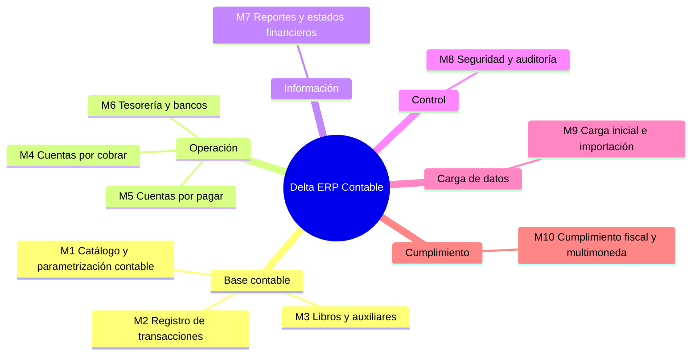

**Figura 2. Módulos del sistema agrupados por función.**

La Figura 3 reproduce la arquitectura y el flujo del modelo de servicio propuesto inicialmente. Esa propuesta contemplaba React o Angular, una base de datos SQL Server o PostgreSQL y un despliegue en servidores propios o en Azure. La implementación usó React sin Angular, PostgreSQL en Neon y despliegue en Azure Container Apps y Vercel.

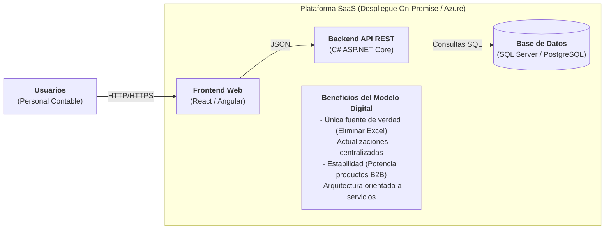

**Figura 3. Arquitectura y flujo del modelo SaaS propuesto para Delta.**

El modelo de negocio completo se resume en el lienzo del apartado 4.3.

## 2.6 Procesos clave

El sistema soporta siete procesos clave: registro de asientos, facturación de cuentas por cobrar y por pagar con IVA y retención, cobros y pagos, conciliación bancaria, revaluación de fin de mes, enteramiento de retenciones y cierre de periodo. El diagrama siguiente resume el flujo desde la factura hasta el cierre.

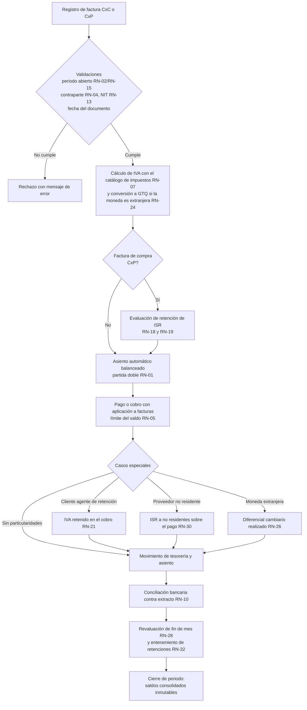

**Figura 4. Flujo del proceso desde el registro de la factura hasta el cierre del periodo.**

Los saldos de documentos, cuentas contables y cuentas bancarias no se almacenan en columnas editables: se calculan en vistas. La única excepción es la fotografía de saldos por periodo, escrita una sola vez al cerrar el periodo y protegida contra modificaciones posteriores.

[Captura 3: pantalla de registro de asiento contable con líneas de débito y crédito balanceadas y el mensaje de confirmación. Perfil: usuario de demostración con perfil Contador. Acción previa: abrir la pestaña Registrar asiento, completar el periodo abierto y dos líneas con importes iguales, y confirmar. Demuestra: el registro de un asiento con partida doble verificada. Enlace: https://delta-erp-contable.vercel.app]

## 2.7 Herramientas recomendadas por proceso

**Tabla 9. Herramientas recomendadas por proceso.**

| Proceso | Herramienta o mecanismo | Descripción |
|---|---|---|
| Registro de asientos y facturas | Aplicación web (React) y API REST (ASP.NET Core) | Captura y validación de forma en el cliente; reglas en el servidor |
| Verificación contable | Disparadores y procedimientos de PostgreSQL | Partida doble, periodo cerrado, límites de pago e inmutabilidad |
| Cálculo fiscal | Motor de dominio de la API | IVA, retenciones de ISR e IVA, retención a no residentes |
| Tipo de cambio | Consulta a Banguat con captura manual de respaldo | Registro de la fuente y de la fecha de referencia |
| Auditoría | Procedimiento almacenado invocado por la API | Bitácora inmutable de las operaciones relevantes |
| Seguimiento del proyecto | Azure Boards | Épicas, historias, iteraciones y casos de prueba |
| Calidad y entrega | GitHub Actions y SonarCloud | Pruebas, puertas de calidad, migraciones y despliegue |
| Hospedaje | Azure Container Apps, Vercel y Neon | Backend, frontend y base de datos |

## 2.8 Impacto organizacional

El sistema define cuatro perfiles de usuario. El menú de la aplicación se adapta al perfil y el servidor valida el permiso en cada operación.

**Tabla 10. Perfiles de usuario y restricciones relevantes.**

| Perfil | Responsabilidades principales | Restricciones relevantes |
|---|---|---|
| Administrador del sistema | Configuración, usuarios, parámetros fiscales y de retención, reapertura de periodos y reversión de asientos | Único perfil que reabre periodos y reversa asientos |
| Contador | Registro de asientos, cuentas por cobrar y por pagar, tesorería, conciliación, reportes y cierre de periodos | No reabre periodos ni reversa asientos |
| Vendedor | Consulta de catálogos y libros; registro de facturas de cuentas por cobrar | Sin acceso a asientos, tesorería ni reportes; el servidor responde 403 ante operaciones no permitidas |
| Técnico | Consulta de catálogos, libros, facturas y pagos | Solo consulta |

La gestión del cambio considera que el personal construyó sus propios controles en hojas de cálculo y puede percibir el sistema como una carga adicional. Las medidas aplicadas son la participación del personal en las revisiones de sprint y la disponibilidad de un manual de usuario por perfil. La capacitación presencial y el periodo de operación en paralelo previstos en el plan original no cuentan con evidencia de ejecución a la fecha de este documento y se consideran pendientes.

[Captura 4: pantalla de inicio de sesión de la aplicación desplegada, con el candado de conexión segura visible. Perfil: sin autenticar. Acción previa: abrir la dirección pública en una ventana nueva. Demuestra: el acceso público por HTTPS. Enlace: https://delta-erp-contable.vercel.app]

[Captura 5: menú principal completo con el usuario de demostración con perfil Administrador del sistema. Perfil: usuario de demostración con perfil Administrador del sistema. Acción previa: iniciar sesión y desplegar cada grupo del menú. Demuestra: las opciones disponibles para el perfil de mayor privilegio. Enlace: https://delta-erp-contable.vercel.app]

[Captura 6: menú principal reducido con el usuario de demostración con perfil Vendedor. Perfil: usuario de demostración con perfil Vendedor. Acción previa: cerrar sesión e iniciar con el usuario Vendedor. Demuestra: que el menú se adapta al perfil y omite Registrar asiento, Tesorería y reportes. Enlace: https://delta-erp-contable.vercel.app]

---

# Capítulo 3. Información y estrategia empresarial

## 3.1 Antecedentes

Delta es una empresa guatemalteca fundada en 1991, especializada en el análisis, diseño y desarrollo de sistemas de información. Su portafolio abarca administración (compras, inventario, cuentas corrientes y contabilidad), producción, gestión comercial (CRM), recursos humanos, analítica y aplicaciones móviles. Cuenta con más de 45 colaboradores, ha atendido a más de 200 clientes con más de 2,000 usuarios y reporta más de 856 sistemas integrados implementados.

Sus fortalezas organizacionales son la innovación y el desarrollo, el talento humano especializado, la infraestructura tecnológica, las asociaciones estratégicas, la reputación de marca y la capacidad de adaptación. El crecimiento sostenido de la empresa, frente al manejo manual de su control contable interno, constituye el punto de partida del proyecto.

## 3.2 Misión

Diseñar, desarrollar e implementar soluciones tecnológicas integrales que optimicen los procesos administrativos, contables y operativos de los clientes y de la propia organización, mediante plataformas digitales confiables, escalables y accesibles bajo un modelo de servicio continuo (SaaS), impulsando la eficiencia, la trazabilidad de la información y la toma de decisiones oportuna.

## 3.3 Visión

Ser la empresa guatemalteca de referencia en transformación digital y desarrollo de sistemas de información, reconocida por ofrecer soluciones propias basadas en la nube que integren de forma centralizada la operación administrativa y contable de las organizaciones, comenzando por la digitalización interna de Delta como modelo replicable para los clientes.

## 3.4 Valores

**Tabla 11. Valores de Delta.**

| Valor | Descripción |
|---|---|
| Innovación | Adoptar y desarrollar tecnología de vanguardia para resolver problemas reales de gestión empresarial |
| Confiabilidad | Garantizar información centralizada, trazable y libre de duplicidad como base de toda decisión |
| Agilidad | Responder con rapidez a los cambios del negocio mediante metodologías iterativas (Scrum) |
| Coherencia | Aplicar internamente la misma transformación digital que se ofrece a los clientes |
| Compromiso con el cliente interno y externo | Priorizar la experiencia y las necesidades reales de quienes usan las soluciones |
| Mejora continua | Evolucionar procesos y productos de forma constante |

## 3.5 Objetivos estratégicos

La tabla relaciona cada objetivo estratégico con el módulo que lo materializa.

**Tabla 12. Objetivos estratégicos y módulos que los materializan.**

| N.º | Objetivo estratégico | Módulos que lo materializan |
|---|---|---|
| 1 | Digitalizar la operación contable interna con un ERP contable propio bajo modelo de servicio, eliminando hojas de cálculo, correo y papel en el control financiero | M1 a M8, M10 |
| 2 | Centralizar la información financiera en una única fuente de verdad, reduciendo la duplicidad y el riesgo de errores | M1, M2, M3, M8 |
| 3 | Reducir el tiempo de generación de reportes financieros para decidir con información actualizada | M3, M7 |
| 4 | Mejorar el control de cuentas por cobrar y por pagar, con mayor trazabilidad de las transacciones pendientes | M4, M5, M6 |
| 5 | Aprovechar la infraestructura y el conocimiento técnico existentes (.NET, ASP.NET Core y PostgreSQL) para minimizar costos | Transversal |
| 6 | Generar un caso de referencia interno que respalde la oferta comercial de Delta | Transversal |

## 3.6 Organigrama

El organigrama de Delta ubica un equipo de ERP interno adscrito al área administrativa, que actúa como contraparte formal del proyecto. La Figura 5 lo representa.

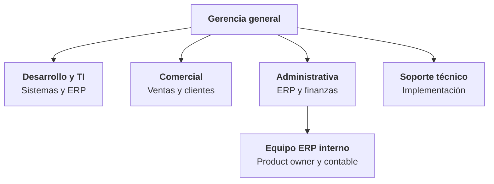

**Figura 5. Organigrama de Delta.**

## 3.7 Modelo de negocio digital propuesto

La propuesta es un ERP contable bajo modelo de servicio, en el que la aplicación se accede en línea y las actualizaciones se aplican de forma centralizada. Su arquitectura separa un frontend en React de una API REST en ASP.NET Core, ambos sobre una base de datos PostgreSQL. Los incrementos funcionales se entregan al cierre de cada sprint y se despliegan de forma automática en la nube.

El apartado 2.3 describe las dos fases del modelo y el apartado 1.6 detalla los módulos construidos. En la Fase 1 el sistema opera para uso exclusivo de Delta. La apertura a nuevos ingresos por suscripción de terceros queda como línea futura.


---

# Capítulo 4. Requerimientos y planificación

## 4.1 Requerimientos funcionales y no funcionales

Los requerimientos de Delta ERP Contable (DEC) se identifican con los códigos RF-XX (funcionales) y RNF-XX (no funcionales). Cada RF se asocia a uno de los diez módulos del sistema (M1 a M10), que coinciden con las épicas E1 a E10 del product backlog. La columna Estado refleja la situación al 18 de octubre de 2026: «Implementado» indica que existe el comportamiento en la API o en la base de datos y que cuenta con casos de prueba; «Parcial» indica que se cubre solo una parte del requerimiento; «No incorporado» indica que el requerimiento no forma parte del incremento entregado en esta fase.

### 4.1.1 Requerimientos funcionales por módulo

**M1. Catálogo y parametrización contable (E1)**

**Tabla 13. Requerimientos funcionales del módulo M1 (E1).**

| ID | Requerimiento | Estado |
|---|---|---|
| RF-01 | Administrar el catálogo de cuentas contables en jerarquía de varios niveles, con naturaleza y tipo; solo las cuentas de último nivel admiten movimiento | Implementado |
| RF-02 | Impedir la eliminación de cuentas con movimiento y permitir únicamente su desactivación | Implementado |
| RF-03 | Administrar centros de costo | Implementado |
| RF-04 | Administrar periodos contables: apertura, cierre formal y reapertura por perfil autorizado | Implementado |
| RF-05 | Administrar monedas y tipos de cambio por fecha, con el quetzal (GTQ) como moneda funcional | Implementado |
| RF-06 | Parametrizar IVA e ISR (porcentajes y cuentas asociadas) sin modificar el código fuente | Implementado |
| RF-07 | Administrar clientes y proveedores con identificación tributaria y datos fiscales | Implementado |

**M2. Registro de transacciones (E2)**

**Tabla 14. Requerimientos funcionales del módulo M2 (E2).**

| ID | Requerimiento | Estado |
|---|---|---|
| RF-08 | Registrar asientos contables con fecha, periodo, cuentas, centros de costo y líneas de cargo y abono | Implementado |
| RF-09 | Rechazar todo asiento cuya suma de cargos difiera de la suma de abonos | Implementado |
| RF-10 | Asignar numeración correlativa única | Parcial: el número del asiento se captura al registrarlo; la generación automática no se incorporó |
| RF-11 | Bloquear el registro, la modificación y la eliminación en periodos cerrados | Implementado |

**M3. Libros y auxiliares (E3)**

**Tabla 15. Requerimientos funcionales del módulo M3 (E3).**

| ID | Requerimiento | Estado |
|---|---|---|
| RF-18 | Libro diario por periodo | Implementado |
| RF-19 | Libro mayor con saldo acumulado por cuenta, consolidando subcuentas | Implementado |
| RF-20 | Balance de saldos jerárquico | Implementado |
| RF-21 | Auxiliares filtrados por cuenta, centro de costo o periodo | Parcial: filtros por periodo y cuenta en el libro mayor |
| RF-22 | Exportación de libros | Parcial: exportación a CSV en los libros fiscales; impresión desde el navegador en los reportes |

**M4. Cuentas por cobrar (E4)**

**Tabla 16. Requerimientos funcionales del módulo M4 (E4).**

| ID | Requerimiento | Estado |
|---|---|---|
| RF-23 | Registrar facturas de venta con cliente, fechas, detalle e impuestos | Implementado |
| RF-24 | Impedir facturas con un cliente inexistente en el catálogo | Implementado |
| RF-25 | Aplicar pagos totales y parciales sin exceder el saldo pendiente | Implementado |
| RF-26 | Registrar notas de crédito referenciadas a su factura | Implementado |
| RF-27 | Generar el asiento contable de la factura, del cobro y de la nota de crédito | Implementado |
| RF-28 | Estado de cuenta por cliente | Parcial: saldos por documento y reporte de saldos con antigüedad |
| RF-29 | Reporte de antigüedad de saldos | Implementado |
| RF-30 | Notificación de vencimientos por correo electrónico (SMTP) | No incorporado |

**M5. Cuentas por pagar (E5)**

**Tabla 17. Requerimientos funcionales del módulo M5 (E5).**

| ID | Requerimiento | Estado |
|---|---|---|
| RF-31 | Registrar facturas de proveedores | Implementado |
| RF-32 | Programar pagos y consultar el calendario de obligaciones | No incorporado |
| RF-33 | Aplicar pagos totales o parciales sin exceder el saldo pendiente | Implementado |
| RF-34 | Controlar saldos por proveedor y vencimientos | Implementado |
| RF-35 | Estado de cuenta por proveedor | Parcial: saldos por documento y reporte de saldos con antigüedad |

**M6. Tesorería y bancos (E6)**

**Tabla 18. Requerimientos funcionales del módulo M6 (E6).**

| ID | Requerimiento | Estado |
|---|---|---|
| RF-36 | Administrar cuentas bancarias vinculadas a su cuenta contable | Implementado |
| RF-37 | Registrar ingresos y egresos con afectación contable automática | Implementado |
| RF-38 | Controlar cheques y sus estados | No incorporado |
| RF-39 | Registrar transferencias entre cuentas propias | Implementado |
| RF-40 | Conciliación bancaria manual | Implementado |
| RF-41 | Finalización de la conciliación únicamente por personal autorizado | Implementado |

**M7. Reportes y estados financieros (E7)**

**Tabla 19. Requerimientos funcionales del módulo M7 (E7).**

| ID | Requerimiento | Estado |
|---|---|---|
| RF-42 | Balance general | Implementado |
| RF-43 | Estado de resultados por periodo | Implementado |
| RF-44 | Estado de flujo de efectivo | No incorporado |
| RF-45 | Indicadores de gestión | No incorporado |
| RF-46 | Reportes comparativos entre periodos | No incorporado |
| RF-47 | Exportación de reportes | Parcial: CSV en reportes fiscales y de saldos; impresión desde el navegador |

**M8. Seguridad y auditoría (E8)**

**Tabla 20. Requerimientos funcionales del módulo M8 (E8).**

| ID | Requerimiento | Estado |
|---|---|---|
| RF-48 | Autenticar usuarios y emitir un token de sesión de vigencia limitada | Implementado |
| RF-49 | Administrar usuarios desde la aplicación | No incorporado: los usuarios se crean mediante scripts de datos |
| RF-50 | Administrar perfiles y permisos | Parcial: cuatro perfiles fijos con permisos por operación definidos en la API |
| RF-51 | Validar permisos en el servidor en cada solicitud | Implementado |
| RF-52 | Registrar la bitácora de auditoría de toda operación relevante | Implementado |
| RF-53 | Consultar la bitácora desde la aplicación | No incorporado |
| RF-54 | Cerrar la sesión por inactividad | No incorporado: el token expira por vigencia |
| RF-55 | Administrar respaldos de la base de datos | No incorporado en la aplicación |

**M9. Carga inicial e importación (E9)**

**Tabla 21. Requerimientos funcionales del módulo M9 (E9).**

| ID | Requerimiento | Estado |
|---|---|---|
| RF-56 a RF-60 | Importar catálogo, saldos de apertura y cartera vigente; validar la consistencia previa; confirmar o descartar la carga | Pendiente: módulo fuera del alcance de esta fase (RN-11) |

**M10. Fiscal y multimoneda (E10)**

El módulo M10 recoge las capacidades tributarias y cambiarias que el negocio exigió durante la ejecución. Se organiza en tres funcionalidades.

**Tabla 22. Capacidades del módulo M10.**

| Funcionalidad | Capacidad | Estado |
|---|---|---|
| F1. Parámetros fiscales e IVA | Configuración fiscal, catálogo de impuestos con vigencia, IVA incluido separado en facturas y notas de crédito, datos del DTE y libro de compras y ventas (RF-06, RNF-43, RNF-44) | Implementado |
| F2. Retenciones de ISR e IVA | Retención de ISR a proveedores del régimen simplificado, IVA retenido por clientes, constancias, reporte por periodo y NIT, retención definitiva a no residentes, ajuste por nota de crédito y enteramiento a la SAT | Implementado |
| F3. Multimoneda y diferencial cambiario | Documentos en USD y EUR, tipo de cambio de Banguat con captura manual de respaldo, diferencial cambiario realizado, cuentas bancarias en USD, revaluación de fin de mes y reporte de saldos con antigüedad (RF-05, RNF-46) | Implementado |

### 4.1.2 Requerimientos no funcionales

Los 46 requerimientos no funcionales se agrupan en diez categorías. La columna Estado distingue lo cumplido con evidencia de lo pendiente de medición formal.

**Tabla 23. Requerimientos no funcionales por categoría.**

| ID | Categoría | Requerimiento | Estado |
|---|---|---|---|
| RNF-01 | Usabilidad | Interfaz íntegramente en español con terminología contable habitual | Cumplido |
| RNF-02 | Usabilidad | Operación en Chrome, Edge y Firefox | Pendiente de verificación formal |
| RNF-03 | Usabilidad | Diseño adaptable a escritorio y tableta | Pendiente de verificación formal |
| RNF-04 | Usabilidad | Mensajes de error con causa y acción sugerida | Cumplido: la API devuelve mensajes descriptivos en español |
| RNF-05 | Usabilidad | Registro de un asiento sin asistencia tras seis horas de capacitación | Pendiente de prueba de aceptación |
| RNF-06 | Usabilidad | Manual de usuario y ayuda contextual | Parcial: manual de usuario elaborado; sin ayuda contextual |
| RNF-07 | Rendimiento | Registro, consulta de saldos y aplicación de pagos en 3 s o menos | Pendiente de medición |
| RNF-08 | Rendimiento | Reportes en 10 s o menos | Pendiente de medición |
| RNF-09 | Rendimiento | 12 usuarios concurrentes | Pendiente de prueba de carga |
| RNF-10 | Rendimiento | Al menos 3,000 asientos mensuales | Pendiente de prueba de volumen |
| RNF-11 | Rendimiento | Crecimiento anual de la base de datos menor a 2 GB | Pendiente de medición |
| RNF-12 | Rendimiento | La carga inicial no bloquea los demás módulos | Diferido con M9 |
| RNF-13 | Seguridad | Comunicación por HTTPS con TLS 1.2 o superior | Cumplido: frontend y API se publican por HTTPS |
| RNF-14 | Seguridad | Contraseñas almacenadas con función de derivación y salt | Cumplido |
| RNF-15 | Seguridad | Política de contraseñas con complejidad y caducidad | No incorporado |
| RNF-16 | Seguridad | Token de sesión con vigencia limitada | Cumplido: el token incluye fecha de expiración configurable |
| RNF-17 | Seguridad | Autorización validada en el servidor en cada solicitud | Cumplido: atributos de autorización por perfil en cada operación y rechazo con 403 |
| RNF-18 | Seguridad | Protección contra inyección SQL, XSS y CSRF | Cumplido: consultas parametrizadas; hotspots de seguridad de SonarCloud revisados al 100 % |
| RNF-19 | Seguridad | Bloqueo temporal por intentos fallidos | No incorporado |
| RNF-20 | Seguridad | Bitácora de auditoría inmutable, incluso para el administrador | Cumplido: disparador que rechaza UPDATE y DELETE |
| RNF-21 | Seguridad | Datos anonimizados en desarrollo y pruebas | Cumplido: los datos de demostración son ficticios |
| RNF-22 | Disponibilidad | Disponibilidad de al menos 99 % en horario laboral | Pendiente de medición |
| RNF-23 | Disponibilidad | Respaldo diario con retención de treinta días | Pendiente de verificación en la plataforma |
| RNF-24 | Disponibilidad | Restauración comprobada con tiempo objetivo de cuatro horas | Pendiente de simulacro |
| RNF-25 | Disponibilidad | Mantenimiento programado fuera del horario laboral | Pendiente |
| RNF-26 | Fiabilidad | Registro transaccional del asiento | Cumplido: el asiento, el documento y la bitácora se guardan en una sola transacción |
| RNF-27 | Fiabilidad | Integridad referencial declarativa | Cumplido |
| RNF-28 | Fiabilidad | Importes en tipos decimales exactos | Cumplido: columnas NUMERIC con dos decimales |
| RNF-29 | Fiabilidad | Sin eliminación física de asientos, facturas ni movimientos | Cumplido: disparadores y reversión formal |
| RNF-30 | Mantenibilidad | Tres capas desacopladas | Cumplido |
| RNF-31 | Mantenibilidad | Control de versiones Git con revisión de cambios | Cumplido: ramas dev y main con Pull Request |
| RNF-32 | Mantenibilidad | API documentada con OpenAPI | Cumplido: especificación generada por la propia API |
| RNF-33 | Mantenibilidad | Estándar de codificación común | Cumplido: análisis estático con SonarCloud |
| RNF-34 | Mantenibilidad | Pruebas automatizadas de las reglas críticas en integración continua | Cumplido |
| RNF-35 | Portabilidad | Empaquetado en contenedores | Cumplido para el backend; el frontend se publica como sitio estático |
| RNF-36 | Portabilidad | Configuración externalizada | Cumplido: variables de entorno y secretos de la plataforma |
| RNF-37 | Portabilidad | Acceso a datos mediante capa de abstracción | Cumplido: Entity Framework Core |
| RNF-38 | Escalabilidad | Duplicar volumen y usuarios mediante ampliación de recursos | Pendiente de prueba de carga |
| RNF-39 | Escalabilidad | Identificación por empresa para una evolución multiempresa | Pendiente: Fase 2 (SaaS multiempresa) |
| RNF-40 | Interoperabilidad | API REST en JSON con versionado | Parcial: JSON implementado; sin esquema de versionado |
| RNF-41 | Interoperabilidad | Integración con servidor SMTP | Pendiente |
| RNF-42 | Interoperabilidad | Importación CSV y exportación a PDF y hoja de cálculo | Parcial: exportación CSV; importación pendiente con M9 |
| RNF-43 | Cumplimiento | Libros conforme a la legislación mercantil y tributaria | Parcial: libro diario, mayor y libro de compras y ventas; validación formal con el contador pendiente |
| RNF-44 | Cumplimiento | IVA e ISR parametrizables | Cumplido: impuestos y retenciones son datos con vigencia |
| RNF-45 | Cumplimiento | Conservación de información y bitácora sin depuración automática | Cumplido: no existe depuración automática |
| RNF-46 | Cumplimiento | Transacciones en moneda funcional con tipo de cambio vigente | Cumplido |

## 4.2 Objetivos SMART

Los objetivos del proyecto se formulan con los criterios específico (E), medible (M), alcanzable (A), relevante (R) y temporal (T). El plazo común es el 19 de octubre de 2026, fecha de cierre del sprint 3.

**Tabla 24. Objetivos SMART.**

| N.º | Objetivo | E | M | A | R | T | Evidencia |
|---|---|---|---|---|---|---|---|
| 1 | Implementar los módulos M1 a M8 y M10 sobre PostgreSQL 16 | Nueve de los diez módulos del sistema | Nueve épicas con módulo operativo; M9 declarada fuera del alcance de esta fase | Equipo de cuatro integrantes con tres sprints de dos semanas planificados | Sustituye el control contable manual en hojas de cálculo | 19/10/2026 | Nueve épicas en estado Done y una en New en Azure Boards (sección 4.8) |
| 2 | Aplicar las reglas de negocio | 35 de las 36 reglas RN-01 a RN-36 | 35 reglas verificables en el esquema o en la API; RN-11 queda excluida por depender de M9 | Reglas críticas resueltas en la base de datos mediante disparadores | Garantiza la integridad contable y el cumplimiento tributario | 19/10/2026 | Matriz de trazabilidad (sección 4.8) |
| 3 | Construir el modelo de datos versionado | 36 tablas | 19 scripts de migración inmutables, probados sobre una copia de producción antes de cada integración a main | Migraciones aplicadas por un script único con registro de control | Permite evolucionar el esquema sin perder datos | 19/10/2026 | Secciones 5.12 y 5.14, Capturas 8 y 11 a 13 |
| 4 | Sostener la calidad del código | Cada Pull Request cumple las puertas de calidad | Cobertura de líneas cambiadas de al menos 80 %; cero bloques duplicados de 80 tokens o más; Quality Gate de SonarCloud en verde | Puertas automatizadas en integración continua | Evita que la deuda técnica se acumule | 19/10/2026 | SonarCloud sobre main: Quality Gate aprobado, cobertura 98.5 %, duplicación 0.0 %, cero errores, vulnerabilidades y code smells, calificaciones A; puertas de cobertura y duplicación en las Capturas 12 y 13 |
| 5 | Automatizar las pruebas | 62 casos cerrados en Azure Boards, de 64 definidos | 62 casos automatizados y ejecutados en integración continua (18 + 28 + 14 + 2) y 2 casos en estado Design (TC-17 y TC-18, dependientes de M9) | Casos vinculados a historias de usuario y ejecutados con xUnit y Vitest | Respalda cada regla de negocio con una prueba repetible | 19/10/2026 | Plan de pruebas en work items Test Case de Azure Boards |
| 6 | Entregar de forma continua | Backend y frontend desplegados desde las ramas dev y main | Despliegue automático con verificación de salud posterior; tres sprints de dos semanas | Cinco flujos de GitHub Actions | Reduce el riesgo de cada entrega | 19/10/2026 | Ejecuciones recientes en estado exitoso para los flujos de despliegue y análisis |

## 4.3 Canvas de modelo de negocio

El Canvas de DEC sintetiza el modelo de negocio en sus nueve bloques: segmentos de clientes, propuesta de valor, canales, relación con los clientes, fuentes de ingresos, recursos clave, actividades clave, socios clave y estructura de costos. La Figura 6 reproduce el lienzo elaborado en la etapa de planificación. Esa propuesta inicial menciona C# con React o Angular y proveedores de nube AWS o Azure. La implementación usó C# con ASP.NET Core sobre .NET 10, React 18 sin Angular, y Azure Container Apps, Vercel y Neon.

El contenido textual del modelo establece dos fases. En la Fase 1, el sistema es una instancia de uso interno para una sola empresa, que sustituye prácticas manuales soportadas en hojas de cálculo, correo electrónico y documentación en papel. En la Fase 2, futura y no implementada, el sistema evolucionaría hacia una plataforma multiempresa comercializable bajo el modelo SaaS. Los recursos tecnológicos efectivos del sistema son .NET 10 LTS, React 18, PostgreSQL 16 en Neon, Azure Container Apps, Vercel, GitHub Actions y SonarCloud (apartado 1.7).

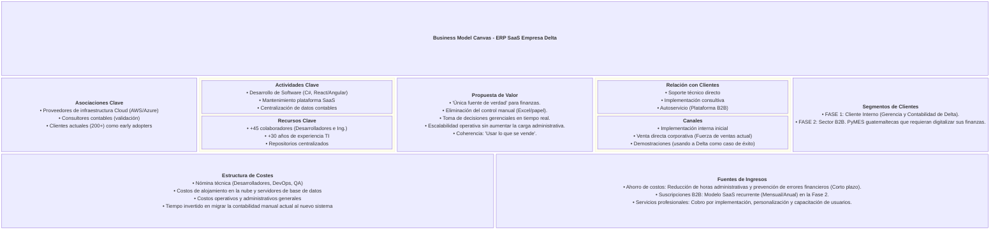

**Figura 6. Business Model Canvas del ERP SaaS de Delta.**

## 4.4 Factibilidad integral

La factibilidad se evaluó en cuatro dimensiones. Las tres primeras se calificaron en una escala de uno a cinco puntos, donde uno es una condición que impide la ejecución y cinco una condición plenamente favorable. Los valores corresponden a la valoración de planificación.

### 4.4.1 Factibilidad técnica

La dimensión técnica es la más favorable porque Delta desarrolla software sobre la plataforma elegida. La tabla contrasta cada capacidad requerida con la situación de la organización y el resultado de la ejecución.

**Tabla 25. Factibilidad técnica: capacidades y brechas.**

| Capacidad requerida | Situación en la organización | Brecha | Resultado de la ejecución |
|---|---|---|---|
| Desarrollo backend en C# y ASP.NET Core | Plataforma de uso habitual en la empresa | Nula | Backend implementado sobre .NET 10 LTS |
| Diseño y administración de bases de datos relacionales | Experiencia con SQL Server, Oracle, MySQL y PostgreSQL | Nula | Esquema de 36 tablas en PostgreSQL 16 |
| Desarrollo frontend en React | Experiencia parcial; trayectoria concentrada en ASP.NET, PHP y Java | Media | Aplicación en React 18 con Vite, cubierta con capacitación dirigida |
| Contenerización e integración continua | Experiencia limitada en Docker y canalizaciones automatizadas | Media | Imagen Docker y cinco flujos de GitHub Actions operativos |
| Conocimiento del dominio contable | Módulo contable propio para terceros | Nula | Lógica funcional reutilizada como referencia |
| Infraestructura | Planificada: servidores propios Windows y Linux. Ejecutada: servicios de nube gestionados (Azure Container Apps, Vercel y Neon) | Nula | Sin adquisición ni administración de servidores propios |

El dimensionamiento de planificación supuso un volumen inferior a tres mil asientos mensuales y doce usuarios concurrentes. Con esa magnitud, el crecimiento anual de la base de datos se proyectó por debajo de los dos gigabytes. Las dos brechas de nivel medio se concentraron en la capa de presentación y en el despliegue, y no en el núcleo contable. La dimensión técnica se califica con cinco (5) puntos.

### 4.4.2 Factibilidad económica

La inversión total estimada en la planificación asciende a Q129,591.00. El 81.3 % corresponde a talento humano interno y el componente de licencias de software es nulo por el uso de tecnologías de código abierto y planes gratuitos.

**Tabla 26. Factibilidad económica: indicadores y dictamen.**

| Indicador | Resultado | Criterio de aceptación | Dictamen |
|---|---|---|---|
| Inversión total requerida | Q129,591.00 | Sin adquisición de licencias ni proveedor externo | Favorable |
| Beneficio neto anual estimado | Q104,144.00 | Superior al costo anual de operación | Favorable |
| Periodo de recuperación | 14.9 meses | Menor a 24 meses | Favorable |
| Valor actual neto (5 años, 12 %) | Q245,824.81 | Mayor que cero | Favorable |
| Tasa interna de retorno | 75.5 % | Mayor a la tasa de descuento del 12 % | Favorable |
| Relación costo-beneficio | 2.28 | Mayor que uno | Favorable |

Los beneficios se apoyan en supuestos de ahorro de horas administrativas y de reducción del tiempo promedio de cobro. Esos supuestos no se verificaron con mediciones de la operación real de Delta; por esa razón se aplica un criterio conservador y la dimensión se califica con cuatro punto cinco (4.5) puntos.

### 4.4.3 Factibilidad operativa

Los usuarios pertenecen a una empresa de tecnología, están familiarizados con sistemas de información y la digitalización interna forma parte de los objetivos estratégicos y del valor de coherencia. La estructura organizacional contempla un equipo de ERP interno adscrito al área administrativa, que actúa como contraparte formal.

El principal riesgo operativo es la gestión del cambio. El personal construyó durante años sus propios controles en hojas de cálculo. Las medidas previstas fueron la participación en las revisiones de sprint, la importación asistida de la información existente (dependiente del módulo M9, pendiente), un periodo de operación en paralelo, la capacitación presupuestada y la designación de un usuario referente. Dado que la mitigación depende de terceros, la dimensión se califica con cuatro (4) puntos.

La calificación global de las tres dimensiones es 4.50 sobre 5.00, equivalente al 90 % del puntaje máximo.

### 4.4.4 Factibilidad legal y fiscal

El sistema opera sobre la normativa tributaria guatemalteca aplicable a Delta. La tabla relaciona cada obligación con el tratamiento implementado.

**Tabla 27. Obligaciones legales y fiscales y su tratamiento en el sistema.**

| Obligación | Tratamiento en el sistema | Regla |
|---|---|---|
| IVA sobre ventas y compras con precio que incluye el impuesto | Cálculo con el catálogo de impuestos, redondeo por línea y separación del IVA en el asiento | RN-07 |
| Datos del documento tributario electrónico (DTE de FEL) | Registro de UUID, serie, número y fecha de certificación; el sistema no certifica ni emite documentos con validez fiscal | RN-12 |
| NIT de clientes y proveedores | Validación con dígito verificador módulo 11 | RN-13 |
| Retención de ISR a proveedores del régimen simplificado | Cálculo por factura con tasa base y tasa del excedente sobre parámetros con vigencia | RN-17, RN-18 |
| IVA retenido por clientes agentes | Registro en el cobro | RN-21 |
| Retención de IVA como agente | Fuera de alcance: Delta no es agente de retención de IVA | RN-20 |
| ISR a no residentes (art. 104 del Decreto 10-2012) | Retención al momento del pago con tipos de renta parametrizados, registrados como referenciales para validación con un asesor | RN-29, RN-30 |
| Enteramiento a la SAT | Registro por periodo con formulario, fecha, boleta y vencimiento al décimo día hábil | RN-32, RN-33 |
| Tipo de cambio de referencia | Consulta a Banguat con captura manual de respaldo y fuente registrada | RN-25 |
| Constancias de retención | Se registran; su emisión se realiza en el portal de la SAT | RN-22 |

Los tipos de renta de no residentes se encuentran marcados como referenciales y su validación por un asesor fiscal queda pendiente. La dimensión legal y fiscal no se califica numéricamente.

## 4.5 Presupuesto

El presupuesto es un estimado de planificación. Cuantifica los recursos necesarios y sustenta el dictamen de factibilidad económica.

### 4.5.1 Premisas

- Las cifras se expresan en quetzales. Cuando se requiere conversión se aplica un tipo de cambio de referencia de Q7.80 por dólar de los Estados Unidos.
- El talento humano se valora a precios de mercado del sector de tecnología en Guatemala. Se trata de un costo imputado y no de un desembolso en efectivo, ya que el desarrollo lo ejecuta personal de la propia empresa.
- El horizonte de desarrollo e implantación es de cuatro meses. La evaluación financiera se realiza a cinco años con una tasa de descuento del 12 % anual.
- No se presupuesta la compra de equipo ni de licencias.
- Se incorpora una reserva de contingencia del 10 % sobre el subtotal, en atención a la variabilidad del análisis PERT.

### 4.5.2 Talento humano

**Tabla 28. Presupuesto de talento humano.**

| Rol | Horas | Costo por hora | Subtotal |
|---|---|---|---|
| Product Owner y analista de requerimientos | 240 | Q80.00 | Q19,200.00 |
| Scrum Master y líder de proyecto | 200 | Q85.00 | Q17,000.00 |
| Desarrollador backend (C# y ASP.NET Core) | 400 | Q75.00 | Q30,000.00 |
| Desarrollador frontend (React) | 320 | Q70.00 | Q22,400.00 |
| Especialista en base de datos y aseguramiento de calidad | 240 | Q70.00 | Q16,800.00 |
| **Total de talento humano** | **1,400** | — | **Q105,400.00** |

### 4.5.3 Infraestructura y software

La tabla siguiente presenta el presupuesto de planificación. La ejecución sustituyó los servidores propios por servicios de nube; la tabla posterior relaciona cada rubro con el servicio efectivamente utilizado.

**Tabla 29. Presupuesto de infraestructura y software en la planificación.**

| Concepto | Detalle de planificación | Subtotal |
|---|---|---|
| Uso de servidores propios Windows y Linux | Costo imputado por cuatro meses de uso, energía y mantenimiento | Q4,000.00 |
| Ambiente de pruebas y demostración en la nube | Instancia de tamaño reducido en Azure durante tres meses | Q1,350.00 |
| Certificado SSL/TLS | Vigencia de un año | Q600.00 |
| Respaldos y almacenamiento externo | Cuatro meses de servicio | Q800.00 |
| PostgreSQL, .NET, ASP.NET Core, React y Visual Studio Code | Licencias de código abierto, MIT y de uso gratuito | Q0.00 |
| Docker, Azure DevOps y GitHub | Edición comunitaria y planes gratuitos | Q0.00 |
| **Total de infraestructura y software** | | **Q6,750.00** |

**Tabla 30. Servicios utilizados en la ejecución.**

| Servicio utilizado en la ejecución | Función | Modalidad |
|---|---|---|
| Neon | Base de datos PostgreSQL 16 con ramas de producción y desarrollo | Sin costo (nivel gratuito) |
| Azure Container Apps (Consumption) | Ejecución del contenedor del backend con escalado a cero | Plan de consumo, sobre suscripción Azure for Students |
| Vercel | Publicación del frontend, con certificado HTTPS administrado | Sin costo (nivel gratuito) |
| GitHub y GitHub Container Registry (GHCR) | Repositorio, flujos de integración y registro de imágenes | Repositorio público, sin costo |
| SonarCloud | Análisis estático, cobertura y duplicación | Sin costo (nivel gratuito) |
| Azure DevOps (Boards) | Gestión del backlog y de los casos de prueba | Plan gratuito |

El costo de Azure no se pudo expresar en cifra: la suscripción es del tipo Azure for Students, la API de consumo no reportó montos y el uso queda cubierto por el crédito de estudiante. El repositorio de GitHub es público y no genera costo. Neon, Vercel y SonarCloud operaron en su nivel gratuito, sin costo. Se mantiene el estimado de planificación.

### 4.5.4 Capacitación, gestión del cambio y otros costos directos

**Tabla 31. Presupuesto de capacitación, gestión del cambio y otros costos directos.**

| Concepto | Detalle | Subtotal |
|---|---|---|
| Facilitación de la capacitación | Doce usuarios, seis horas por usuario | Q960.00 |
| Material de apoyo y guías rápidas | Material impreso y digital | Q500.00 |
| Acompañamiento posterior a la puesta en marcha | Veinte horas de soporte durante la operación en paralelo | Q1,500.00 |
| Internet y servicios de comunicación | Cuatro meses para el equipo de proyecto | Q1,200.00 |
| Papelería, impresión y reproducción de documentos | Entregables del proyecto | Q800.00 |
| Transporte y visitas a la empresa | Sesiones de elicitación y revisiones de sprint | Q700.00 |
| **Total** | | **Q5,660.00** |

### 4.5.5 Resumen de la inversión

**Tabla 32. Resumen de la inversión.**

| Rubro | Monto | Participación |
|---|---|---|
| Talento humano | Q105,400.00 | 81.3 % |
| Infraestructura y software | Q6,750.00 | 5.2 % |
| Capacitación y gestión del cambio | Q2,960.00 | 2.3 % |
| Otros costos directos | Q2,700.00 | 2.1 % |
| Subtotal | Q117,810.00 | 90.9 % |
| Reserva de contingencia (10 %) | Q11,781.00 | 9.1 % |
| **Inversión total** (equivalente a US$16,614.23) | **Q129,591.00** | **100.0 %** |

El proyecto es intensivo en conocimiento y no en capital: más de ocho de cada diez quetzales corresponden a horas de trabajo especializado.

La Figura 7 representa la proporción de cada rubro dentro de la inversión total, en quetzales.

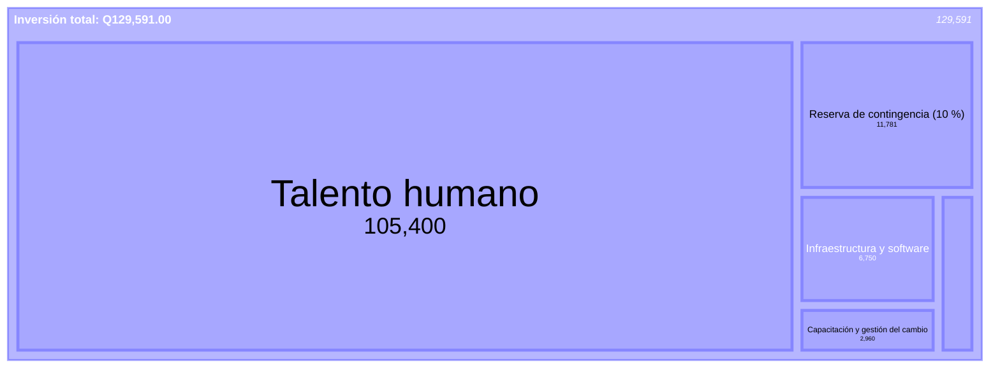

**Figura 7. Distribución de la inversión por rubro (quetzales).**

### 4.5.6 Análisis costo-beneficio

**Tabla 33. Flujo neto y valor presente a cinco años.**

| Año | Flujo neto | Factor de descuento (12 %) | Valor presente | Valor presente acumulado |
|---|---|---|---|---|
| 0 | (Q129,591.00) | 1.0000 | (Q129,591.00) | (Q129,591.00) |
| 1 | Q104,144.00 | 0.8929 | Q92,985.71 | (Q36,605.29) |
| 2 | Q104,144.00 | 0.7972 | Q83,022.96 | Q46,417.67 |
| 3 | Q104,144.00 | 0.7118 | Q74,127.64 | Q120,545.32 |
| 4 | Q104,144.00 | 0.6355 | Q66,185.39 | Q186,730.71 |
| 5 | Q104,144.00 | 0.5674 | Q59,094.10 | Q245,824.81 |

El valor actual neto a cinco años es de Q245,824.81, la tasa interna de retorno alcanza el 75.5 %, la relación beneficio-costo es de 2.28 y la inversión se recupera en 14.9 meses. Si se excluye el rubro de licencias evitadas, por tratarse de un costo hipotético, el beneficio neto anual desciende a Q53,600.00, el periodo de recuperación se extiende a aproximadamente 29 meses y el valor actual neto se mantiene positivo en Q63,600.00.

## 4.6 Planificación con PERT probabilístico

La planificación utilizó la técnica PERT en su variante probabilística, apropiada cuando la duración de las actividades es incierta. Para cada actividad se estimaron tres duraciones en días laborables: optimista (a), más probable (m) y pesimista (b). La duración esperada y la varianza se obtienen con las expresiones siguientes:

```
te = (a + 4m + b) / 6
σ² = [(b − a) / 6]²
```

La fecha base del cronograma es el lunes 20 de julio de 2026, con semana laboral de cinco días.

### 4.6.1 Actividades del proyecto

**Tabla 34. Actividades del proyecto y entregables asociados.**

| ID | Actividad | Entregable asociado |
|---|---|---|
| A | Selección de la empresa y elaboración de la propuesta | Propuesta inicial |
| B | Selección y fundamentación del modelo de negocio digital (SaaS) | Modelo de negocio |
| C | Levantamiento de la información institucional de Delta | Información de la empresa |
| D | Determinación de requerimientos, primera parte | Requerimientos, primera parte |
| E | Diseño y aplicación de instrumentos de elicitación | Requerimientos, segunda parte |
| F | Especificación de requerimientos funcionales, no funcionales y reglas del negocio | Requerimientos, segunda parte |
| G | Análisis de sistemas con UML: contexto, casos de uso, clases y secuencias | Análisis UML, primera parte |
| H | Análisis de sistemas con UML: componentes, actividades, estados, despliegue, red y seguridad | Análisis UML, segunda parte |
| I | Diseño del modelo relacional, diccionario de datos y arquitectura | Modelo de datos |
| J | Construcción de la base de datos: tablas, funciones, disparadores, procedimientos y vistas | Scripts de base de datos |
| K | Implementación de DevOps: control de versiones, contenedores y gestión del proyecto | Repositorio e infraestructura base |
| L | Implementación de integración y entrega continuas y plan de pruebas | Flujos de integración y plan de pruebas |
| M | Desarrollo del backend y de la API REST en C# y ASP.NET Core | Código de la aplicación |
| N | Desarrollo del frontend web e integración con la API | Código de la aplicación |
| O | Ejecución del plan de pruebas funcionales y de integración | Resultados de pruebas |
| P | Elaboración del manual de usuario | Manual de usuario |
| Q | Integración del documento completo del proyecto (borrador) | Borrador integrado |
| R | Revisión final, documento definitivo y presentación | Proyecto final |

### 4.6.2 Duraciones estimadas

**Tabla 35. Duraciones estimadas de las actividades.**

| ID | Optimista (a) | Más probable (m) | Pesimista (b) | Esperada (te) | Varianza (σ²) |
|---|---|---|---|---|---|
| A | 3 | 4 | 6 | 4.17 | 0.250 |
| B | 1 | 2 | 4 | 2.17 | 0.250 |
| C | 3 | 4 | 6 | 4.17 | 0.250 |
| D | 4 | 5 | 8 | 5.33 | 0.444 |
| E | 3 | 4 | 8 | 4.50 | 0.694 |
| F | 4 | 5 | 8 | 5.33 | 0.444 |
| G | 4 | 6 | 9 | 6.17 | 0.694 |
| H | 4 | 5 | 8 | 5.33 | 0.444 |
| I | 4 | 5 | 7 | 5.17 | 0.250 |
| J | 3 | 5 | 8 | 5.17 | 0.694 |
| K | 2 | 3 | 6 | 3.33 | 0.444 |
| L | 3 | 4 | 7 | 4.33 | 0.444 |
| M | 8 | 11 | 16 | 11.33 | 1.778 |
| N | 7 | 9 | 14 | 9.50 | 1.361 |
| O | 3 | 4 | 7 | 4.33 | 0.444 |
| P | 2 | 3 | 5 | 3.17 | 0.250 |
| Q | 3 | 4 | 6 | 4.17 | 0.250 |
| R | 2 | 3 | 4 | 3.00 | 0.111 |
| **Suma** | — | — | — | **90.67** | — |

### 4.6.3 Ruta crítica

La ruta crítica está formada por las actividades A, C, D, F, G, I, J, M, N, O, Q y R, con una duración total esperada de 67.83 días laborables. Doce de las dieciocho actividades son críticas, lo que indica una red con escasa flexibilidad. La única actividad con holgura significativa es L, con 16.50 días. Las demás actividades no críticas tienen holguras inferiores a dos días y se tratan en la práctica como críticas.

### 4.6.4 Cronograma planificado

**Tabla 36. Cronograma planificado de las actividades.**

| ID | Inicio | Fin | Duración (días) | Holgura (días) |
|---|---|---|---|---|
| A | 20/07/2026 | 27/07/2026 | 4.17 | 0.00 |
| B | 27/07/2026 | 29/07/2026 | 2.17 | 2.00 |
| C | 27/07/2026 | 31/07/2026 | 4.17 | 0.00 |
| D | 31/07/2026 | 07/08/2026 | 5.33 | 0.00 |
| E | 31/07/2026 | 06/08/2026 | 4.50 | 0.83 |
| F | 07/08/2026 | 14/08/2026 | 5.33 | 0.00 |
| G | 14/08/2026 | 25/08/2026 | 6.17 | 0.00 |
| H | 25/08/2026 | 01/09/2026 | 5.33 | 1.67 |
| I | 25/08/2026 | 01/09/2026 | 5.17 | 0.00 |
| J | 01/09/2026 | 08/09/2026 | 5.17 | 0.00 |
| K | 01/09/2026 | 04/09/2026 | 3.33 | 1.67 |
| L | 08/09/2026 | 14/09/2026 | 4.33 | 16.50 |
| M | 08/09/2026 | 23/09/2026 | 11.33 | 0.00 |
| N | 23/09/2026 | 07/10/2026 | 9.50 | 0.00 |
| O | 07/10/2026 | 13/10/2026 | 4.33 | 0.00 |
| P | 07/10/2026 | 12/10/2026 | 3.17 | 1.17 |
| Q | 13/10/2026 | 19/10/2026 | 4.17 | 0.00 |
| R | 19/10/2026 | 22/10/2026 | 3.00 | 0.00 |

La construcción se planificó en tres sprints de dos semanas: del 8 al 21 de septiembre, del 22 de septiembre al 5 de octubre y del 6 al 19 de octubre de 2026. Azure Boards registra además un cuarto sprint, del 20 de octubre al 2 de noviembre de 2026, que no había iniciado a la fecha de este documento. El primer registro de código en el repositorio corresponde al 16 de septiembre de 2026; la comparación entre el cronograma planificado y la ejecución real se presenta en el apartado 4.7.

## 4.7 Cronograma: diagrama de Gantt

El cronograma se presenta en dos bloques. El bloque planificado traslada a calendario la estimación PERT de las dieciocho actividades del proyecto, con inicio el lunes 20 de julio de 2026. El bloque real registra los hitos ejecutados, con las fechas de los commits del repositorio de código y de la creación de cada script de migración.

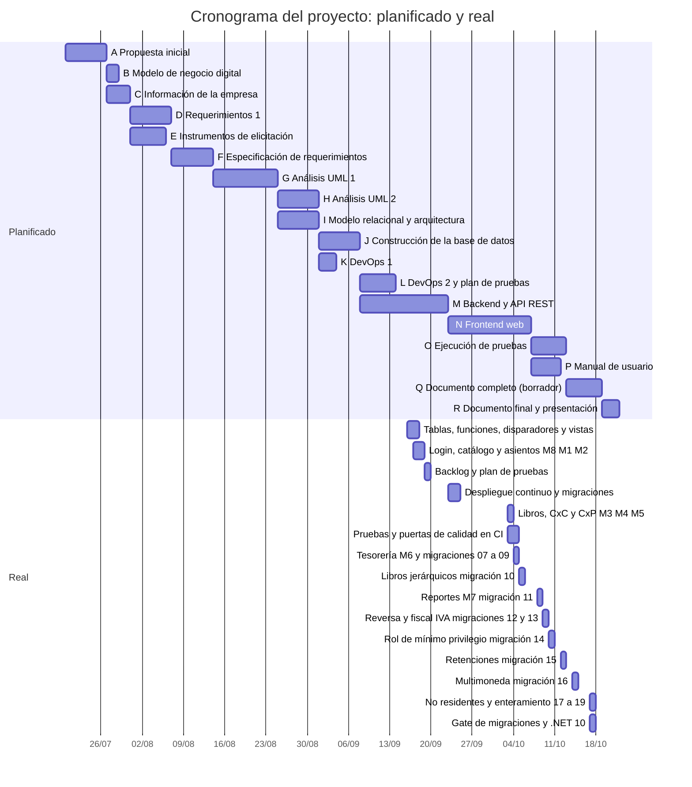

**Figura 8. Cronograma del proyecto: actividades planificadas e hitos ejecutados.**

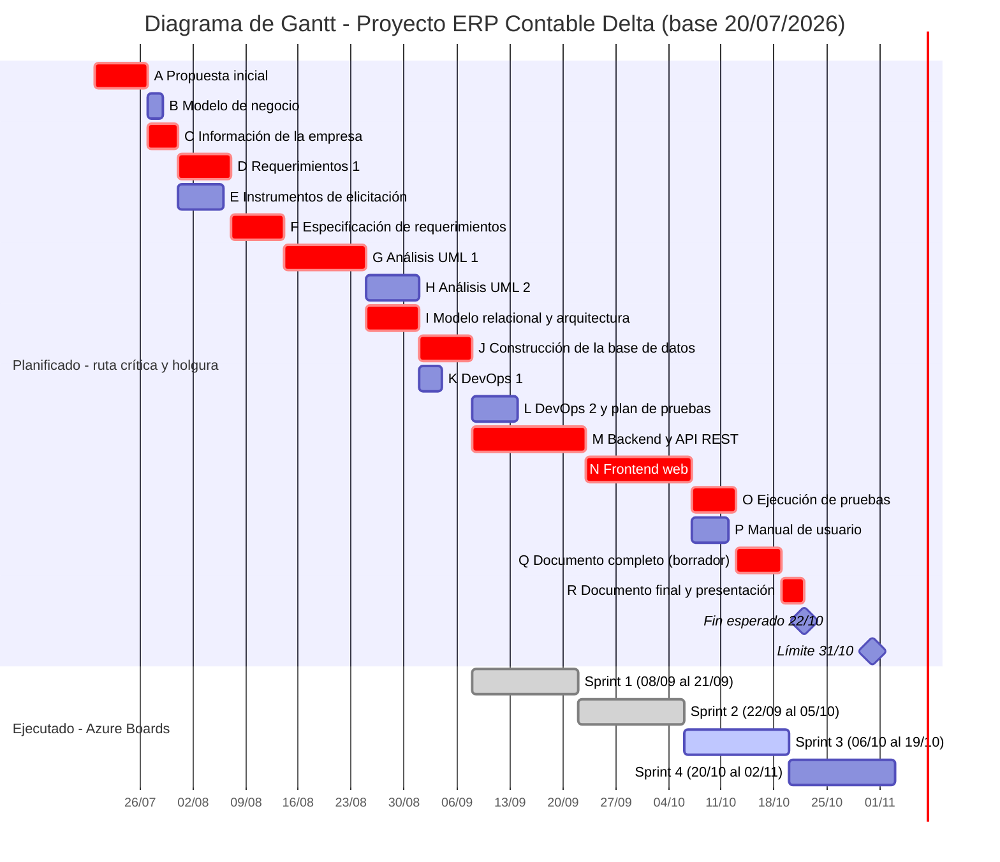

**Figura 9. Diagrama de Gantt del proyecto: ruta crítica planificada y sprints ejecutados en Azure Boards.**

La Figura 9 muestra la ruta crítica planificada (actividades A, C, D, F, G, I, J, M, N, O, Q y R, con fin esperado el 22/10/2026) y las iteraciones registradas en Azure Boards. Las actividades con holgura (B, E, H, K, L y P) se dibujan sin marca de ruta crítica. El diagrama no representa la holgura disponible, que se resume en el apartado 4.6.3. La planificación original preveía tres sprints; Azure Boards registra un cuarto, del 20/10/2026 al 02/11/2026, que no había iniciado.

La comparación entre lo planificado y lo ejecutado se resume así.

**Tabla 37. Comparación entre lo planificado y lo ejecutado.**

| Frente | Planificado | Real | Observación |
|---|---|---|---|
| Base de datos (actividad J) | 01/09 a 08/09 | Primeros scripts el 16/09; seed de desarrollo el 18/09 | La construcción inició una semana después de lo previsto |
| DevOps (actividades K y L) | 01/09 a 14/09 | Despliegue continuo, migraciones automáticas y alias de Vercel el 23 y 24/09 | La automatización se concentró en dos días |
| Backend y frontend (M y N) | 08/09 a 07/10 | M8, M1 y M2 el 17 y 18/09; M3, M4 y M5 el 03/10; M6 el 04/10; M7 el 08/10 | Entre el 24/09 y el 03/10 no se registran commits en el repositorio |
| Pruebas (actividad O) | 07/10 a 13/10 | Pruebas automatizadas en integración continua desde el 03/10; casos TC-49 a TC-62 cerrados el 17/10 | La ejecución de pruebas se anticipó y acompañó cada módulo |
| Alcance fiscal (M10) | No previsto en el cronograma original | Migraciones 12 a 19 entre el 09/10 y el 17/10 | El módulo fiscal amplió el alcance durante los dos últimos sprints |

El 17 de octubre de 2026 concentró veintidós de los 106 commits del repositorio. El 3 y el 4 de octubre sumaron veintiocho. El sprint 3 se encuentra en curso: cierra el 19 de octubre de 2026.

## 4.8 Matriz de trazabilidad

La matriz enlaza cada módulo con sus requerimientos funcionales, las reglas de negocio que lo gobiernan, las migraciones y tablas que lo sostienen, los puntos de acceso de la API, las pantallas del frontend y los casos de prueba que lo verifican. Permite recorrer el camino objetivo, épica, requerimiento, regla, diseño, tabla, historia y caso de prueba sin pérdida de continuidad.

**Tabla 38. Matriz de trazabilidad por módulo.**

| Módulo / épica | RF | RN | Migración y tablas | API | Pantalla | Casos de prueba |
|---|---|---|---|---|---|---|
| M1 / E1 Catálogo y parametrización | RF-01 a RF-07 | RN-02, RN-15 | 01: cuentacontable, centrocosto, periodocontable, saldocuentaperiodo; 03, 08 y 10 (disparadores y procedimientos de cierre) | api/cuentas, api/centros-costo, api/periodos | Catálogo: Cuentas contables, Centros de costo, Periodos | TC-01, TC-02 |
| M2 / E2 Registro de transacciones | RF-08 a RF-11 | RN-01, RN-02, RN-03, RN-08, RN-15 | 01: asientocontable, lineaasiento, plantillaasiento, lineaplantillaasiento; 07, 12 y 16 (partida doble y reversa) | api/asientos, api/asientos/{id}/reversar | Registro de asiento; diálogo de reversa en el libro diario | TC-03, TC-04, TC-20 |
| M3 / E3 Libros y auxiliares | RF-18 a RF-22 | RN-01 | Vistas de balance de las migraciones 05, 08 y 10; función de reporte 11 | api/libros/balance-saldos, diario y mayor | Libros: Balance de saldos, Libro diario, Libro mayor | TC-05, TC-06, TC-19 |
| M4 / E4 Cuentas por cobrar | RF-23 a RF-30 | RN-04, RN-05, RN-14, RN-15 | 01: documentocxc, lineadocumentocxc, recibopagocliente, aplicacionpagocliente; 13 y 16 | api/cxc/facturas, api/cxc/pagos | Cuentas por cobrar | TC-07, TC-08 |
| M5 / E5 Cuentas por pagar | RF-31 a RF-35 | RN-04, RN-05, RN-14, RN-15, RN-18 | 01: documentocxp, lineadocumentocxp, pagoproveedorcabecera, aplicacionpagoproveedor; 13, 15 y 16 | api/cxp/facturas, api/cxp/pagos | Cuentas por pagar | TC-09, TC-10 |
| M6 / E6 Tesorería y bancos | RF-36 a RF-41 | RN-01, RN-10, RN-26, RN-27 | 01 y 09: cuentabancaria, movimientotesoreria, conciliacionbancaria, detalleconciliacion; 16 | api/cuentas-bancarias, api/movimientos-tesoreria, api/conciliaciones | Tesorería: Cuentas, Movimientos, Conciliaciones | TC-11, TC-12 |
| M7 / E7 Reportes | RF-42 a RF-47 | Reglas de cierre y saldos (RN-02) | 11: función de saldos jerárquicos sobre saldocuentaperiodo | api/reportes/balance-general, estado-resultados, saldos-antiguedad | Reportes: Balance general, Estado de resultados, Saldos en moneda | TC-13, TC-14, TC-60 |
| M8 / E8 Seguridad y auditoría | RF-48 a RF-55 | RN-08, RN-09 | 01: perfil, usuario, bitacoraauditoria; 04 y 14 (auditoría y rol de mínimo privilegio) | api/auth/login y autorización por perfil | Inicio de sesión; menú según perfil | TC-15, TC-16 |
| M9 / E9 Carga inicial | RF-56 a RF-60 | RN-11 | Sin tablas propias | Sin puntos de acceso | Sin pantalla | TC-17, TC-18 (estado Design; pendiente) |
| M10-F1 / E10 Parámetros fiscales e IVA | RF-05, RF-06 | RN-06, RN-07, RN-12, RN-13, RN-14, RN-16 | 13: impuesto, configuracionfiscal, campos fiscales de contraparte y documentos | api/configuracion-fiscal, api/impuestos, api/libros/fiscal | Catálogo: Configuración fiscal, Impuestos; Libros: Compras y ventas | TC-21 a TC-35, TC-48 |
| M10-F2 / E10 Retenciones | RF-06 | RN-17 a RN-23, RN-29 a RN-36 | 15, 17, 18 y 19: parametroretencion, retencion, constanciaretencion, enteramiento, ajuste_retencion, feriado | api/retenciones/parametros, constancias, reporte, enteramientos, ajustes; api/feriados | Retenciones: parámetros, constancias, reporte, enteramiento, ajustes, feriados | TC-36 a TC-47, TC-63, TC-64 |
| M10-F3 / E10 Multimoneda | RF-05 | RN-06, RN-24 a RN-28 | 16: revaluacion, revaluacionpartida, historialtipocambio y columnas de moneda | api/monedas, api/tipos-cambio, api/revaluaciones | Tipos de cambio, Revaluaciones, Saldos en moneda | TC-49 a TC-62 |

Los casos TC-01 a TC-18 se vinculan como hijos de la historia de usuario que verifican. Desde TC-19, el vínculo es del tipo «Tested By». Las épicas E1 a E8 y E10 figuran en estado Done en Azure Boards, y la épica E9 permanece en New. Los casos se gestionan como work items de tipo Test Case enlazados a sus historias. Azure Test Plans contiene además un plan de pruebas con diez suites, en el que 18 casos están asignados a las suites de módulo, dos por cada módulo de M1 a M9.

[Captura 7: Work item de un caso de prueba en Azure Boards (por ejemplo, el TC-38, identificador 310) con la pestaña Links abierta, donde se vean los vínculos «Tested By» hacia la historia de usuario E10-F2-H3. Perfil: Product Owner en Azure DevOps. Acción previa: abrir el work item y seleccionar Links; expandir el vínculo para mostrar el título de la historia. Demuestra: la trazabilidad entre un requerimiento tributario, su historia y su caso de prueba. Enlace: https://dev.azure.com/drecinosg2/erp-contable-delta/_workitems/edit/310]

La Figura 10 muestra, a modo de ejemplo, la trazabilidad del módulo M2: el módulo satisface sus reglas de negocio y los casos de prueba lo verifican.

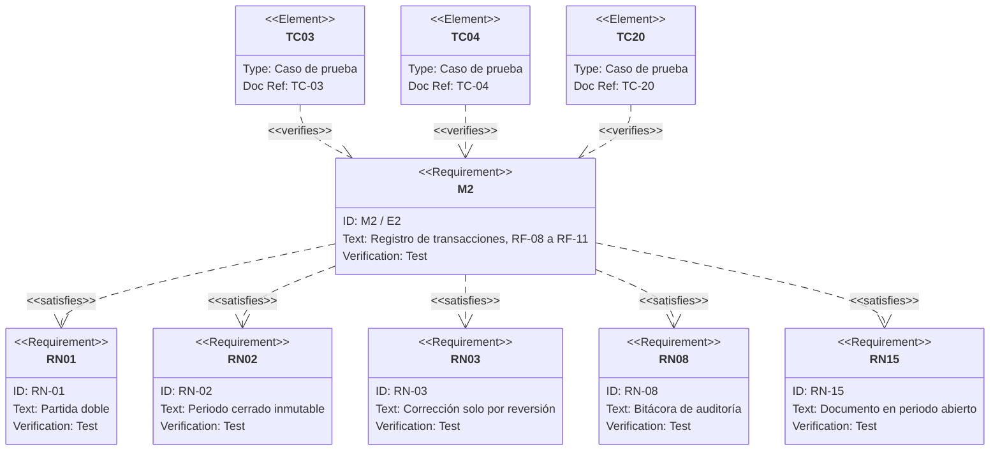

**Figura 10. Trazabilidad del módulo M2 (ejemplo para el módulo M2).**

## 4.9 Matriz de riesgos

La matriz usa una escala cualitativa de tres niveles (Baja, Media y Alta) para la probabilidad y el impacto. La escala es un criterio del equipo y no representa probabilidades numéricas.

**Tabla 39. Matriz de riesgos.**

| ID | Riesgo | Probabilidad / Impacto | Respuesta | Estado | Evidencia |
|---|---|---|---|---|---|
| R1 | Una migración incorrecta afecta los datos de producción | Media / Alta | Los scripts son inmutables: una corrección se publica como un script nuevo. Cada Pull Request a main ejecuta las migraciones sobre una rama de Neon creada como copia de producción, que se elimina al terminar. Ese trabajo es una comprobación requerida para integrar | Materializado y mitigado: un script de migración falló al aplicarse en producción, se corrigió con un script nuevo y se creó el control sobre una copia de producción | Flujo de migraciones en Pull Request (Captura 8) |
| R2 | El cambio de plataforma de .NET 8 a .NET 10 interrumpe la compilación o las pruebas | Media / Media | Migración en un único cambio de versión, paquetes actualizados y pruebas adaptadas | Materializado y resuelto el 17/10/2026 | Compilación y suite de pruebas en estado exitoso tras la migración |
| R3 | Duplicación de código entre cuentas por cobrar y por pagar | Alta / Media | Extracción de reglas comunes a un solo lugar y puerta de duplicación en integración continua | Materializado y resuelto (refactorizaciones del 03/10 y del 09/10) | Resultado de la puerta de duplicación (Captura 10) |
| R4 | Saldos manipulables o descuadre contable | Media / Alta | Los saldos se derivan de vistas y no se almacenan como columnas editables; un disparador exige partida doble; el cierre de periodo consolida saldos de forma inmutable | Mitigado | Reglas RN-01, RN-02 y RN-03; casos TC-04 y TC-20 |
| R5 | Dependencia del servicio de tipos de cambio de Banguat | Media / Media | Consulta con caché en el historial, reintento ante errores transitorios y captura manual con motivo y perfil autorizado cuando el servicio no responde | Mitigado | Casos TC-50 y TC-51 |
| R6 | Exposición de secretos | Baja / Alta | Secretos en el almacén de secretos del repositorio y de Azure Container Apps referenciados como secreto; la API usa un rol de base de datos de mínimo privilegio sin pertenecer al superusuario | Mitigado | Migración del rol de aplicación y pruebas de permisos |
| R7 | Límites de los planes gratuitos (Azure DevOps con ejecución formal de suites limitada, Container Apps en consumo, Neon) | Alta / Baja | Casos de prueba como work items enlazados; adaptación a los límites de cada servicio | Materializado y aceptado | Work items de tipo Test Case en Azure Boards |
| R8 | Alcance: M9 y las notificaciones por SMTP no se entregan | Alta / Media | Priorización del núcleo contable y fiscal | Materializado y diferido | Casos TC-17 y TC-18 en estado Design |
| R9 | Gestión del cambio y capacitación del personal contable | Media / Media | Manual de usuario por perfil | Vigente | Manual de usuario elaborado; capacitación pendiente de ejecución |

Tres controles de la matriz se respaldan con evidencia visual de los flujos automatizados.

[Captura 8: Ejecución del flujo «Migraciones — prueba contra copia de producción» en un Pull Request hacia main, con el job de migración exitoso y el resumen de scripts aplicados. Perfil: acceso al repositorio en GitHub. Acción previa: abrir GitHub > Actions > Migraciones — prueba contra copia de producción y seleccionar una ejecución en estado exitoso (archivo .github/workflows/migrations-check.yml). Demuestra: el control de R1, es decir, que las migraciones se prueban sobre una copia de producción antes de integrarse. Enlace: https://github.com/DavidsitoPay/erp-contable-delta/actions]

[Captura 9: Resumen del job de cobertura de líneas cambiadas (diff-cover) dentro del flujo «Pruebas — backend y frontend (dev)», con el umbral de 80 % y el porcentaje alcanzado. Perfil: acceso al repositorio en GitHub. Acción previa: abrir una ejecución reciente del flujo en la rama dev y abrir el resumen del run (archivo .github/workflows/backend-build-check.yml). Demuestra: la puerta de calidad del objetivo 4 sobre las líneas modificadas. Enlace: https://github.com/DavidsitoPay/erp-contable-delta/actions]

[Captura 10: Job de duplicación (jscpd) del mismo flujo, con el resultado sin bloques duplicados de 80 tokens o más. Perfil: acceso al repositorio en GitHub. Acción previa: en la misma ejecución, abrir el job jscpd y su resumen. Demuestra: el control de R3 y el cumplimiento del objetivo 4 en duplicación. Enlace: https://github.com/DavidsitoPay/erp-contable-delta/actions]

# Capítulo 5. Diseño del sistema

El diseño de DEC describe tres capas desacopladas, un modelo de datos relacional en PostgreSQL 16 y un conjunto de diagramas UML que se derivan del código y del esquema en producción. Los diagramas de este capítulo se construyeron a partir de los controladores, servicios, reglas de dominio y scripts de base de datos vigentes. Los diagramas elaborados durante el análisis se recrearon con los nombres reales de las entidades y los componentes implementados.

## 5.1 Arquitectura general y contexto

DEC se estructura en tres capas.

**Tabla 40. Capas de la arquitectura.**

| Capa | Tecnología | Responsabilidad |
|---|---|---|
| Presentación | Aplicación de una sola página en React 18 con Vite | Interacción con el usuario y validación de forma; no contiene reglas de negocio ni acceso a la base de datos |
| Lógica y servicios | API REST en ASP.NET Core sobre .NET 10 LTS con Entity Framework Core | Reglas de negocio, autenticación por token JWT, autorización por perfil y registro en la bitácora de auditoría |
| Datos | PostgreSQL 16 en Neon | Integridad referencial, restricciones de dominio, disparadores, procedimientos y vistas que hacen cumplir las reglas que la aplicación no puede garantizar por sí sola |

Los sistemas externos son el servicio SOAP del Banco de Guatemala (Banguat), que provee el tipo de cambio de referencia, y un servidor de correo SMTP para notificaciones, que está diseñado y no se implementó. La comunicación sigue la cadena navegador, frontend (HTTPS), API (HTTPS y JSON) y base de datos (SQL mediante Npgsql y Entity Framework Core). Ningún módulo del frontend accede directamente a la base de datos.

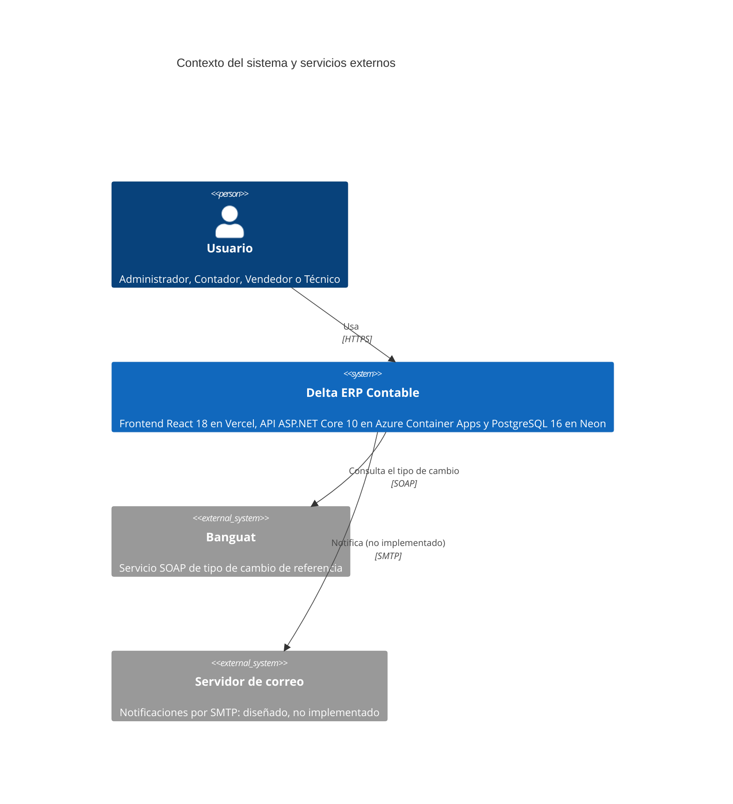

**Figura 11. Contexto del sistema y servicios externos.**

## 5.2 Casos de uso

Los actores corresponden a los cuatro perfiles que reconoce la API: Administrador del sistema, Contador, Vendedor y Técnico. El perfil Técnico existe en el modelo de datos y no tiene permisos sobre los módulos de negocio: toda solicitud de negocio con ese perfil recibe un rechazo 403. Los casos de uso se limitan a los implementados.

**Núcleo contable, seguridad y control**

```mermaid
usecase-beta
    actor ADM("Administrador del sistema")
    actor CON("Contador")
    systemBoundary DEC["Delta ERP Contable"]
        CU01("CU-01 Iniciar sesión")
        CU02("CU-02 Administrar cuentas y centros de costo")
        CU03("CU-03 Cerrar y reabrir periodo")
        CU04("CU-04 Registrar asiento")
        CU05("CU-05 Reversar asiento")
        CU06("CU-06 Configurar parámetros fiscales y retenciones")
        CU07("CU-07 Mantener calendario de feriados")
        CU08("CU-08 Consultar libros y balance de saldos")
        CU09("CU-09 Consultar balance general y estado de resultados")
    end
    ADM --> CU01
    CON --> CU01
    ADM --> CU02
    CON --> CU02
    ADM --> CU03
    CON --> CU03
    ADM --> CU04
    CON --> CU04
    ADM --> CU05
    ADM --> CU06
    ADM --> CU07
    CON --> CU08
    ADM --> CU08
    CON --> CU09
    ADM --> CU09
```

**Figura 12. Casos de uso del núcleo contable, la seguridad y el control.**

**Operación comercial, tesorería y obligaciones fiscales**

```mermaid
usecase-beta
    actor VEN("Vendedor")
    actor CON("Contador")
    actor ADM("Administrador del sistema")
    systemBoundary DEC["Delta ERP Contable"]
        CU10("CU-10 Registrar factura o nota de crédito de venta")
        CU11("CU-11 Registrar cobro con IVA retenido")
        CU12("CU-12 Registrar factura o nota de crédito de compra")
        CU13("CU-13 Pagar a proveedor con retención de ISR")
        CU14("CU-14 Administrar cuentas bancarias y movimientos")
        CU15("CU-15 Conciliar cuenta bancaria")
        CU16("CU-16 Capturar tipo de cambio manual y revaluar")
        CU17("CU-17 Enterar retenciones y resolver ajustes")
        CU18("CU-18 Consultar libro fiscal y reporte de retenciones")
    end
    VEN --> CU10
    CON --> CU10
    ADM --> CU10
    CON --> CU11
    ADM --> CU11
    CON --> CU12
    ADM --> CU12
    CON --> CU13
    ADM --> CU13
    CON --> CU14
    ADM --> CU14
    CON --> CU15
    ADM --> CU15
    CON --> CU16
    ADM --> CU16
    CON --> CU17
    ADM --> CU17
    CON --> CU18
    ADM --> CU18
```

**Figura 13. Casos de uso de la operación comercial, la tesorería y las obligaciones fiscales.**

Las restricciones por perfil que sustentan los diagramas son las siguientes. La reversa de asientos, la edición de la configuración fiscal, la escritura de parámetros de retención y la escritura del calendario de feriados son exclusivas del Administrador del sistema. El Vendedor factura a clientes y consulta impuestos y monedas, pero recibe 403 al registrar cobros, consultar retenciones o acceder a tesorería y reportes. El Contador comparte el resto de las operaciones con el Administrador.

## 5.3 Diagrama de clases

El modelo de clases del backend se organiza en capas. Las entidades del dominio representan las tablas del esquema; las reglas puras encapsulan los cálculos y validaciones sin acceso a datos; los servicios coordinan reglas, persistencia y auditoría; los controladores exponen la API.

La Figura 14 presenta el núcleo contable y de seguridad. Cada usuario pertenece a un perfil y un perfil agrupa a varios usuarios (relación N:1). Los permisos se derivan de roles fijos y no de una lista de permisos por usuario. La bitácora de auditoría es una tabla sin entidad en la capa de dominio: se escribe mediante un procedimiento almacenado.

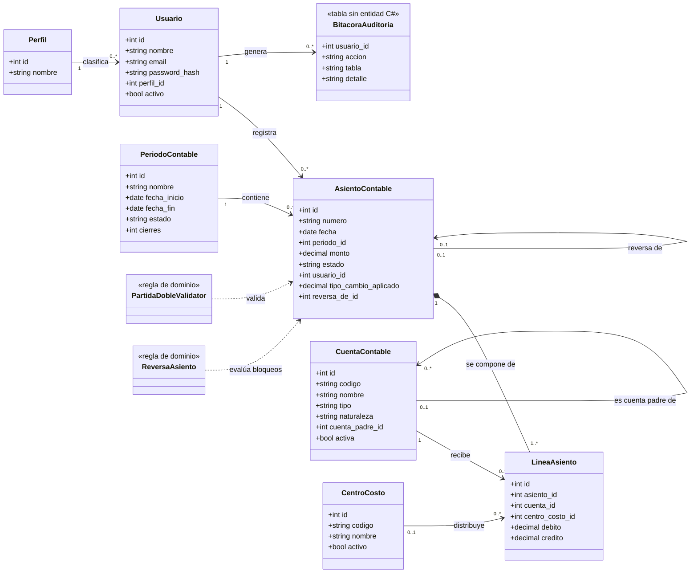

**Figura 14. Diagrama de clases del núcleo contable y de seguridad.**

La Figura 15 presenta las cuentas por cobrar y por pagar. Cliente y proveedor son una misma entidad, la contraparte, distinguida por su tipo. Los documentos de ambos módulos heredan de una base común. La nota de crédito es un documento con tipo propio que referencia al documento de origen. Los cobros y pagos se registran en cada módulo y generan el movimiento de tesorería que muestra la Figura 16, junto con la conciliación bancaria y el enteramiento. La Figura 17 agrupa las clases fiscales y de multimoneda. No existe una entidad de importación de datos: la carga inicial se realiza mediante scripts SQL.

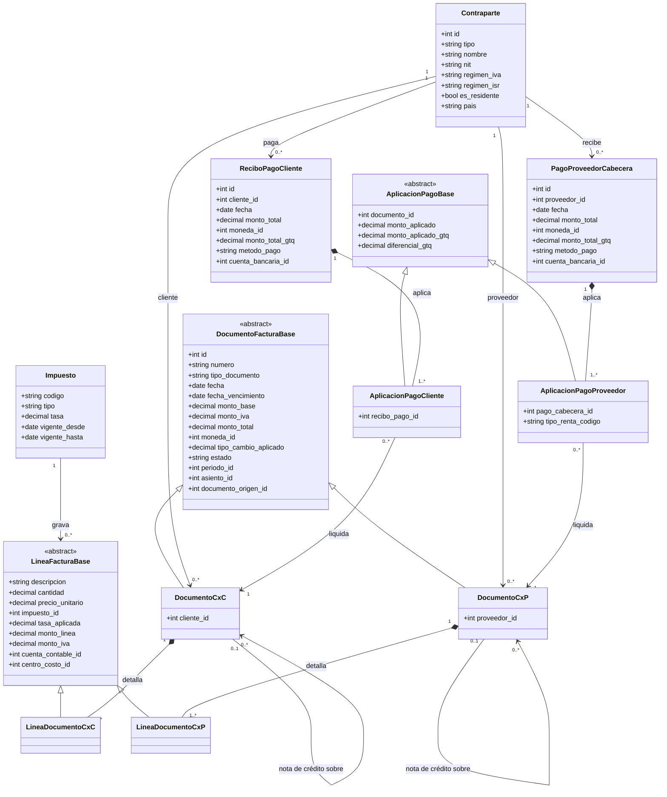

**Figura 15. Diagrama de clases de cuentas por cobrar y por pagar.**

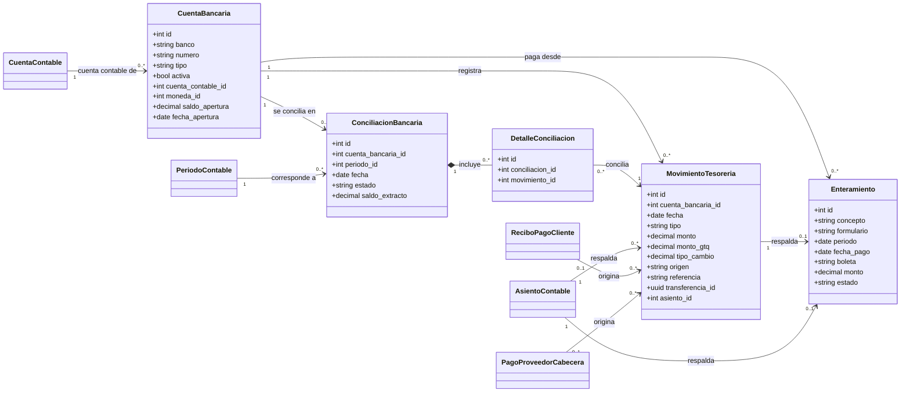

**Figura 16. Diagrama de clases de tesorería, conciliación bancaria y enteramiento.**

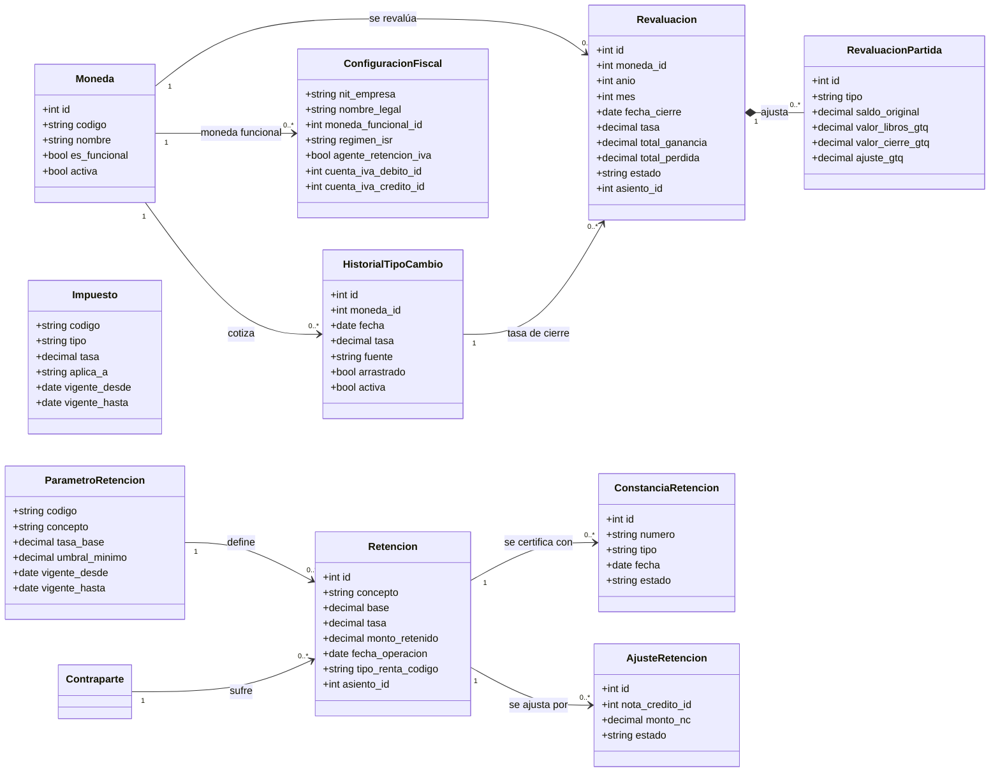

**Figura 17. Diagrama de clases fiscal y multimoneda.**

**Tabla 41. Clases representativas por capa.**

| Capa | Clases representativas | Responsabilidad |
|---|---|---|
| Entidades | CuentaContable, AsientoContable, LineaAsiento, DocumentoCxC, DocumentoCxP (con base común DocumentoFacturaBase), AplicacionPagoCliente, AplicacionPagoProveedor, CuentaBancaria, MovimientoTesoreria, ParametroRetencion, Retencion, Enteramiento | Mapeo de las tablas mediante Entity Framework Core |
| Reglas puras | PartidaDobleValidator, AsientoFacturaBuilder, AsientoTesoreriaBuilder, MotorFiscal, RetencionRules, RetencionNoResidenteRules, EnteramientoRules, DiaHabilRules, CambioRules, DiferencialCambiarioRules, RevaluacionRules, EstadosFinancieros | Cálculo de asientos, impuestos, retenciones, diferenciales y estados financieros |
| Servicios | ValidacionContable, FacturaService, FacturaFiscalService, TesoreriaService, RetencionService, EnteramientoService, TipoCambioService, RevaluacionService, AuditoriaService, ReversaAsiento | Orquestación de reglas, persistencia transaccional y bitácora |
| Controladores | AsientosController, CxCController, CxPController, ConciliacionesController, EnteramientosController, TiposCambioController, entre otros | Exposición de la API REST y autorización por perfil |

Los documentos de cuentas por cobrar y por pagar comparten la abstracción IDocumentoFactura, de modo que `AsientoFacturaBuilder` es el único punto donde ambos módulos se diferencian: el lado de control suma lo que suma el otro lado y la partida doble se cumple por construcción.

## 5.4 Diagramas de secuencia

Se presentan seis secuencias: el registro de un asiento, la reversión de un asiento, el inicio de sesión, la factura de compra con retención de ISR, el pago a un proveedor no residente y el enteramiento de retenciones.

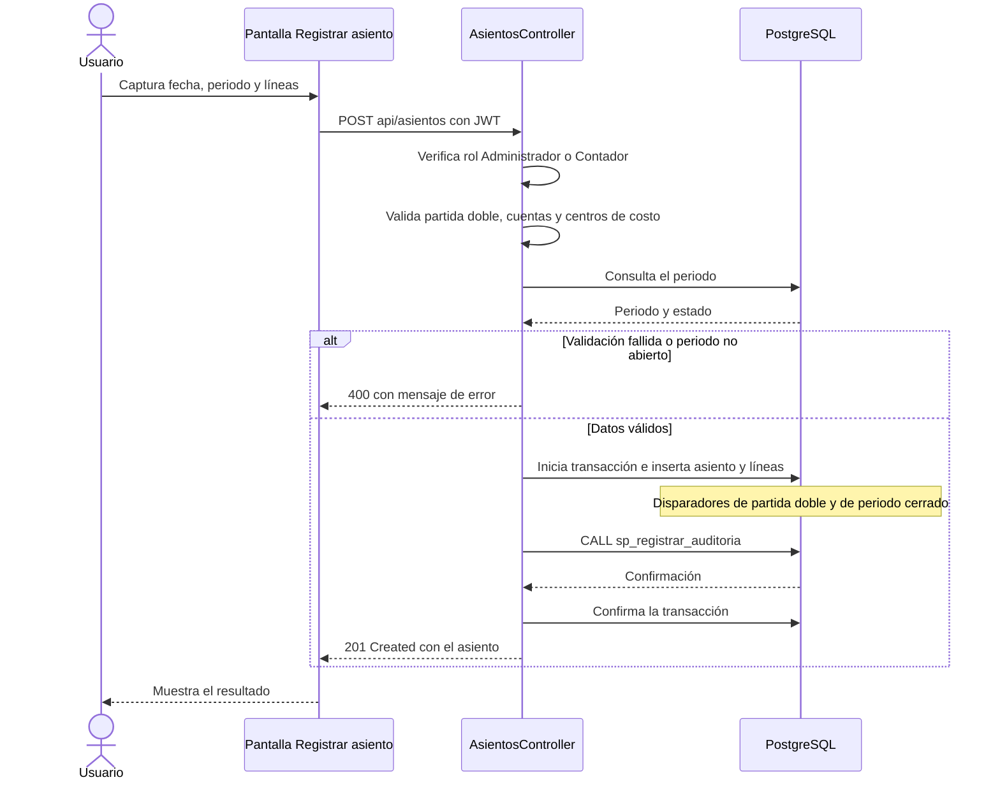

**Figura 18. Diagrama de secuencia del registro de un asiento contable.**

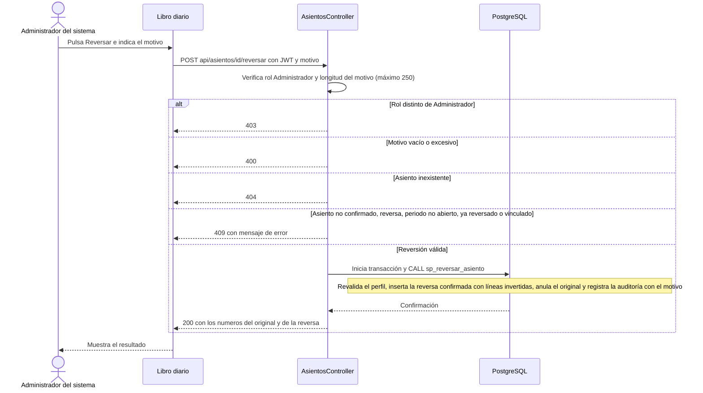

**Figura 19. Diagrama de secuencia de la reversión de un asiento.**

**Inicio de sesión con JWT**

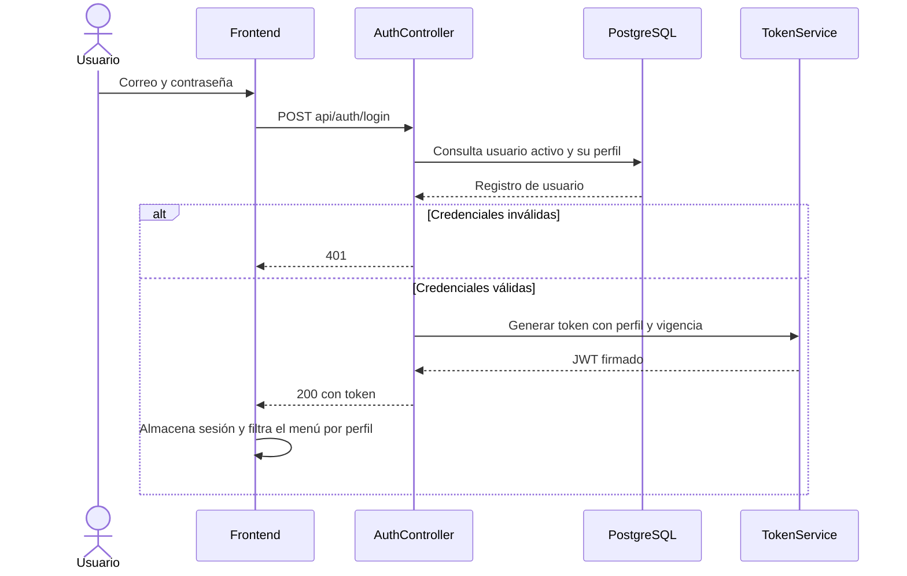

**Figura 20. Secuencia del inicio de sesión con JWT.**

**Factura de compra con retención de ISR**

```mermaid
sequenceDiagram
    actor C as Contador
    participant F as Frontend
    participant X as CxPController
    participant S as FacturaFiscalService
    participant R as RetencionService
    participant B as AsientoFacturaBuilder
    participant AU as AuditoriaService
    participant D as PostgreSQL
    C->>F: Captura la factura del proveedor
    F->>X: POST api/cxp/facturas/retencion-previa
    X-->>F: Cálculo de la retención sin escribir
    F->>X: POST api/cxp/facturas
    X->>S: Preparar (IVA, tipo de cambio)
    S->>R: Evaluar proveedor con el parámetro vigente
    R-->>S: Retención de ISR o revisión pendiente
    X->>B: Construir asiento (control por el neto, retención al final)
    X->>AU: Ejecutar en una transacción
    AU->>D: Asiento, factura y fila de retención
    AU->>D: sp_registrar_auditoria
    D-->>AU: Disparador de partida doble (diferido) aprobado
    AU-->>X: Confirmación
    X-->>F: 201 con el detalle de la factura
```

**Figura 21. Secuencia de la factura de compra con retención de ISR.**

**Pago a un proveedor no residente**

```mermaid
sequenceDiagram
    actor C as Contador
    participant X as CxPController
    participant T as TesoreriaService
    participant R as RetencionService
    participant TC as TipoCambioService
    participant B as AsientoTesoreriaBuilder
    participant D as PostgreSQL
    C->>X: POST api/cxp/pagos/retencion-previa
    X->>R: Calcular por aplicación (tipo de renta y parámetro vigente)
    R->>TC: Tipo de cambio del día del pago
    TC->>D: Consulta el historial de tipos de cambio
    TC-->>R: Tasa de Banguat, arrastrada o manual
    R-->>X: Base en GTQ, tasa, retención y neto al banco
    C->>X: POST api/cxp/pagos
    X->>T: Preparar el pago con las retenciones
    T->>B: Construir liquidación (banco reducido por la retención)
    X->>D: Pago, movimiento, asiento y retención ISR_NORES en una transacción auditada
    D-->>X: Confirmación o 409 (cuenta de ISR sin configurar)
    X-->>C: 201 con las retenciones
```

**Figura 22. Secuencia del pago a un proveedor no residente.**

**Enteramiento de retenciones a la SAT**

```mermaid
sequenceDiagram
    actor C as Contador
    participant E as EnteramientosController
    participant S as EnteramientoService
    participant T as TesoreriaService
    participant D as PostgreSQL
    C->>E: GET saldo por enterar del periodo
    E-->>C: Saldo, vencimiento al décimo día hábil y estado
    C->>E: POST vista-previa
    E-->>C: Partida a registrar
    C->>E: POST enteramiento con formulario, boleta y monto
    E->>S: Registrar
    S->>S: Validar solicitud, banco en GTQ y cuenta de ISR
    S->>T: Preparar movimiento de egreso y asiento
    S->>D: Movimiento, asiento y fila de enteramiento
    D->>D: Disparador toma bloqueo por periodo y valida el saldo
    alt Monto mayor al saldo
        D-->>S: Error 55000
        S-->>C: 409
    else Monto válido
        D-->>S: Confirmación
        S-->>C: 201
    end
```

**Figura 23. Secuencia del enteramiento de retenciones a la SAT.**

## 5.5 Diagrama de componentes

Los componentes del frontend se agrupan por área funcional y se comunican con la API a través de un servicio central de acceso HTTP, que expone un objeto por recurso. En el backend, cada controlador depende de servicios y reglas de dominio, y estos del contexto de datos. La base de datos aporta los componentes que hacen cumplir la integridad: disparadores, procedimientos almacenados y vistas.

La Figura 24 detalla los componentes de cada capa y sus interfaces. La Figura 25 los agrupa por módulo funcional (M1 a M10, con la numeración del apartado 2.5). El servidor SMTP se dibuja punteado porque está diseñado y no se implementó. La integración externa implementada es el servicio SOAP de Banguat. Los cobros y pagos se registran en cuentas por cobrar y por pagar y generan el movimiento de tesorería. El módulo M9 no ofrece API: la carga inicial se realiza con scripts SQL.

```mermaid
flowchart TB
    subgraph FE["Frontend (React 18)"]
        direction TB
        PAN["Pantallas por módulo: catálogo, asientos, libros, contrapartes, CxC, CxP, tesorería, retenciones, revaluaciones, reportes"]
        SVC["Servicio de acceso HTTP (un objeto por recurso)"]
        PAN --> SVC
    end
    subgraph API["API (ASP.NET Core 10)"]
        direction TB
        AUT["Autenticación JWT y roles"]
        CTR["Controladores por módulo"]
        SRV["Servicios: auditoría, facturas, tesorería, retenciones, enteramiento, tipo de cambio, revaluación"]
        REG["Reglas de dominio puras: partida doble, facturas, pagos, retenciones, cambio"]
        ERR["Traducción de errores de PostgreSQL a HTTP"]
        CTX["Contexto de datos (Entity Framework Core)"]
        BGC["Cliente SOAP de Banguat"]
        AUT --> CTR
        CTR --> SRV
        CTR --> REG
        SRV --> REG
        CTR --> ERR
        CTR --> CTX
        SRV --> CTX
        SRV --> BGC
    end
    subgraph DB["Base de datos (PostgreSQL 16)"]
        direction TB
        TBL["Tablas"]
        TRG["Disparadores: partida doble, periodo cerrado, inmutabilidad"]
        PRC["Procedimientos: cierre y reapertura de periodo, reversa de asientos, auditoría, conciliación"]
        VST["Vistas y función de reporte de saldos"]
        TBL --- TRG
    end
    EXT["Servicio SOAP de Banguat"]
    SVC -->|"HTTPS y JWT"| AUT
    CTX -->|"SQL"| TBL
    CTR -->|"CALL"| PRC
    SRV -->|"CALL"| PRC
    CTR -->|"consultas"| VST
    BGC -->|"SOAP"| EXT
```

**Figura 24. Diagrama de componentes del sistema.**

```mermaid
flowchart TB
    subgraph FE["Frontend (React SPA en Vercel)"]
        UIA["Autenticación"]
        UIR["Registro contable y libros"]
        UIC["CxC y CxP"]
        UIT["Tesorería y retenciones"]
        UIP["Reportes"]
    end
    subgraph API["API REST (ASP.NET Core 10 en Azure Container Apps)"]
        SEG["M8 Seguridad y auditoría"]
        CAT["M1 Catálogo y parametrización contable"]
        TRX["M2 Registro de transacciones"]
        LIB["M3 Libros y auxiliares"]
        CXC["M4 Cuentas por cobrar"]
        CXP["M5 Cuentas por pagar"]
        TES["M6 Tesorería y bancos"]
        REP["M7 Reportes y estados financieros"]
        FIS["M10-F2 Retenciones y enteramiento"]
        MON["M10-F3 Multimoneda y revaluación"]
    end
    DB[("PostgreSQL 16 en Neon")]
    BGT["Servicio SOAP de Banguat"]
    SMTP["Servidor SMTP (diseñado, no implementado)"]
    CAR["M9 Carga inicial e importación (pendiente): solo scripts SQL, sin API"]
    UIA -->|"HTTPS"| SEG
    UIR -->|"HTTPS"| TRX
    UIC -->|"HTTPS"| CXC
    UIC -->|"HTTPS"| CXP
    UIT -->|"HTTPS"| TES
    UIP -->|"HTTPS"| REP
    SEG -.->|"valida permisos"| TRX
    SEG -.->|"valida permisos"| CXC
    SEG -.->|"valida permisos"| CXP
    SEG -.->|"valida permisos"| TES
    SEG -.->|"valida permisos"| REP
    TRX -->|"usa catálogo"| CAT
    TRX -->|"alimenta"| LIB
    CXC -->|"genera asiento"| TRX
    CXP -->|"genera asiento"| TRX
    CXC -->|"registra cobro"| TES
    CXP -->|"registra pago"| TES
    FIS -->|"enteramiento"| TES
    FIS -->|"retenciones de facturas"| CXP
    MON -->|"tipo de cambio"| BGT
    MON -->|"revalúa saldos"| TRX
    API -->|"SQL"| DB
    CAR -->|"carga datos"| DB
    API -.->|"SMTP"| SMTP
```

**Figura 25. Diagrama de componentes por módulo funcional.**

**Tabla 42. Interfaces y dependencias de los componentes por módulo.**

| Componente | Interfaz que ofrece | Depende de |
|---|---|---|
| Aplicación web (módulos de Catálogo, Asientos, Libros, CxC, CxP, Tesorería, Reportes, Retenciones, Revaluaciones) | Pantallas por perfil | Servicio de acceso HTTP a la API |
| Autenticación | Emisión y validación de tokens JWT | Tabla de usuarios y perfiles |
| Servicios de aplicación | Operaciones transaccionales con bitácora | Reglas de dominio y contexto de datos |
| Reglas de dominio | Cálculos y validaciones puras | Ninguna dependencia de datos |
| Cliente de Banguat | Consulta SOAP del tipo de cambio | Servicio externo de Banguat |
| Base de datos | Tablas, vistas, disparadores y procedimientos | Rol de aplicación con mínimo privilegio |

## 5.6 Diagramas de actividades

**Registro de una factura de compra con IVA y retención**

```mermaid
flowchart TD
    A([Inicio]) --> B[Capturar contraparte, periodo, líneas e impuestos]
    B --> C{Contraparte existe y periodo abierto}
    C -->|No| X1[Rechazar con 400]
    C -->|Sí| D[Calcular base e IVA con redondeo por línea]
    D --> E{IVA con crédito fiscal}
    E -->|Sí| F[Exigir datos del DTE y cuenta de IVA crédito]
    E -->|No| G[Llevar el IVA al costo]
    F --> H{Proveedor sujeto a retención de ISR}
    G --> H
    H -->|Sin régimen definido| I[Registrar sin retención y marcar revisión pendiente]
    H -->|Régimen simplificado| J[Aplicar escala con el parámetro vigente]
    H -->|No aplica| K[Sin retención]
    J --> L[Construir asiento: control por el neto y retención al final]
    I --> L
    K --> L
    L --> M[Guardar asiento, factura, retención y bitácora en una transacción]
    M --> N{Partida doble cuadra}
    N -->|No| X2[Revertir la transacción]
    N -->|Sí| O([Factura registrada])
```

**Figura 26. Actividades del registro de una factura de compra con IVA y retención.**

**Cierre de periodo contable**

```mermaid
flowchart TD
    A([Inicio]) --> B[Solicitar cierre de un periodo]
    B --> C{Perfil Contador o Administrador}
    C -->|No| X1[Rechazar con 403]
    C -->|Sí| D{Periodo existe}
    D -->|No| X2[Responder 404]
    D -->|Sí| E{Estado Abierto}
    E -->|No| X3[Responder 409]
    E -->|Sí| F[Incrementar el número de cierre]
    F --> G["Consolidar por cuenta los asientos Confirmado y Anulado en saldocuentaperiodo"]
    G --> H[Marcar el periodo como Cerrado]
    H --> I[Registrar la acción en la bitácora]
    I --> J([Periodo cerrado])
```

**Figura 27. Actividades del cierre de periodo contable.**

## 5.7 Diagramas de estados

Los estados corresponden a las restricciones de la base de datos que los validan.

```mermaid
stateDiagram-v2
    direction LR
    [*] --> Abierto
    Abierto --> Cerrado: sp_cerrar_periodo
    Cerrado --> Abierto: sp_reabrir_periodo
```

**Figura 28. Estados del periodo contable.**

```mermaid
stateDiagram-v2
    direction LR
    [*] --> Borrador
    Borrador --> Confirmado: partida doble válida
    Confirmado --> Anulado: reversa formal con motivo
```

**Figura 29. Estados del asiento contable.**

```mermaid
stateDiagram-v2
    direction LR
    [*] --> Pendiente: conciliación creada
    Pendiente --> Conciliado: finalizar con diferencia cero
    Pendiente --> Cancelada: cancelar
    Conciliado --> [*]
    Cancelada --> [*]
```

**Figura 30. Estados de la conciliación bancaria.**

```mermaid
stateDiagram-v2
    direction LR
    [*] --> EMITIDA: registrar constancia
    EMITIDA --> ANULADA: anular con motivo
    ANULADA --> [*]
```

**Figura 31. Estados de la constancia de retención.**

```mermaid
stateDiagram-v2
    direction LR
    [*] --> VIGENTE: registrar enteramiento
    VIGENTE --> ANULADO: contra-asiento y motivo
    ANULADO --> [*]
```

**Figura 32. Estados del enteramiento.**

```mermaid
stateDiagram-v2
    direction LR
    [*] --> PENDIENTE: nota de crédito tras un enteramiento vigente
    PENDIENTE --> RESUELTO: resolver con motivo y referencia
    RESUELTO --> [*]
```

**Figura 33. Estados del ajuste de retención.**

La constancia de retención se deriva además en la API como pendiente o vencida, según el plazo del mes siguiente. La revaluación de fin de mes pasa de Vigente a Anulada cuando se anula, con sus contra-asientos.

## 5.8 Interfaz de programación y navegación

La API expone recursos en JSON bajo el prefijo `api/`. La autorización se declara por operación con los perfiles descritos en la sección 5.2. La navegación del frontend se organiza en un menú fijo con cinco desplegables, filtrado según el perfil.

**Tabla 43. Recursos de la API y rutas de la aplicación por área.**

| Área | Recursos principales de la API | Rutas de la aplicación |
|---|---|---|
| Autenticación | `POST api/auth/login` | Inicio de sesión |
| Catálogo | `api/cuentas`, `api/centros-costo`, `api/periodos` (cerrar y reabrir), `api/impuestos`, `api/configuracion-fiscal`, `api/tipos-cambio`, `api/monedas`, `api/feriados` | `/catalogo/{cuentas, centros-costo, periodos, tipos-cambio, configuracion-fiscal, impuestos, parametros-retencion, feriados}` |
| Asientos y libros | `api/asientos` (registrar, reversar), `api/libros/{balance-saldos, diario, mayor}`, `api/libros/fiscal/{ventas, compras}` | `/asientos`, `/libros/{balance, diario, mayor, fiscal, retenciones}` |
| Contrapartes | `api/contrapartes` | `/contrapartes` |
| Cuentas por cobrar y por pagar | `api/cxc/{facturas, pagos}`, `api/cxp/{facturas, pagos}` y sus vistas previas de retención | `/cxc`, `/cxp` |
| Tesorería | `api/cuentas-bancarias`, `api/movimientos-tesoreria`, `api/conciliaciones` | `/tesoreria` |
| Retenciones | `api/retenciones/{parametros, reporte, enteramientos, ajustes}` y constancias | `/retenciones/enteramiento` y pantallas de Retenciones |
| Multimoneda | `api/tipos-cambio`, `api/revaluaciones` | `/catalogo/tipos-cambio`, `/revaluaciones` |
| Reportes | `api/reportes/{balance-general, estado-resultados, saldos-antiguedad}` | `/reportes/{balance-general, estado-resultados, saldos-moneda}` |

Los códigos de respuesta siguen una convención uniforme. El código 400 indica una solicitud inválida; 401, ausencia de autenticación; 403, perfil no autorizado; 404, recurso inexistente; y 409, un conflicto de estado o de integridad que la base de datos detecta (por ejemplo, un periodo no abierto, una restricción de unicidad o un monto que excede un saldo). La API traduce los códigos de error de PostgreSQL a estas respuestas.

## 5.9 Diagrama de despliegue

Cada capa se despliega en un servicio administrado independiente. El backend se empaqueta en una imagen de contenedor de dos etapas (compilación y ejecución) basada en las imágenes oficiales de .NET 10, se publica en GitHub Container Registry y corre en Azure Container Apps. El frontend, al ser una aplicación de una sola página sin estado de servidor, se publica directamente en Vercel desde el código fuente. La base de datos PostgreSQL 16 corre en Neon con dos ramas: `production`, la única que usa el backend desplegado, y `development`, de uso local.

```mermaid
architecture-beta
    group gh(cloud)[GitHub]
    group vc(cloud)[Vercel]
    group az(cloud)[Azure Container Apps]
    group nn(cloud)[Neon]
    service dev(internet)[Desarrollador]
    service repo(server)[Repositorio] in gh
    service ci(server)[GitHub Actions] in gh
    service ghcr(disk)[Container Registry] in gh
    service sq(cloud)[SonarCloud]
    service spa(internet)[SPA React] in vc
    service api(server)[API ASP.NET Core] in az
    service prod(database)[Rama production] in nn
    dev:R --> L:repo
    repo:R --> L:ci
    repo:T --> B:sq
    ci:B --> T:ghcr
    ghcr:R --> L:api
    api:R --> L:prod
    spa:B --> T:api
    ci:R --> L:spa
```

**Figura 34. Despliegue y flujo de entrega continua.**

Cinco flujos de GitHub Actions automatizan la entrega. El flujo de pruebas se ejecuta en cada push a la rama dev con cuatro trabajos en paralelo (backend, frontend, duplicación y cobertura de líneas cambiadas) y un trabajo final que falla si alguno no resulta exitoso. El flujo de análisis de SonarCloud se ejecuta en cada Pull Request y en cada push a main. El gate de migraciones se ejecuta en cada Pull Request a main. El flujo de despliegue del backend se ejecuta en cada push a main: aplica las migraciones pendientes sobre la rama de producción, construye y publica la imagen, actualiza Azure Container Apps y verifica el punto de salud con hasta doce intentos. El flujo del alias de Vercel reapunta el dominio corto al último despliegue de producción.

## 5.10 Red y seguridad

La seguridad es una responsabilidad compartida entre la capa de lógica y la capa de datos. Cuatro límites de confianza delimitan los controles.

**Tabla 44. Límites de confianza y controles.**

| Límite | Entre | Controles |
|---|---|---|
| L1 | Navegador y frontend | HTTPS; el frontend solo valida forma |
| L2 | Frontend y API | HTTPS, lista de orígenes permitidos (CORS) y validación del token (emisor, audiencia, vigencia y firma) |
| L3 | API y base de datos | Cadena de conexión como secreto, rol de aplicación de mínimo privilegio, reglas de integridad en la base y verificación de perfil dentro de los procedimientos sensibles |
| L4 | Repositorio y producción | Pull Request obligatorio, pruebas y análisis en integración continua, autenticación federada (OIDC) hacia Azure |

```mermaid
flowchart LR
    U["Usuario"] ==>|"L1: HTTPS"| SPA["SPA en Vercel"]
    SPA ==>|"L2: HTTPS, CORS, JWT"| API["API en Azure Container Apps"]
    API ==>|"L3: secreto de conexión y rol delta_api"| PROD[("Neon: producción")]
    CI["GitHub Actions"] ==>|"L4: OIDC y despliegue"| API
    CI ==>|"L4: migraciones con rol propietario"| PROD
```

**Figura 35. Límites de confianza L1 a L4.**

La base de datos opera con dos roles. El propietario aplica las migraciones mediante un secreto del flujo de despliegue. La API usa el rol `delta_api`, cuya cadena de conexión es un secreto de la aplicación referenciado como secreto de Azure Container Apps. Los permisos de `delta_api` son de mínimo privilegio: operaciones de datos solo en 34 de las 36 tablas (las dos tablas de plantillas de asiento carecen de permisos); sin UPDATE en las tablas inmutables (bitácora, saldos consolidados, movimientos de tesorería, líneas de asiento, retenciones, partidas de revaluación, pagos, aplicaciones y detalles); DELETE únicamente en el detalle de conciliación; EXECUTE solo en nueve rutinas; y revocación a PUBLIC del permiso de ejecución y de creación en el esquema. Ninguna rutina usa SECURITY DEFINER, por lo que triggers y procedimientos se ejecutan con los permisos del llamador.

Los controles de la capa de datos garantizan lo que la aplicación no puede asegurar por sí sola: la bitácora no puede alterarse, ni siquiera por el administrador; las contraseñas se almacenan con una función de derivación y salt; no existe eliminación física de usuarios ni de cuentas con movimiento; y la reapertura de un periodo y la finalización de una conciliación verifican el perfil del usuario dentro del procedimiento almacenado.

## 5.11 Modelo entidad-relación

El diagrama siguiente muestra las catorce tablas núcleo del modelo, con sus claves y relaciones. Se derivó de los scripts de creación vigentes. Las tablas de documentos de cobro, recibos de pago, conciliación bancaria y detalle de conciliación se representan como clases en las Figuras 15 y 16 y se describen en el Anexo A.

```mermaid
erDiagram
    periodocontable ||--o{ asientocontable : "contiene"
    asientocontable ||--o{ lineaasiento : "se compone de"
    cuentacontable ||--o{ lineaasiento : "recibe"
    cuentacontable ||--o{ cuentacontable : "es padre de"
    contraparte ||--o{ documentocxp : "emite"
    asientocontable ||--o| documentocxp : "respalda"
    documentocxp ||--o{ aplicacionpagoproveedor : "se paga con"
    pagoproveedorcabecera ||--o{ aplicacionpagoproveedor : "agrupa"
    cuentabancaria ||--o{ pagoproveedorcabecera : "paga desde"
    cuentabancaria ||--o{ movimientotesoreria : "registra"
    asientocontable ||--o| movimientotesoreria : "respalda"
    documentocxp ||--o| retencion : "genera ISR"
    asientocontable ||--o{ retencion : "respalda"
    cuentabancaria ||--o{ enteramiento : "paga desde"
    movimientotesoreria ||--o| enteramiento : "respalda"
    moneda ||--o{ historialtipocambio : "cotiza"
    moneda ||--o{ documentocxp : "denomina"
    moneda ||--o{ cuentabancaria : "denomina"

    periodocontable {
        int id PK
        varchar nombre
        date fecha_inicio
        date fecha_fin
        varchar estado
        int cierres
    }
    cuentacontable {
        int id PK
        varchar codigo UK
        varchar nombre
        varchar tipo
        varchar naturaleza
        int cuenta_padre_id FK
        boolean activa
    }
    asientocontable {
        int id PK
        varchar numero
        date fecha
        int periodo_id FK
        decimal monto
        varchar estado
        int usuario_id FK
        int reversa_de_id FK
    }
    lineaasiento {
        int id PK
        int asiento_id FK
        int cuenta_id FK
        int centro_costo_id FK
        decimal debito
        decimal credito
    }
    contraparte {
        int id PK
        varchar tipo
        varchar nombre
        varchar nit
        varchar regimen_iva
        varchar regimen_isr
        varchar pais
    }
    documentocxp {
        int id PK
        varchar numero
        varchar tipo_documento
        int proveedor_id FK
        date fecha
        decimal monto_total
        int moneda_id FK
        decimal monto_total_original
        int documento_origen_id FK
        int asiento_id FK
    }
    pagoproveedorcabecera {
        int id PK
        int proveedor_id FK
        date fecha
        decimal monto_total
        int cuenta_bancaria_id FK
    }
    aplicacionpagoproveedor {
        int id PK
        int pago_cabecera_id FK
        int documento_id FK
        decimal monto_aplicado
    }
    cuentabancaria {
        int id PK
        varchar banco
        varchar numero
        int cuenta_contable_id FK
        int moneda_id FK
        decimal saldo_apertura
    }
    movimientotesoreria {
        int id PK
        int cuenta_bancaria_id FK
        date fecha
        varchar tipo
        decimal monto
        int asiento_id FK
    }
    retencion {
        int id PK
        varchar concepto
        int documento_cxp_id FK
        int parametro_id FK
        decimal base
        decimal tasa
        decimal monto_retenido
        int asiento_id FK
    }
    enteramiento {
        int id PK
        date periodo
        varchar formulario
        varchar boleta
        decimal monto
        int cuenta_bancaria_id FK
        int asiento_id FK
        int movimiento_tesoreria_id FK
        varchar estado
    }
    moneda {
        int id PK
        varchar codigo
        varchar nombre
    }
    historialtipocambio {
        int id PK
        int moneda_id FK
        date fecha
        decimal tasa
    }
```

**Figura 36. Modelo entidad-relación de las tablas núcleo.**

## 5.12 Modelo relacional y diccionario de datos

El esquema contiene 36 tablas de dominio, organizadas en nueve grupos, más una tabla de control de migraciones. Ninguna tabla almacena un saldo editable: los saldos de cuentas, documentos y cuentas bancarias se derivan de vistas. La única tabla de saldos, el consolidado por periodo, es inmutable y se escribe una sola vez desde el procedimiento de cierre. El diccionario completo con tipo, restricción y descripción de cada columna se presenta en el Anexo C.

**Tabla 45. Grupos de tablas del esquema relacional.**

| Grupo | Tabla | Propósito | Columnas clave |
|---|---|---|---|
| Seguridad y auditoría | perfil | Perfiles de acceso | id, nombre |
| | usuario | Usuarios del sistema | email único, hash de contraseña, perfil_id, activo |
| | bitacoraauditoria | Registro inmutable de operaciones | usuario_id, fecha, accion, tabla_afectada, detalle |
| Catálogo y configuración | moneda | Monedas GTQ, USD y EUR | codigo, nombre |
| | historialtipocambio | Tipos de cambio por fecha | moneda_id, fecha, tasa, fuente, activa |
| | periodocontable | Periodos contables | fecha_inicio, fecha_fin, estado, cierres |
| | contraparte | Clientes y proveedores | tipo, nit, régimen de IVA y de ISR, país |
| | cuentacontable | Catálogo jerárquico de cuentas | codigo único, tipo, naturaleza, cuenta_padre_id, activa |
| | centrocosto | Centros de costo | codigo único, activo |
| | impuesto | Catálogo de impuestos con vigencia | codigo, tipo, tasa, aplica_a, genera_credito, vigente_desde, vigente_hasta |
| | configuracionfiscal | Parámetros fiscales (fila única) | régimen, agente de retención, cuentas de IVA, de retención y cambiarias |
| Asientos | asientocontable | Cabecera del asiento | numero, fecha, periodo_id, estado, reversa_de_id |
| | lineaasiento | Líneas de cargo y abono | asiento_id, cuenta_id, debito, credito |
| | plantillaasiento | Plantillas de asiento | nombre, descripcion |
| | lineaplantillaasiento | Líneas de plantilla | plantilla_id, cuenta_id, distribucion |
| Cuentas por cobrar | documentocxc | Facturas y notas de venta | cliente_id, tipo_documento, monto_total, moneda_id, asiento_id |
| | lineadocumentocxc | Líneas de la factura | documento_id, cantidad, precio_unitario, impuesto_id |
| | recibopagocliente | Cabecera del cobro | cliente_id, monto_total, cuenta_bancaria_id |
| | aplicacionpagocliente | Aplicación del cobro a facturas | recibo_pago_id, documento_id, monto_aplicado |
| Cuentas por pagar | documentocxp | Facturas y notas de compra | proveedor_id, tipo_documento, monto_total, moneda_id, asiento_id |
| | lineadocumentocxp | Líneas de la factura | documento_id, cantidad, precio_unitario, impuesto_id |
| | pagoproveedorcabecera | Cabecera del pago | proveedor_id, monto_total, cuenta_bancaria_id |
| | aplicacionpagoproveedor | Aplicación del pago a facturas | pago_cabecera_id, documento_id, monto_aplicado |
| Tesorería | cuentabancaria | Cuentas bancarias | banco, numero, cuenta_contable_id, moneda_id, saldo_apertura |
| | movimientotesoreria | Movimientos inmutables con asiento | cuenta_bancaria_id, tipo, monto, asiento_id |
| | conciliacionbancaria | Conciliaciones | cuenta_bancaria_id, periodo_id, estado |
| | detalleconciliacion | Movimientos conciliados | conciliacion_id, movimiento_id |
| Consolidación | saldocuentaperiodo | Fotografía inmutable del cierre | periodo_id, cierre_numero, cuenta_id, saldo_final |
| Retenciones y enteramiento | parametroretencion | Tasas, tramos y umbrales con vigencia | concepto, tasa, vigencia |
| | retencion | Retenciones efectuadas o recibidas (solo INSERT) | concepto, base, tasa, monto_retenido, asiento_id |
| | constanciaretencion | Datos de la constancia de retención | número, tipo, estado EMITIDA o ANULADA |
| | enteramiento | Pago del ISR retenido a la SAT | periodo, formulario, boleta, monto, estado |
| | ajuste_retencion | Ajuste por nota de crédito posterior | estado PENDIENTE o RESUELTO |
| | feriado | Calendario de días inhábiles | fecha, medio_dia |
| Multimoneda | revaluacion | Revaluación de fin de mes | estado Vigente o Anulada, asientos de cierre y reversa |
| | revaluacionpartida | Partidas de la revaluación | revaluacion_id, saldo original y valor en GTQ |

[Captura 11: Consola de Neon, rama development o production, listado de tablas del esquema public (tabla Tables o consulta con el listado de tablas), donde se vean las 36 tablas de dominio y schema_migrations. Perfil: propietario del proyecto Neon. Acción previa: abrir Neon > proyecto erp-contable-delta > Tables y elegir la rama; alternativamente ejecutar en el SQL Editor la consulta de tablas de information_schema.tables. Demuestra: que el esquema desplegado contiene las tablas descritas. Enlace: https://console.neon.tech]

## 5.13 Motor de base de datos: PostgreSQL 16

El proyecto usa PostgreSQL 16 sobre Neon, por la combinación de lógica procedimental, transacciones con DDL y ramas de copia sobre escritura. La tabla relaciona cada capacidad con el mecanismo que la usa.

**Tabla 46. Capacidades de PostgreSQL utilizadas en el sistema.**

| Capacidad | Uso en DEC |
|---|---|
| Disparadores y funciones PL/pgSQL | Partida doble, bloqueo de periodos cerrados, prohibición de eliminar asientos, inmutabilidad de la bitácora, de los saldos consolidados, de los movimientos y de las retenciones |
| Disparadores de restricción diferibles | La partida doble se valida al confirmar la transacción, no al insertar cada línea |
| Control de vigencias sin traslape | Disparadores sobre impuestos y parámetros de retención que rechazan versiones con rangos que se cruzan |
| Restricciones CHECK con lógica condicional | Coherencia del origen de una retención, del estado de un enteramiento, de los datos del DTE y del tipo de impuesto |
| Índices únicos parciales | Una retención de ISR por factura, una boleta de enteramiento vigente por formulario |
| Bloqueos consultivos transaccionales | Serialización de enteramientos simultáneos del mismo periodo |
| Vistas y funciones de tabla | Saldos de cuentas, documentos y bancos, conciliación, retenciones y saldo por enterar, calculados en tiempo real |
| Tipos numéricos exactos | Importes con NUMERIC y dos decimales; tipo de cambio con seis decimales |
| Transacciones con DDL | Cada migración se ejecuta completa o se revierte completa |
| Ramas copy-on-write de Neon | El gate de migraciones prueba los scripts sobre una copia de producción creada y eliminada en minutos |
| Roles y permisos por objeto | El rol de aplicación recibe permisos tabla por tabla |

## 5.14 Scripts de base de datos

Los 19 scripts de migración se aplican en orden numérico mediante un script único que ejecuta cada uno en una sola transacción y registra el resultado en la tabla de control `schema_migrations`. Si un script falla, se revierte por completo y no se registra como aplicado. Un script aplicado nunca se edita: una corrección se publica como un script con número mayor. Las migraciones no incluyen reversión. Cuando un script posterior redefine un objeto, rige la versión del número mayor. El DDL completo de las 36 tablas se presenta en el Anexo A.

**Núcleo del modelo: asientos y líneas**

```sql
CREATE TABLE asientocontable (
    id                    SERIAL PRIMARY KEY,
    numero                VARCHAR(30) NOT NULL,
    fecha                 DATE NOT NULL,
    periodo_id            INT NOT NULL REFERENCES periodocontable(id),
    monto                 DECIMAL(14,2) NOT NULL,
    estado                VARCHAR(20) NOT NULL DEFAULT 'Borrador', -- Borrador|Confirmado|Anulado
    usuario_id            INT NOT NULL REFERENCES usuario(id),
    tipo_cambio_aplicado  DECIMAL(12,6)
);

CREATE TABLE lineaasiento (
    id               SERIAL PRIMARY KEY,
    asiento_id       INT NOT NULL REFERENCES asientocontable(id),
    cuenta_id        INT NOT NULL REFERENCES cuentacontable(id),
    centro_costo_id  INT REFERENCES centrocosto(id),
    debito           DECIMAL(14,2) NOT NULL DEFAULT 0,
    credito          DECIMAL(14,2) NOT NULL DEFAULT 0
);
```

El extracto muestra la integridad referencial declarativa y los importes en tipos exactos.

**Disparador de partida doble (RN-01)**

```sql
CREATE OR REPLACE FUNCTION fn_validar_partida_doble() RETURNS TRIGGER AS $$
DECLARE
    v_total_debito  DECIMAL(14,2);
    v_total_credito DECIMAL(14,2);
BEGIN
    IF NEW.estado = 'Confirmado' THEN
        SELECT COALESCE(SUM(debito), 0), COALESCE(SUM(credito), 0)
        INTO v_total_debito, v_total_credito
        FROM lineaasiento WHERE asiento_id = NEW.id;

        IF v_total_debito <> v_total_credito THEN
            RAISE EXCEPTION 'RN-01: el asiento % no cumple partida doble (débito % != crédito %)',
                NEW.id, v_total_debito, v_total_credito;
        END IF;
    END IF;
    RETURN NEW;
END;
$$ LANGUAGE plpgsql;

CREATE CONSTRAINT TRIGGER trg_validar_partida_doble
AFTER INSERT OR UPDATE ON asientocontable
DEFERRABLE INITIALLY DEFERRED
FOR EACH ROW EXECUTE FUNCTION fn_validar_partida_doble();
```

El extracto resume la función vigente: la base de datos rechaza todo asiento confirmado descuadrado, al confirmar la transacción y con independencia de la aplicación.

**Retenciones: tabla de solo inserción con restricciones de coherencia**

```sql
CREATE TABLE retencion (
    id                          SERIAL PRIMARY KEY,
    concepto                    VARCHAR(15)   NOT NULL,
    contraparte_id              INT           NOT NULL REFERENCES contraparte(id),
    documento_cxp_id            INT REFERENCES documentocxp(id),
    documento_cxc_id            INT REFERENCES documentocxc(id),
    parametro_id                INT           NOT NULL REFERENCES parametroretencion(id),
    base                        DECIMAL(14,2) NOT NULL,
    tasa                        DECIMAL(7,4)  NOT NULL,
    monto_retenido              DECIMAL(14,2) NOT NULL,
    asiento_id                  INT           NOT NULL REFERENCES asientocontable(id),
    CONSTRAINT ck_retencion_concepto CHECK (concepto IN ('ISR_ROS', 'IVA_CLIENTE')),
    CONSTRAINT ck_retencion_montos CHECK (base > 0 AND monto_retenido > 0)
    -- ...restricciones de origen y de ajuste con motivo (columnas restantes omitidas)
);

CREATE UNIQUE INDEX ux_retencion_isr_documento
    ON retencion (documento_cxp_id) WHERE concepto = 'ISR_ROS';
```

El extracto abrevia la tabla vigente; la definición completa figura en el Anexo A. Muestra una instantánea inmutable de la retención (base, tasa y parámetro usado) y un índice único parcial que limita a una la retención de ISR por factura.

**Rol de aplicación de mínimo privilegio (sin contraseña)**

```sql
DO $$
BEGIN
    IF NOT EXISTS (SELECT FROM pg_roles WHERE rolname = 'delta_api') THEN
        CREATE ROLE delta_api NOLOGIN;
    END IF;
END
$$;

REVOKE CREATE ON SCHEMA public FROM PUBLIC;
REVOKE EXECUTE ON ALL ROUTINES IN SCHEMA public FROM PUBLIC;
REVOKE ALL ON ALL TABLES IN SCHEMA public FROM delta_api;

GRANT USAGE ON SCHEMA public TO delta_api;
GRANT SELECT ON perfil, usuario, moneda TO delta_api;
-- ...el resto de los GRANT se declara tabla por tabla
```

El rol se crea sin inicio de sesión ni contraseña en el script; el inicio de sesión y la contraseña se fijan fuera del repositorio, rama por rama.

**Las 19 migraciones**

**Tabla 47. Migraciones de base de datos.**

| N.º | Contenido | Tablas nuevas |
|---|---|---|
| 01 | Tablas base del modelo relacional | 26 |
| 02 | Funciones de soporte | 0 |
| 03 | Disparadores de integridad: partida doble, periodo cerrado, no eliminación, bitácora inmutable | 0 |
| 04 | Procedimientos almacenados: auditoría, cierre y reapertura de periodo | 0 |
| 05 | Vistas de saldos de cuentas, documentos y bancos | 0 |
| 06 | Datos semilla de perfiles y usuarios | 0 |
| 07 | Perfil autorizado y versión vigente de la partida doble | 0 |
| 08 | Correcciones de balance y cierre versionado de periodos | 0 |
| 09 | Tesorería y conciliación bancaria | 0 (columnas, vistas y disparadores) |
| 10 | Balance de saldos jerárquico | 0 |
| 11 | Función de saldos para reportes financieros | 0 |
| 12 | Reversa de asientos | 0 |
| 13 | Fiscal: IVA, catálogo de impuestos y configuración fiscal | 2 |
| 14 | Rol de aplicación de mínimo privilegio | 0 |
| 15 | Retenciones de ISR e IVA | 3 |
| 16 | Multimoneda, diferencial cambiario y revaluación | 2 |
| 17 | Retención de ISR a no residentes | 0 (columnas, índices y vistas) |
| 18 | Enteramiento, ajuste por nota de crédito y feriados | 3 |
| 19 | Día inhábil de la SAT del 19 de octubre de 2026 | 0 |

Las tablas nuevas suman 36. Además de las migraciones, existen cuatro scripts de datos de demostración que no forman parte de la secuencia: se cargan manualmente y cuentan con una guardia que impide ejecutarlos dos veces.

[Captura 12: Consulta de la tabla de control schema_migrations en Neon (SELECT * FROM schema_migrations ORDER BY 1) con los 19 scripts registrados. Perfil: propietario del proyecto Neon. Acción previa: abrir Neon > SQL Editor, elegir la rama production o development y ejecutar la consulta. Demuestra: que las 19 migraciones están aplicadas y registradas. Enlace: https://console.neon.tech]

[Captura 13: Paso «Aplicar migraciones» del flujo de despliegue del backend en GitHub Actions, con el log de run_migrations.sh donde se vea la verificación de schema_migrations y los scripts aplicados u omitidos. Perfil: acceso al repositorio en GitHub. Acción previa: abrir Actions > Backend — build y despliegue a Azure Container Apps > una ejecución exitosa en main (archivo .github/workflows/backend-deploy.yml) y expandir el paso de migraciones. Demuestra: la aplicación automatizada y transaccional de las migraciones en producción. Enlace: https://github.com/DavidsitoPay/erp-contable-delta/actions]

# Capítulo 6. Gestión ágil del proyecto con Scrum

El proyecto Delta ERP Contable se gestionó con Scrum sobre Azure Boards. El trabajo se organizó en diez épicas (E1 a E10), una por módulo (M1 a M10), y se planificó en tres sprints de dos semanas (del 8 de septiembre al 19 de octubre de 2026). Azure Boards registra además una cuarta iteración, aún sin iniciar. El presente capítulo describe el backlog, los roles, la planificación y los resultados de cada sprint, la creación de la base de datos, el equipo, la comunicación y el seguimiento. Las cifras de Azure Boards proceden de una consulta realizada el 17 de octubre de 2026. El estado se expresa al 18 de octubre de 2026, fecha del documento.

## 6.1 Product Backlog

El backlog tiene tres niveles: épica, característica (Feature) e historia de usuario (Product Backlog Item, PBI). Cada épica agrupa un módulo funcional. Cada característica reúne las historias que la implementan. Cada historia lleva criterios de aceptación, prioridad (1 es la más alta), esfuerzo estimado en horas y valor de negocio.

**Tabla 48. Estado del backlog en Azure Boards (17/10/2026).**

| Tipo de elemento | Hecho (Done) | Nuevo (New) | Total |
|---|---|---|---|
| Épica | 9 | 1 | 10 |
| Característica (Feature) | 11 | 1 | 12 |
| Historia (Product Backlog Item) | 45 | 2 | 47 |
| Caso de prueba (Test Case) | 62 en estado Closed | no aplica | 62 en estado Closed |
| Total de elementos del proyecto | | | 144 |

La única épica abierta es E9 (importación de catálogo y saldos): su característica y sus dos historias están en estado Nuevo. El resto del backlog está cerrado. El equipo gestionó el trabajo a nivel de historia (PBI) y no lo descompuso en elementos de tipo Task: el proyecto registra 0 Tasks, por lo que el avance por sprint se mide en historias cerradas (apartado 6.3).

**Tabla 49. Épicas, características e historias.**

| Épica | Módulo | Característica | Historias | Prioridad | Esfuerzo (h) | Estado |
|---|---|---|---|---|---|---|
| E1 | M1 Catálogo y parametrización contable | E1-F1 Catálogo de cuentas, centros de costo y periodos | 2 | 1 | 14 | Hecho |
| E2 | M2 Registro de transacciones | E2-F1 Registro y reversión de asientos (partida doble) | 3 | 1 | 12 | Hecho |
| E3 | M3 Libros y auxiliares | E3-F1 Libros y balance de saldos | 2 | 1 | 8 | Hecho |
| E4 | M4 Cuentas por cobrar | E4-F1 Gestión de cuentas por cobrar | 2 | 1 | 13 | Hecho |
| E5 | M5 Cuentas por pagar | E5-F1 Gestión de cuentas por pagar | 2 | 1 | 13 | Hecho |
| E6 | M6 Tesorería y bancos | E6-F1 Tesorería y conciliación bancaria | 2 | 2 | 13 | Hecho |
| E7 | M7 Reportes y estados financieros | E7-F1 Reportes y estados financieros | 2 | 1 | 13 | Hecho |
| E8 | M8 Seguridad y auditoría | E8-F1 Autenticación, roles y auditoría | 2 | 1 | 14 | Hecho |
| E9 | M9 Importación de catálogo y saldos | E9-F1 Importación de catálogo y saldos | 2 | 2 | 8 | Por hacer |
| E10 | M10 Parámetros fiscales, retenciones y multimoneda | E10-F1 Parámetros fiscales e IVA | 8 | 1 | 40 | Hecho |
| E10 | M10 | E10-F2 Retenciones de ISR e IVA | 13 | 1 | 61 | Hecho |
| E10 | M10 | E10-F3 Multimoneda y diferencial cambiario | 6 | 1 | 72 | Hecho |

La épica E10 amplió el alcance inicial de nueve módulos. Cubre las obligaciones fiscales guatemaltecas: IVA incluido en el precio, datos del documento tributario electrónico, retenciones de ISR e IVA, retención definitiva a no residentes y operación en dólares y euros con el tipo de cambio de Banguat. Sus historias incluyen el ajuste por nota de crédito y el enteramiento a la SAT. La retención de IVA como agente de retención quedó fuera de alcance, porque Delta no tiene esa condición.

Las historias de E9 permanecen en estado Nuevo: la validación de archivos CSV (RN-11) y la inserción transaccional de la importación. La regla RN-11 es la única de las 36 reglas de negocio sin implementar.

La Figura 37 distribuye las épicas según su estado en Azure Boards.

```mermaid
kanban
    Nuevo
        e9[E9 Importación de catálogo y saldos]
    Hecho
        e1[E1 Catálogo y parametrización contable]
        e2[E2 Registro de transacciones]
        e3[E3 Libros y auxiliares]
        e4[E4 Cuentas por cobrar]
        e5[E5 Cuentas por pagar]
        e6[E6 Tesorería y bancos]
        e7[E7 Reportes y estados financieros]
        e8[E8 Seguridad y auditoría]
        e10[E10 Parámetros fiscales, retenciones y multimoneda]
```

**Figura 37. Épicas del Product Backlog por estado (17/10/2026).**

[Captura 14: Azure Boards > Boards > Backlogs, nivel "Epics", con las diez épicas E1 a E10 y su estado (nueve en Done, E9 en New). Perfil: Product Owner (David Recinos) en la organización drecinosg2, proyecto erp-contable-delta. Acción previa: ninguna. Demuestra: estructura del backlog y estado real por épica. Enlace: https://dev.azure.com/drecinosg2/erp-contable-delta/_backlogs]

[Captura 15: Azure Boards > Backlogs, nivel "Backlog items", con la jerarquía expandida de la épica E10 hasta sus características E10-F1, E10-F2 y E10-F3 y sus historias, con las columnas Estado, Iteration Path y Effort. Perfil: Product Owner. Acción previa: mostrar las columnas indicadas y expandir los niveles. Demuestra: trazabilidad épica, característica e historia con estimación. Enlace: https://dev.azure.com/drecinosg2/erp-contable-delta/_backlogs]

## 6.2 Roles Scrum

**Tabla 50. Roles y responsabilidades.**

| Rol | Integrante | Responsabilidades en el proyecto |
|---|---|---|
| Product Owner | David Edgar Recinos García | Prioriza el backlog, redacta los criterios de aceptación, valida los incrementos y decide el alcance de cada sprint. En el backlog tiene asignadas las historias de cuentas por cobrar, reportes y parámetros fiscales. |
| Scrum Master | Alejandro Rocael Ochoa Pérez | Facilita las ceremonias, mantiene el burndown y el taskboard, retira impedimentos y coordina las entregas. Tiene asignadas las historias de tesorería e importación. |
| Equipo de desarrollo | José Rodolfo López y López | Autenticación y autorización (M8), cuentas por pagar (M5), contenedores y pipeline de compilación. |
| Equipo de desarrollo | Luis David Reyes Mijangos | Script de base de datos, catálogo (M1), asientos (M2) y libros (M3). |

## 6.3 Planificación de los sprints

Se creó una iteración por sprint en Azure Boards, con fechas fijas de dos semanas. Los sprints 1 a 3 se definieron en la planificación inicial del proyecto. La cuarta iteración, del 20/10/2026 al 02/11/2026, se creó a continuación de la tercera y no forma parte de los tres sprints planificados.

**Tabla 51. Iteraciones en Azure Boards y resultados.**

| Sprint | Inicio | Fin | Estado al 18/10/2026 | Historias (PBI) cerradas |
|---|---|---|---|---|
| Sprint 1 | 08/09/2026 | 21/09/2026 | Cerrado | 6 |
| Sprint 2 | 22/09/2026 | 05/10/2026 | Cerrado | 6 |
| Sprint 3 | 06/10/2026 | 19/10/2026 | Último día (termina el 19/10) | 33 |
| Sprint 4 | 20/10/2026 | 02/11/2026 | Sin iniciar | 0 |

El conteo por sprint usa la iteración actual de cada historia y no la fecha de cierre. Las 45 historias en estado Hecho se reparten así en 6, 6 y 33. Una historia que pasó de un sprint a otro cuenta en el sprint donde quedó asignada. Las 2 historias restantes son las de E9 y no están cerradas.

La Figura 38 presenta las cuatro iteraciones y la Figura 39 las historias cerradas en cada una.

```mermaid
timeline
    title Iteraciones en Azure Boards
    Sprint 1 : 08/09/2026 a 21/09/2026 : 6 PBI cerradas
    Sprint 2 : 22/09/2026 a 05/10/2026 : 6 PBI cerradas
    Sprint 3 : 06/10/2026 a 19/10/2026 : 33 PBI cerradas
    Sprint 4 : 20/10/2026 a 02/11/2026 : Sin iniciar
```

**Figura 38. Línea de tiempo de los sprints.**

```mermaid
xychart-beta
    title "Historias (PBI) cerradas por sprint"
    x-axis ["Sprint 1", "Sprint 2", "Sprint 3", "Sprint 4"]
    y-axis "PBI cerradas" 0 --> 35
    bar [6, 6, 33, 0]
```

**Figura 39. Historias (PBI) cerradas por sprint.**

[Captura 16: Azure Boards > Project Settings > Project configuration > Iterations, mostrando Sprint 1 a Sprint 4 con sus fechas de inicio y fin. Perfil: Scrum Master (Alejandro Ochoa). Acción previa: ninguna. Demuestra: existencia de cuatro iteraciones con las fechas de la Tabla 51. Enlace: https://dev.azure.com/drecinosg2/erp-contable-delta/_settings/work-team?type=iterations]

## 6.4 Sprint 1 (08/09/2026 al 21/09/2026)

**Objetivo.** Dejar operativas la base de datos y la infraestructura de desarrollo, y avanzar los módulos M8 (seguridad), M1 (catálogo) y el núcleo de M2 (asientos), que son prerrequisito del resto del sistema.

**Sprint Backlog.** El sprint se estimó en 108 horas. Al registrar el alcance real ya construido, el backlog del sprint creció a 152 horas en 17 tareas, ninguna mayor de 16 horas. Este desglose corresponde al plan del sprint: en Azure Boards el trabajo se gestionó a nivel de historia y el proyecto no registra elementos de tipo Task.

**Tabla 52. Tareas del Sprint Backlog y estado al 19/09/2026 (día 8 de 10).**

| # | Tarea | Módulo | Responsable | Estimación | Estado |
|---|---|---|---|---|---|
| 1 | Script de base de datos completo (tablas, triggers, procedimientos y vistas) | Transversal | Luis David Reyes | 16 h | Hecho |
| 2 | Corrección del modelo según la observación de auditoría (saldos por vista, bitácora desde la API) | Transversal | David Recinos | 10 h | Hecho |
| 3 | Datos de desarrollo con un usuario por perfil | Transversal | Luis David Reyes | 3 h | Hecho |
| 4 | Repositorio GitHub, estructura de carpetas y plantilla de variables de entorno | DevOps | Alejandro Ochoa | 6 h | Hecho |
| 5 | Configuración de Azure Boards (épicas con descripción, criterios y estimación) | DevOps | David Recinos | 10 h | Hecho |
| 6 | Contenedores locales de los servicios | DevOps | José Rodolfo López | 10 h | Hecho |
| 7 | Pipeline de compilación del backend y del frontend | DevOps | José Rodolfo López | 8 h | Hecho |
| 8 | Backend M2/M3: entidades, contexto de datos y partida doble (RN-01) | M2/M3 | Luis David Reyes | 12 h | Hecho |
| 9 | Backend M8: usuarios, perfiles, JWT, roles y autorización (RN-09) | M8 | José Rodolfo López | 14 h | Hecho |
| 10 | Backend M1: cuentas con jerarquía sin ciclos, centros de costo y periodos | M1 | Luis David Reyes | 14 h | Hecho |
| 11 | Frontend: inicio de sesión, tema, catálogo y registro de asientos | M1/M2/M8 | José Rodolfo López | 14 h | Hecho |
| 12 | Decisión de arquitectura: backend modular en lugar de microservicios | DevOps | David Recinos | 3 h | Hecho |
| 13 | Características e historias dentro de cada épica y creación del Sprint 1 | DevOps | Alejandro Ochoa | 6 h | Pendiente al 19/09 |
| 14 | Documento de entrega de DevOps 1 | Documentación | David Recinos | 8 h | Pendiente al 19/09 |
| 15 | Video de implementación de DevOps 1 | Documentación | Equipo | 4 h | Pendiente al 19/09 |
| 16 | Facilitar el Daily Scrum y mantener el burndown | Scrum | Alejandro Ochoa | 8 h | En curso |
| 17 | Revisar y priorizar el backlog | Scrum | David Recinos | 6 h | En curso |

La decisión de la tarea 12 se mantuvo hasta el final del proyecto: el backend es una sola aplicación ASP.NET Core modular. El dominio contable exige transacciones atómicas entre asientos, cuentas por cobrar, cuentas por pagar y tesorería.

**Burndown.** El sprint se siguió con horas restantes por día. La Tabla 53 recoge los datos hasta el día 8.

**Tabla 53. Burndown del Sprint 1 (horas restantes).**

| Día | Fecha | Ideal | Real |
|---|---|---|---|
| 0 | 08/09 | 108 | 108 |
| 1 | 09/09 | 97 | 100 |
| 2 | 10/09 | 86 | 92 |
| 3 | 11/09 | 76 | 80 |
| 4 | 12/09 | 65 | 66 |
| 5 | 15/09 | 54 | 58 |
| 6 | 16/09 | 43 | 48 |
| 7 | 17/09 | 32 | 40 |
| 8 | 18/09 | 22 | 34 |
| 8b | 19/09 | sin dato | aproximadamente 30 |

El equipo se mantuvo por encima de la línea ideal durante el sprint. La causa registrada fue el trabajo no planificado de corrección del modelo de datos tras una observación de auditoría. Los datos de los días 9 y 10 (20 y 21 de septiembre) no figuran en el registro disponible. El cierre del sprint se sustenta en el estado final de las historias en Azure Boards: 6 cerradas.

[Captura 17: Azure Boards > Boards > Sprints > Sprint 1, vista "Analytics"/burndown de la iteración con las horas restantes por día. Perfil: Scrum Master. Acción previa: abrir la iteración Sprint 1. Si la vista de Analytics no está disponible en la organización gratuita, capturar el Taskboard del Sprint 1 con las tareas en Done y marcar el burndown como no disponible. Demuestra: avance del sprint frente a la línea ideal. Enlace: https://dev.azure.com/drecinosg2/erp-contable-delta/_sprints/taskboard]

**Daily Scrum.** En cada reunión diaria se respondieron tres preguntas: qué se hizo, qué se hará y qué impedimentos existen. En la primera semana (08 al 12/09) el Product Owner priorizó el backlog y coordinó la corrección del modelo de datos, el Scrum Master configuró el repositorio y las ramas, José Rodolfo López preparó los contenedores y Luis David Reyes escribió el script completo de la base de datos. En la segunda semana (15 al 19/09) se configuró Azure Boards con las épicas, se construyó el pipeline de compilación y se inició el backend contable (RN-01). No se registraron impedimentos bloqueantes. El detalle diario queda en los comentarios de los elementos de trabajo.

**Sprint Review.** Al 19/09 se demostró el incremento siguiente: base de datos corregida (22 tablas en ese momento), repositorio con integración continua en verde, backlog de nueve épicas en Azure Boards y la arquitectura modular definida. En los días siguientes se completaron el inicio de sesión (M8), el catálogo contable (M1) y el registro de asientos (M2) con su interfaz, cuyos primeros commits datan del 17 y 18/09.

**Retrospectiva.**

**Tabla 54. Retrospectiva del Sprint 1.**

| Qué funcionó | Qué no funcionó | Acción de mejora |
|---|---|---|
| Dividir el trabajo por especialidad (base de datos, DevOps, backend) evitó bloqueos entre integrantes. | La observación de auditoría obligó a rehacer parte del modelo ya avanzado y consumió horas no planificadas. | Reservar un margen cercano al 10 % de las horas del sprint para correcciones por retroalimentación. |
| La integración continua detectó un error real (un paquete faltante) antes de que se acumulara más código. | La ejecución formal de suites en Azure Test Plans quedó limitada por la licencia gratuita y el límite se descubrió al intentar usarla. | Verificar los límites de licencia de las herramientas antes de planificar tareas que dependan de ellas. |

La segunda acción tuvo efecto visible: los casos de prueba se gestionaron como elementos de trabajo de tipo Test Case enlazados a las historias (véase 7.8).

[Captura 18: Azure Boards > Boards > Queries (o Work items), lista de elementos de tipo Test Case del proyecto (TC-01 a TC-64, con TC-17 y TC-18 en estado Design y el resto en Closed). Perfil: Product Owner. Acción previa: filtrar Work Item Type = Test Case y abrir uno, por ejemplo TC-38, para mostrar sus pasos y su enlace "Tested By" a la historia. Demuestra: gestión del plan de pruebas mediante elementos de trabajo enlazados. Enlace: https://dev.azure.com/drecinosg2/erp-contable-delta/_workitems]

## 6.5 Sprints 2, 3 y 4

La información de estos sprints procede del historial del repositorio, de los Pull Request fusionados y de Azure Boards. No se conserva un burndown diario de ellos. Se informa lo que las fuentes permiten comprobar.

**Sprint 2 (22/09/2026 al 05/10/2026), cerrado, 6 historias.** El sprint concentró tres líneas de trabajo.

1. Automatización del despliegue (23/09): migraciones de base de datos aplicadas automáticamente al desplegar a la rama principal, retiro de los contenedores locales a favor del frontend en Vercel y flujo que mantiene el alias corto del frontend. El primer Pull Request se fusionó el 24/09.
2. Calidad (03 y 04/10): SonarCloud integrado a la integración continua para cubrir el backend en C#, suites de pruebas en la integración continua, control de duplicación (jscpd) y control de cobertura de líneas cambiadas. El pipeline secundario de Azure Pipelines se retiró el 03/10 por redundante.
3. Módulos funcionales: M3 (libros y auxiliares), M4 (cuentas por cobrar), M5 (cuentas por pagar) y M6 (tesorería y conciliación bancaria) se implementaron el 03 y 04/10. El 05/10 se completaron el balance de saldos y el libro mayor jerárquicos.

El 03/10 y el 04/10 registran 14 commits cada día, los máximos de septiembre y de la primera semana de octubre. El trabajo funcional se concentró al cierre del sprint.

**Sprint 3 (06/10/2026 al 19/10/2026), en su último día al 18/10, 33 historias.** Es el sprint con más historias cerradas. Incluye:

- Reportes financieros, balance general y estado de resultados (M7, 08/10).
- Reversión de asientos (RN-03, 09/10).
- Parámetros fiscales e IVA (E10-F1, 09/10, migración 13) y rol de mínimo privilegio de la API (10/10, migración 14).
- Retenciones de ISR e IVA recibido (E10-F2, 12/10, migración 15).
- Multimoneda y diferencial cambiario (E10-F3, 14/10, migración 16).
- Retención de ISR a no residentes, ajuste por nota de crédito y enteramiento (E10-F2, 17/10, migraciones 17 a 19).
- Control de migraciones contra una copia de producción en los Pull Request a la rama principal, y actualización a .NET 10 LTS (17/10).

El 17/10 concentra 22 commits, el máximo del proyecto. El sprint termina el 19/10. El conteo de historias corresponde al estado de Azure Boards al 18/10/2026.

**Sprint 4 (20/10/2026 al 02/11/2026), sin iniciar.** La iteración existe en Azure Boards, no ha iniciado y no tiene historias cerradas. Su alcance se define en la planificación del sprint. Los candidatos son la documentación final y las historias de E9.

[Captura 19: Azure Boards > Boards > Sprints > Sprint 2 > Taskboard. Perfil: Scrum Master. Acción previa: seleccionar la iteración "Sprint 2". Demuestra: trabajo cerrado en el segundo sprint y asignación por integrante. Enlace: https://dev.azure.com/drecinosg2/erp-contable-delta/_sprints/taskboard]

[Captura 20: Azure Boards > Boards > Sprints > Sprint 3 > Taskboard, con las historias agrupadas por estado (el proyecto no registra elementos de tipo Task). Perfil: Scrum Master. Acción previa: seleccionar la iteración "Sprint 3" en el selector superior. Demuestra: volumen de trabajo cerrado en el sprint de mayor carga. Enlace: https://dev.azure.com/drecinosg2/erp-contable-delta/_sprints/taskboard]

## 6.6 Creación de la base de datos

La base de datos es PostgreSQL 16 en Neon, un proveedor de PostgreSQL administrado. El proyecto de Neon contiene dos ramas independientes:

- **production:** la única rama que usa el backend desplegado y a la que se aplican las migraciones desde el flujo de despliegue.
- **development:** rama de trabajo del equipo. Sus migraciones se aplican manualmente y deben dejar el mismo registro de control que el flujo automático.

La base opera con dos roles. El propietario solo aplica migraciones. El rol de la API, de mínimo privilegio, lo usa el backend en ejecución. Este rol se crea sin contraseña en el script de migración y la clave se asigna por rama fuera del repositorio. Tiene permisos de lectura y escritura sobre 34 de las 36 tablas, sin actualización sobre las tablas inmutables y con ejecución limitada a 9 rutinas.

El esquema se construye con 19 scripts de migración numerados. El procedimiento de migración aplica solo los que no figuran en la tabla de control de migraciones (`schema_migrations`), en orden y cada uno dentro de una sola transacción. Si un script falla, la transacción se revierte y el script no se registra como aplicado. Una migración ya aplicada no se edita: la corrección se hace con un script nuevo.

**Tabla 55. Evolución del esquema por migración.**

| Migraciones | Contenido | Fecha de creación |
|---|---|---|
| 01 | Tablas base del modelo contable | 16/09/2026 |
| 02 a 12 | Funciones, triggers, procedimientos, vistas, datos de desarrollo, perfil autorizado, correcciones de balance y cierre, tesorería, balance jerárquico, reportes y reversión de asientos | Entre el 16/09 y el 09/10/2026 |
| 13 | Parámetros fiscales e IVA | 09/10/2026 |
| 14 | Rol de mínimo privilegio de la API | 10/10/2026 |
| 15 | Retenciones de ISR e IVA | 12/10/2026 |
| 16 | Multimoneda y diferencial cambiario | 14/10/2026 |
| 17 a 19 | Retención a no residentes, enteramiento, ajuste por nota de crédito y calendario de feriados | 17/10/2026 |

Al 17/10/2026 la rama `development` contiene 37 tablas base en el esquema público: las 36 tablas de dominio y la tabla de control de migraciones. Contiene además 8 vistas. Los datos de demostración se cargan con scripts separados que el flujo automático no aplica y que incluyen una guarda contra la doble ejecución. La demostración usa ocho usuarios (dos por perfil), cuentas bancarias, movimientos, conciliaciones y un lote de documentos fiscales y multimoneda. No se documentan credenciales.

[Captura 21: Consola de Neon > proyecto erp-contable-delta > Branches, con las ramas production y development y su estado. Perfil: propietario del proyecto Neon. Acción previa: ninguna. Demuestra: separación entre el ambiente de producción y el de desarrollo. Enlace: https://console.neon.tech/app/projects/lingering-cell-09535323/branches]

[Captura 22: Consola de Neon > rama development > Tables, o SQL Editor con una consulta que cuente tablas y vistas del esquema public y un SELECT sobre schema_migrations. Perfil: propietario. Acción previa: seleccionar la rama development. Demuestra: 37 tablas base (36 de dominio y la de control) y las migraciones registradas. Enlace: https://console.neon.tech/app/projects/lingering-cell-09535323/branches]

## 6.7 Equipo de trabajo

El equipo lo forman cuatro estudiantes de Ingeniería en Sistemas de la Universidad Mariano Gálvez de Guatemala, en el curso Seminario de Tecnologías de Información, bajo la cátedra de Erick Aguilar. La distribución de módulos se resume en la Tabla 50 y en la columna de asignación del backlog. La actividad del repositorio ofrece una medida de la carga: 106 commits entre el 16/09 y el 17/10/2026 y 34 Pull Request fusionados, todos hacia la rama principal. El primero se fusionó el 24/09 y el último el 18/10 (hora UTC).

## 6.8 Comunicación del equipo

Los canales documentados son el Daily Scrum, los comentarios de los elementos de trabajo de Azure Boards y los comentarios de los Pull Request en GitHub, donde SonarCloud y los controles de calidad publican su resultado. Las decisiones de arquitectura quedan en documentos técnicos versionados junto al código. No existe un plan de comunicación formal con la gerencia de Delta; se declara pendiente en 8.3.

## 6.9 Seguimiento del proyecto

El seguimiento combina cuatro fuentes:

1. **Azure Boards:** estado de épicas, características, historias y casos de prueba, con el estado Hecho como criterio de cierre.
2. **GitHub:** historial de commits y Pull Request fusionados. La rama de trabajo es `dev` y la rama principal es `main`.
3. **GitHub Actions:** resultado de cada ejecución de pruebas, controles de calidad y despliegue (capítulo 7).
4. **SonarCloud:** Quality Gate, cobertura, duplicación e incidencias sobre `main` (apartado 7.9).

**Tabla 56. Indicadores de seguimiento al 18/10/2026.**

| Indicador | Valor | Fuente |
|---|---|---|
| Épicas cerradas | 9 de 10 | Azure Boards |
| Historias cerradas | 45 de 47 | Azure Boards |
| Casos de prueba cerrados en Azure Boards | 62 (de 64 definidos; TC-17 y TC-18 en Design) | Azure Boards y plan de pruebas |
| Commits | 106 | Git |
| Pull Request fusionados | 34 | GitHub |
| Cobertura de código nuevo | 98,5 % | SonarCloud |
| Densidad de líneas duplicadas | 0,0 % | SonarCloud |

# Capítulo 7. DevOps y despliegue en la nube

El sistema se despliega en servicios administrados independientes, uno por capa, sin servidores propios. El backend corre como contenedor en Azure Container Apps. El frontend se publica en Vercel. La base de datos es PostgreSQL 16 en Neon. La integración y el despliegue continuos se ejecutan en GitHub Actions, y la calidad del código se analiza en SonarCloud. El presente capítulo describe cada componente y los resultados de las ejecuciones observadas al 18 de octubre de 2026.

## 7.1 Herramientas y arquitectura de despliegue

**Tabla 57. Herramientas por capa.**

| Capa | Tecnología | Servicio |
|---|---|---|
| Frontend | React 18.3, Vite 5.4 | Vercel, con despliegue de producción desde la rama principal y vistas previas por rama |
| Backend | ASP.NET Core sobre .NET 10 LTS, EF Core y Npgsql | Azure Container Apps (imagen de contenedor) |
| Registro de imágenes | Imágenes Docker versionadas por commit | GitHub Container Registry |
| Base de datos | PostgreSQL 16 | Neon (ramas production y development) |
| Integración y despliegue continuos | Cinco flujos de trabajo | GitHub Actions |
| Calidad y seguridad del código | Análisis estático, cobertura y duplicación | SonarCloud |
| Gestión del trabajo | Épicas, características, historias y casos de prueba | Azure Boards |

El flujo de datos es: navegador, frontend (HTTPS), backend (HTTPS con JSON), base de datos (SQL mediante Npgsql y EF Core). La comunicación con un servidor SMTP para notificaciones está diseñada y no implementada.

**Evolución tecnológica.** El backend se inició sobre .NET 8. El 17/10/2026 se migró a .NET 10 LTS, con actualización de los paquetes a su última versión y adaptación de las pruebas. Los flujos de integración continua se actualizaron en la misma fecha: ejecutan las pruebas con el SDK 10 y usan Node 24 para el frontend, con jobs en paralelo. El cambio se realizó en un commit de migración y dos de corrección de pruebas, y la compilación quedó en verde.

[Captura 23: Portal de Azure > Resource groups > grupo de recursos del proyecto (rg-delta-erp), pestaña "Overview" con la lista de recursos: entorno de Container Apps (cae-delta-erp) y aplicación de contenedor (ca-delta-erp-backend). Perfil: propietario de la suscripción de Azure. Acción previa: ninguna. Demuestra: infraestructura del backend agrupada en un solo grupo de recursos. Enlace: https://portal.azure.com/#browse/resourcegroups]

## 7.2 Control de versiones y protección de ramas

El código se aloja en un único repositorio de GitHub. La rama `main` representa lo desplegado en producción. La rama `dev` es la de integración del equipo. Todo cambio llega a `main` mediante Pull Request. La regla de protección de `main` exige el Pull Request, incluye a los administradores y prohíbe el force-push y el borrado de la rama. El control de migraciones contra la copia de producción es una verificación requerida para fusionar. No se exige un número mínimo de aprobaciones, porque el equipo es de cuatro personas.

La Figura 40 ilustra de forma esquemática el flujo de integración: los cambios se acumulan en `dev` y llegan a `main` mediante Pull Request. Las etiquetas indican el tipo de cambio y no corresponden a commits reales.

```mermaid
gitGraph
    commit id: "main"
    branch dev
    checkout dev
    commit id: "feat"
    commit id: "fix"
    checkout main
    merge dev id: "Pull Request" tag: "despliegue"
```

**Figura 40. Flujo esquemático de ramas: dev, Pull Request y main.**

Los valores sensibles (cadena de conexión de la rama de producción de Neon, clave de la API de Neon, identidad federada de Azure y token de Vercel) se guardan como secretos cifrados del repositorio. Ningún flujo los expone en sus registros. La autenticación hacia Azure usa OpenID Connect y no almacena una credencial de larga duración.

## 7.3 Despliegue del backend en Azure Container Apps

El backend se despliega en Azure Container Apps. La decisión se apoya en cinco características verificables del servicio:

1. **Contenedor portable.** La aplicación se empaqueta como imagen Docker. La misma imagen corre en un entorno local o en cualquier servicio compatible con contenedores.
2. **Imagen versionada e identificada.** Cada despliegue publica la imagen en GitHub Container Registry con el hash del commit como etiqueta, y el resumen del despliegue registra el digest. Un despliegue se puede relacionar con un commit exacto.
3. **Escala a cero.** La aplicación se configura con un rango de cero a dos réplicas. En ausencia de tráfico no hay réplicas en ejecución.
4. **Secretos como referencias.** La cadena de conexión de la base de datos y la clave de firma de los tokens JWT son secretos de la aplicación de contenedor y se leen mediante `secretref`, no como texto plano.
5. **Desacople del frontend.** El frontend es una aplicación de página única en un servicio distinto. Cada capa se despliega y se escala por separado, y el origen permitido de CORS se declara como variable de entorno.

La aplicación se configura con puerto de destino 5000, ingreso externo, rango de cero a dos réplicas y límites de 0,25 vCPU y 0,5 GiB de memoria por réplica. La limitación observada del plan de consumo es que un cambio que solo modifica configuración (un secreto o una variable de entorno, sin cambiar la imagen) no siempre se aplica a la réplica en ejecución. Cuando esto ocurre, el recurso se vuelve a crear. Los despliegues que cambian la imagen no presentan este problema.

El frontend se despliega en Vercel con integración nativa a GitHub. Cada push a `main` genera un despliegue de producción, y las demás ramas generan vistas previas. Una regla de reescritura redirige cualquier ruta a la página principal, para que el enrutamiento del lado del cliente funcione al recargar. Un flujo adicional reasigna el dominio corto del proyecto a cada nuevo despliegue de producción. La URL pública del frontend es https://delta-erp-contable.vercel.app.

La base de datos es PostgreSQL 16 en Neon. La rama `production` es la única que usa el backend desplegado. El proveedor es sin servidor y ofrece ramas copy-on-write, que el control de migraciones aprovecha (véase 7.6).

[Captura 24: Portal de Azure > Container Apps > ca-delta-erp-backend > "Revisions and replicas", con la revisión activa, su estado Healthy y las revisiones anteriores. Perfil: propietario de la suscripción de Azure. Acción previa: abrir también la pestaña "Overview" para ver el dominio público y, si es posible, "Application > Containers" para ver la etiqueta de la imagen. Demuestra: despliegue por revisiones y la imagen etiquetada con el commit. Enlace: https://portal.azure.com/#view/HubsExtension/BrowseResource/resourceType/Microsoft.App%2FcontainerApps]

[Captura 25: Portal de Azure > ca-delta-erp-backend > "Security" > "Secrets" (y "Environment variables" con referencias a secretos). Perfil: propietario de la suscripción. Acción previa: no revelar ningún valor; capturar únicamente los nombres de los secretos y el tipo de variable "Reference a secret". Demuestra: la cadena de conexión y la clave JWT se guardan como secretos y no como texto plano. Enlace: https://portal.azure.com/#view/HubsExtension/BrowseResource/resourceType/Microsoft.App%2FcontainerApps]

[Captura 26: Panel de Vercel > proyecto delta-erp-contable > "Deployments", con el despliegue de producción más reciente en estado Ready, y la pestaña "Domains" con el dominio asignado. Perfil: propietario del equipo en Vercel. Acción previa: filtrar por entorno Production. Demuestra: frontend publicado y vinculado a un commit de la rama principal (último despliegue de producción: 18/10/2026, 04:40 UTC, estado Ready, desde la fusión del Pull Request 51). Enlace: https://vercel.com/davidsito-team/delta-erp-contable]

## 7.4 Dockerfile en dos etapas

La imagen del backend se construye en dos etapas. La primera usa el SDK de .NET 10 para restaurar dependencias y publicar en modo Release. La segunda usa la imagen de ejecución de ASP.NET Core 10, copia solo el resultado publicado y corre con un usuario sin privilegios de administración.

```dockerfile
FROM mcr.microsoft.com/dotnet/sdk:10.0 AS build
WORKDIR /src
COPY src/ ./src/
WORKDIR /src/src/DeltaERP.Api
RUN dotnet restore
RUN dotnet publish -c Release -o /app/publish

FROM mcr.microsoft.com/dotnet/aspnet:10.0 AS runtime
WORKDIR /app
COPY --from=build /app/publish .
USER $APP_UID
EXPOSE 5000
ENV ASPNETCORE_URLS=http://+:5000
ENTRYPOINT ["dotnet", "DeltaERP.Api.dll"]
```

Este extracto demuestra la separación entre compilación y ejecución: la imagen final no contiene el SDK ni el código fuente, y el proceso no corre como superusuario.

## 7.5 Conexión del código con el pipeline

El pipeline toma el código de GitHub directamente. No hay una copia sincronizada en otro repositorio. Los eventos que disparan los flujos son el push a `dev`, el Pull Request hacia `main` y el push a `main`. La tabla 58 relaciona cada evento con el flujo que dispara.

## 7.6 Pipelines de integración y despliegue continuo

Se definieron cinco flujos de trabajo en GitHub Actions. GitHub Actions no requiere un servidor propio, vive junto al repositorio y permite autenticación federada con Azure.

**Tabla 58. Flujos de trabajo de GitHub Actions.**

| Flujo | Disparador | Jobs | Control que aplica |
|---|---|---|---|
| Pruebas, backend y frontend (dev) | Push a `dev` | Pruebas del backend (con PostgreSQL como servicio), pruebas del frontend, gate de duplicación, gate de cobertura de líneas cambiadas, resultado consolidado | Cobertura de líneas cambiadas de al menos 80 % contra `main`. Cualquier bloque duplicado de 80 tokens o más hace fallar el flujo. |
| Backend, build y despliegue a Azure Container Apps | Push a `main` | `migrate` y `build-and-deploy` encadenados | Si la migración falla, la imagen no se construye ni se despliega. Verificación de salud de la revisión y del endpoint de salud. |
| Frontend, alias corto de Vercel | Push a `main` | `update-alias` | Espera a que el despliegue de Vercel esté listo y reasigna el alias. Tolera errores transitorios de la API de Vercel. |
| Migraciones, prueba contra copia de producción | Pull Request hacia `main` | `migrar-copia-prod` | Aplica las migraciones pendientes sobre una rama efímera copia de producción. Es verificación requerida para fusionar. |
| SonarCloud, análisis de código | Pull Request y push a `main` | Compilación, pruebas con cobertura y análisis (backend .NET y frontend) | Quality Gate de SonarCloud. El paso final se ejecuta aunque fallen las pruebas. |

El flujo de despliegue del backend encadena dos jobs: el segundo depende del primero.

```yaml
jobs:
  migrate:
    runs-on: ubuntu-latest
    steps:
      - uses: actions/checkout@v7
      - name: Aplicar migraciones pendientes
        shell: bash
        env:
          NEON_CONN: ${{ secrets.NEON_PROD_CONNECTION_STRING }}
        run: bash scripts/aplicar_migraciones.sh "$NEON_CONN" | tee migraciones.log
  build-and-deploy:
    needs: migrate
    steps:
      # construye la imagen, la publica en GHCR y se autentica en Azure con OIDC
      - name: Actualizar Azure Container App con la nueva imagen
        run: |
          az containerapp update --name ca-delta-erp-backend \
            --resource-group rg-delta-erp \
            --image ${{ steps.image.outputs.name }}:${{ github.sha }}
      # verifica que la revisión llegue a Healthy y que el endpoint /health responda
```

El extracto demuestra la dependencia entre la migración y el despliegue, y la etiqueta de la imagen por commit. El paso de verificación espera hasta 30 intentos a que la revisión quede en estado saludable y hasta 12 intentos a que el endpoint de salud responda. El resumen de cada ejecución registra imagen, digest, revisión y commit.

**Gates de calidad en el flujo de pruebas.** Dos jobs imponen los controles de calidad antes de que un cambio llegue a un Pull Request:

```yaml
jscpd:
  name: Gate de duplicación (jscpd)
  run: npx --yes --ignore-scripts jscpd@4.2.4 --min-tokens 80 --exitCode 1
       --format "csharp,javascript,jsx" src-backend src-frontend
cobertura-diff:
  name: Gate de coverage (líneas cambiadas)
  run: diff-cover cov/backend-*.xml cov/frontend.xml
       --compare-branch=origin/main --fail-under=80
```

La instrucción `--exitCode 1` hace fallar el job ante cualquier duplicación detectada, y `--fail-under=80` falla si menos del 80 % de las líneas modificadas respecto de `main` está cubierto por pruebas. Los comandos reales excluyen binarios, pruebas, dependencias y archivos de configuración.

**Control de migraciones contra una copia de producción.** Este control es la respuesta a un riesgo que se materializó en el proyecto: un script de migración falló al aplicarse en producción. El fallo se corrigió con un script nuevo y se creó el control, que prueba las migraciones sobre los datos reales antes de cada fusión a `main`. En cada Pull Request hacia `main`, el flujo crea una rama efímera de Neon a partir de `production` (copy-on-write, con expiración de dos horas como red de seguridad), aplica las migraciones pendientes y borra la rama al terminar.

```yaml
on:
  pull_request:
    branches: [main]
jobs:
  migrar-copia-prod:
    steps:
      - name: Crear rama Neon efímera desde production
        uses: neondatabase/create-branch-action@<commit fijado>
        with:
          parent_branch: production
          branch_name: migcheck-${{ github.event.pull_request.number }}-${{ github.run_id }}
          expires_at: ${{ steps.expiry.outputs.at }}
      - name: Aplicar migraciones pendientes sobre la copia
        run: bash scripts/aplicar_migraciones.sh "$DB_URL" 2>&1 | tee migraciones.log
      - name: Borrar rama Neon efímera
        if: ${{ always() && steps.neon.outputs.branch_id != '' }}
        uses: neondatabase/delete-branch-action@<commit fijado>
```

Los pasos de acciones externas se fijan por hash de commit y no por etiqueta mutable. Los Pull Request originados en bifurcaciones no reciben secretos, y en ellos el job se omite. El script de migración corre con la opción de fallo de tuberías, de modo que un error del script no queda enmascarado por el registro del log.

[Captura 27: GitHub > repositorio > pestaña "Actions", con la lista lateral de los cinco flujos de trabajo (Pruebas backend y frontend, Backend build y despliegue, Frontend alias Vercel, Migraciones prueba contra copia de producción, SonarCloud). Perfil: colaborador del repositorio. Acción previa: ninguna. Demuestra: existencia de los cinco flujos. Enlace: https://github.com/DavidsitoPay/erp-contable-delta/actions]

[Captura 28: GitHub Actions > flujo "Backend, build y despliegue a Azure Container Apps" > última ejecución exitosa sobre `main`, con los jobs `migrate` y `build-and-deploy` y el resumen (imagen, digest, revisión, commit, health). Perfil: colaborador. Acción previa: abrir la ejecución del 18/10/2026 04:40 UTC y expandir "Summary". Demuestra: migración, construcción, despliegue y verificación de salud encadenados. Enlace: https://github.com/DavidsitoPay/erp-contable-delta/actions/workflows/backend-deploy.yml]

[Captura 29: GitHub > Pull Request hacia `main` (por ejemplo el 51) > pestaña "Checks" con el job `migrar-copia-prod` en verde y su resumen de migraciones, junto a la regla de protección de `main` (Settings > Branches) que lo exige. Perfil: colaborador/administrador. Acción previa: abrir el resumen del run del flujo de migraciones. Demuestra: control de migraciones contra copia de producción como verificación requerida. Enlace: https://github.com/DavidsitoPay/erp-contable-delta/actions/workflows/migrations-check.yml]

## 7.7 Ejecución del pipeline y resultados

La Tabla 59 resume la última ejecución observada de cada flujo, tomada de GitHub Actions el 18/10/2026 (hora UTC).

**Tabla 59. Última ejecución por flujo.**

| Flujo | Rama `main` | Rama `dev` |
|---|---|---|
| Backend, build y despliegue | Éxito, 18/10/2026 04:40 | Éxito, 24/09/2026 00:25 |
| Frontend, alias de Vercel | Éxito, 18/10/2026 04:40 | Sin ejecuciones |
| SonarCloud | Éxito, 18/10/2026 04:40 | Éxito, 18/10/2026 04:36 (Pull Request) |
| Migraciones contra copia de producción | Sin ejecuciones | Éxito, 18/10/2026 04:36 (Pull Request) |
| Pruebas, backend y frontend | Sin ejecuciones | Éxito, 18/10/2026 04:33 (push) |

La ausencia de ejecuciones en una celda es coherente con el disparador de cada flujo: el flujo de migraciones corre sobre Pull Request hacia `main`, y el de pruebas, sobre push a `dev`.

Entre las últimas 30 ejecuciones del flujo de pruebas en `dev` hay varias fallidas (17/10/2026 a las 22:10, 22:16 y 23:28, y 18/10/2026 a las 03:34), seguidas de una ejecución exitosa a las 04:33. Estas fallas muestran el uso real de los controles: los cambios del 17/10, que incluyen la migración a .NET 10 y las historias de enteramiento, se corrigieron en el mismo flujo hasta pasar los gates.

En el periodo se fusionaron 34 Pull Request, todos con base `main`. El primero fue el número 2 (24/09/2026 03:58 UTC) y el último el número 51 (18/10/2026 04:40 UTC).

Vercel registra el último despliegue de producción en estado Ready (18/10/2026 04:40 UTC, commit de la fusión del Pull Request 51). Los dos despliegues de producción anteriores (Pull Request 50 y 49) también terminaron en estado Ready.

[Captura 30: GitHub Actions > flujo "Pruebas, backend y frontend (dev)" > ejecución exitosa más reciente, con los jobs de backend, frontend, duplicación y cobertura de líneas cambiadas y el job "Resultado de las pruebas". Perfil: colaborador. Acción previa: abrir la ejecución del 18/10/2026 04:33 UTC. Demuestra: la ejecución completa de las pruebas y de los gates en verde. Enlace: https://github.com/DavidsitoPay/erp-contable-delta/actions/workflows/backend-build-check.yml]

## 7.8 Pruebas y plan de pruebas

**Plan de pruebas.** Los casos de prueba son elementos de trabajo de tipo Test Case en Azure Boards, con pasos (acción y resultado esperado) y prioridad de 1 a 4. Cada caso se vincula a la historia que verifica, mediante la relación de hijo (TC-01 a TC-18) o la relación "Tested By" (desde TC-19). Azure Test Plans contiene además un plan de pruebas ("Plan de pruebas - Delta ERP Contable", activo) con 10 suites estáticas: una raíz sin casos y nueve de módulos (M1 a M9). El plan tiene 18 casos asignados, dos por cada suite de módulo; los 46 casos restantes de los 64 definidos permanecen como elementos Test Case enlazados a sus historias, fuera de las suites. La trazabilidad entre casos, historias y estado se gestiona mediante los elementos Test Case enlazados.

**Tabla 60. Cobertura del plan de pruebas.**

| Grupo | Casos | Alcance | Estado | Automatización |
|---|---|---|---|---|
| Núcleo contable | TC-01 a TC-16, TC-19, TC-20 | M1, M2, M3, M4, M5, M6, M7, M8 | Cerrados | 18 automatizados, ejecutados en CI |
| Importación | TC-17, TC-18 | M9 | Design | Pendientes: funcionalidad no implementada |
| Fiscal e IVA | TC-21 a TC-35 y TC-48 | E10-F1 | Cerrados | 16 automatizados |
| Retenciones | TC-36 a TC-47 | E10-F2 | Cerrados | 12 automatizados |
| Multimoneda | TC-49 a TC-62 | E10-F3 | Cerrados | 14 automatizados |
| Enteramiento y ajuste | TC-63, TC-64 | E10-F2 (H11, H12) | Cerrados | 2 automatizados |

La suma automatizada es 18 + 28 + 14 + 2 = 62 casos cerrados y ejecutados en integración continua (los 28 de las características F1 y F2 de la épica E10 son TC-21 a TC-48). Se agregan 2 casos en estado Design (TC-17 y TC-18), para un total de 64 casos definidos. Los casos de interfaz TC-34, TC-35 y TC-47 se verifican con Vitest. Los demás de E10 se verifican con xUnit, salvo TC-62, que usa Vitest.

La consulta a Azure Boards devolvió 62 elementos Test Case en estado Closed. Sumados a los dos casos en estado Design (TC-17 y TC-18), completan los 64 casos definidos (62 + 2 = 64).

**Pruebas automatizadas.** El análisis del código de pruebas arroja los siguientes conteos:

**Tabla 61. Conteo de pruebas automatizadas.**

| Suite | Conteo | Criterio de conteo |
|---|---|---|
| Backend (xUnit) | 917 métodos con atributo Fact o Theory | Un Theory con varios conjuntos de datos cuenta una vez |
| Frontend (Vitest) | 778 invocaciones de `it(` o `test(` | Conteo por líneas; puede incluir alguna llamada que no sea una prueba |
| Casos de prueba definidos | 64 identificadores únicos (TC-01 a TC-64), de los cuales 18 están asignados a suites del plan | Conteo de identificadores distintos de tipo Test Case |

El presente documento no afirma un número de ejecuciones acumuladas. El resultado de cada ejecución está en los registros de GitHub Actions (captura 30). Las pruebas de integración usan una base PostgreSQL real como servicio del job y sustituyen el cliente de Banguat por un doble de prueba, de modo que el flujo no depende de un servicio externo.

## 7.9 Calidad con SonarCloud

SonarCloud analiza el backend en C#, el frontend y el código SQL del repositorio en cada Pull Request y en cada push a `main`. La carpeta de scripts SQL se excluye del análisis de SonarCloud, porque su analizador SQL es para Oracle PL/SQL. Los scripts tampoco se miden por duplicación, ya que las correcciones redefinen objetos y repiten por diseño cuerpos de scripts anteriores.

**Tabla 62. Métricas de SonarCloud en la rama `main` (consulta del 17/10/2026).**

| Métrica | Valor |
|---|---|
| Quality Gate | Aprobado (OK) |
| Cobertura (código nuevo) | 98,5 % (umbral 80 %) |
| Líneas duplicadas (código nuevo) | 0,0 % (umbral 3 %) |
| Puntos críticos de seguridad revisados | 100 % (umbral 100 %) |
| Errores (bugs) | 0 |
| Vulnerabilidades | 0 |
| Code smells | 0 |
| Security hotspots abiertos | 0 |
| Líneas de código (ncloc) | 18 517 |
| Calificación de fiabilidad, seguridad y mantenibilidad | A, A, A |

La cobertura de 98,5 % corresponde a la condición de código nuevo del Quality Gate, y la métrica global de la rama también es 98,5 %. Las incidencias que SonarCloud detectó en los Pull Request (por ejemplo, las de los Pull Request 18, 25, 30, 33, 38, 40 y 42) se corrigieron antes de fusionar, según el historial de commits.

[Captura 31: SonarCloud > proyecto DavidsitoPay_erp-contable-delta > rama `main` > "Overall Code", con el Quality Gate (Passed), cobertura, duplicación, issues y calificaciones. Perfil: colaborador del proyecto en SonarCloud. Acción previa: seleccionar la rama main. Demuestra: las métricas de la Tabla 62. Enlace: https://sonarcloud.io/project/overview?id=DavidsitoPay_erp-contable-delta]

[Captura 32: SonarCloud > "Pull requests" > un Pull Request reciente con el Quality Gate aprobado y la condición de cobertura en código nuevo. Perfil: colaborador. Acción previa: seleccionar el Pull Request más reciente. Demuestra: el análisis por Pull Request antes de fusionar. Enlace: https://sonarcloud.io/project/pull_requests_list?id=DavidsitoPay_erp-contable-delta]

## 7.10 Monitoreo

El monitoreo se apoya en los mecanismos de cada servicio:

- **Verificación posterior al despliegue.** El flujo comprueba que la revisión de la aplicación de contenedor llegue al estado saludable y que el endpoint de salud del backend responda antes de dar por bueno el despliegue. Si no responde, el flujo falla.
- **Registros de Azure Container Apps.** El flujo de registros de la aplicación y las revisiones muestran el estado de cada despliegue.
- **Despliegues de Vercel.** El panel lista cada despliegue con su estado y el commit asociado.
- **Neon.** La consola muestra el estado de las ramas y los registros de consulta.
- **Auditoría funcional.** La bitácora de auditoría de la base de datos, inmutable por trigger, registra las acciones críticas de los usuarios.

Un sistema de monitoreo de rendimiento de aplicaciones (APM) con alertas no está implementado; queda como trabajo futuro (8.3).

[Captura 33: Aplicación desplegada en el dominio de producción del frontend (Vercel), con el usuario de demostración con perfil Contador: pantalla de factura de compra con retención de ISR, o reporte de saldos en moneda extranjera. Perfil: usuario de demostración con perfil Contador. Acción previa: registrar o abrir una factura de proveedor del régimen simplificado y mostrar base, tasa, retención y neto a pagar. Demuestra: el sistema funcionando sobre la infraestructura descrita. Enlace: https://delta-erp-contable.vercel.app]

# Capítulo 8. Cierre del proyecto

## 8.1 Reflexión sobre la aplicación de Scrum

La reflexión se limita a hechos observables del proyecto.

**Distribución del trabajo entre sprints.** De las 45 historias cerradas, 6 pertenecen al Sprint 1, 6 al Sprint 2 y 33 al Sprint 3. El conteo se basa en la iteración asignada y no en la fecha de cierre, pero la proporción indica una carga concentrada en el tercer sprint. Dos hechos la explican. Los dos primeros sprints se dedicaron en gran parte a la base de datos, la infraestructura y los controles de calidad, que no se expresan como historias de usuario. Además, la épica E10 aportó 27 historias según el backlog, incorporadas al alcance durante el proyecto. La velocidad por sprint no es, por tanto, comparable entre iteraciones.

**Estimación.** El Sprint 1 se planificó en 108 horas y cerró con un backlog de 152 horas. La diferencia proviene del alcance ya construido, que superó lo previsto, y del retrabajo del modelo de datos tras una observación de auditoría. El burndown real quedó por encima del ideal desde el día 1. La acción de mejora acordada, reservar cerca del 10 % de las horas para correcciones, no se verificó con datos en los sprints posteriores, porque no se conserva burndown de ellos.

**Incremento y definición de terminado.** El proyecto adoptó una definición de terminado verificable por máquina. Un cambio se fusiona a `main` solo si las pruebas pasan, las líneas cambiadas tienen al menos 80 % de cobertura, no existe un bloque duplicado de 80 tokens o más, SonarCloud aprueba el Quality Gate y las migraciones se aplican sobre una copia de producción. Las fallas del flujo de pruebas del 17 y 18 de octubre muestran que estos controles bloquearon cambios hasta que se corrigieron. El resultado es una cobertura de código nuevo de 98,5 % y cero líneas duplicadas en `main`.

**Riesgo materializado.** Un script de migración falló al aplicarse en producción. El fallo se corrigió con un script nuevo, porque las migraciones aplicadas no se editan. Para evitar su repetición se creó el control que aplica las migraciones sobre una rama copia de producción en cada Pull Request hacia `main`. La lección es que la prueba contra un entorno vacío o de desarrollo no es suficiente cuando los datos de producción difieren, y que el control debe estar antes de la fusión y no después.

**Limitaciones de herramientas.** La retrospectiva del Sprint 1 identificó que la licencia gratuita de Azure DevOps limita la ejecución formal de suites en Azure Test Plans. Por ello los casos de prueba se gestionaron como elementos enlazados a las historias. El plan de consumo de Azure Container Apps no aplica de forma confiable los cambios que solo modifican configuración, lo que obligó a volver a crear el recurso en esos casos.

**Evolución tecnológica.** La migración de .NET 8 a .NET 10 LTS (17/10/2026) se completó el mismo día con la compilación en verde. El cambio se registró en commits separados: migración de la plataforma y paquetes, adaptación de las pruebas y un ajuste de configuración del proyecto.

**Evidencia de ceremonias.** Solo el Sprint 1 cuenta con Sprint Backlog, burndown, resumen del Daily Scrum, revisión y retrospectiva documentados. Para los sprints 2 y 3 existen el historial de commits, los Pull Request y el estado de Azure Boards, pero no actas de revisión ni de retrospectiva. Es una debilidad de proceso: la mejora continua del equipo se apoyó en los controles automáticos más que en retrospectivas registradas.

**Decisión de arquitectura.** El backend modular único, definido en el Sprint 1, permitió mantener transacciones atómicas entre los módulos contables y fiscales. No se detectó un caso en que la decisión obligara a rehacer la estructura.

## 8.2 Conclusión por módulo

La Tabla 63 relaciona cada módulo con su estado y con la evidencia que lo respalda.

**Tabla 63. Estado de los módulos al 18/10/2026.**

| Módulo | Épica | Estado | Evidencia |
|---|---|---|---|
| M1 Catálogo y parametrización contable | E1 | Operativo | Historias cerradas; casos TC-01 y TC-02 cerrados |
| M2 Registro de transacciones | E2 | Operativo, con reversión de asientos (RN-03) | Historias cerradas; TC-03, TC-04 y TC-20 cerrados |
| M3 Libros y auxiliares | E3 | Operativo, con balance y mayor jerárquicos | TC-05, TC-06 y TC-19 cerrados |
| M4 Cuentas por cobrar | E4 | Operativo | TC-07 y TC-08 cerrados |
| M5 Cuentas por pagar | E5 | Operativo | TC-09 y TC-10 cerrados |
| M6 Tesorería y bancos | E6 | Operativo, con conciliación bancaria (RN-10) | TC-11 y TC-12 cerrados |
| M7 Reportes y estados financieros | E7 | Operativo | TC-13 y TC-14 cerrados |
| M8 Seguridad y auditoría | E8 | Operativo, con JWT, perfiles y bitácora inmutable | TC-15 y TC-16 cerrados |
| M9 Importación de catálogo y saldos | E9 | Pendiente | TC-17 y TC-18 en estado Design |
| M10 Parámetros fiscales, retenciones y multimoneda | E10 | Operativo | TC-21 a TC-64 cerrados |

Nueve de los diez módulos están operativos, algunos con requerimientos parciales o no incorporados (sección 4.1 y apartado 8.3). Se aplican 35 de las 36 reglas de negocio; RN-11 depende de M9. El modelo de datos tiene 36 tablas en 19 migraciones versionadas. Los cuatro perfiles (Administrador del sistema, Contador, Vendedor y Técnico) tienen permisos validados en el servidor y en la base de datos. El sistema está desplegado en producción con un flujo automatizado de extremo a extremo, y los controles de calidad se encuentran en verde en `main`.

## 8.3 Trabajo futuro y pendientes

Los siguientes puntos están pendientes y no forman parte de lo entregado:

1. **M9, importación de catálogo y saldos (RN-11).** Falta la validación de archivos CSV y la inserción transaccional. Los casos TC-17 y TC-18 permanecen en estado Design.
2. **Notificaciones por correo electrónico (SMTP).** La integración con un servidor SMTP está diseñada y no implementada.
3. **Retención de IVA como agente de retención.** Está fuera del alcance porque Delta no tiene esa condición. Se evaluaría si Delta cambiara de condición. El sistema advierte al usuario cuando la empresa se marca como agente y no calcula esa retención.
4. **Fase 2, versión SaaS multiempresa.** El sistema atiende a una sola empresa. La versión multiempresa no se ha iniciado.
5. **Plan de comunicación formal** con la gerencia de Delta.
6. **Requerimientos parciales o no incorporados (sección 4.1).** Incluyen el estado de flujo de efectivo (RF-44), los indicadores de gestión (RF-45), los reportes comparativos (RF-46), el control de cheques (RF-38), la programación de pagos (RF-32), la administración de usuarios y de la bitácora desde la aplicación (RF-49 y RF-53), el cierre de sesión por inactividad (RF-54), la política de contraseñas (RNF-15) y el bloqueo por intentos fallidos (RNF-19), además de las funciones parciales de numeración automática, filtros, exportación y estados de cuenta.
7. **Monitoreo de rendimiento (APM) y alertas** sobre el backend desplegado.
8. **Sprint 4 (20/10 al 02/11/2026).** La iteración existe y su alcance se define en la planificación del sprint.

---

# Anexos

---

## Anexo A. Definición de las tablas del esquema en PostgreSQL 16

Las sentencias siguientes corresponden a la creación de cada tabla y a las alteraciones posteriores de estructura y restricciones, en el orden de aplicación de las migraciones. Los comentarios de línea se conservan cuando existen.

### A.1 Tabla perfil

```sql
-- migración 01
CREATE TABLE perfil (
    id      SERIAL PRIMARY KEY,
    nombre  VARCHAR(100) NOT NULL
);
```

### A.2 Tabla usuario

```sql
-- migración 01
CREATE TABLE usuario (
    id             SERIAL PRIMARY KEY,
    nombre         VARCHAR(150) NOT NULL,
    email          VARCHAR(150) NOT NULL UNIQUE,
    password_hash  VARCHAR(255) NOT NULL, -- función de derivación con salt
    perfil_id      INT NOT NULL REFERENCES perfil(id),
    activo         BOOLEAN NOT NULL DEFAULT TRUE
);
```

### A.3 Tabla bitacoraauditoria

```sql
-- migración 01
CREATE TABLE bitacoraauditoria (
    id              SERIAL PRIMARY KEY,
    usuario_id      INT NOT NULL REFERENCES usuario(id),
    fecha           DATE NOT NULL DEFAULT CURRENT_DATE,
    accion          VARCHAR(100) NOT NULL,
    tabla_afectada  VARCHAR(100) NOT NULL,
    detalle         TEXT
);
```

### A.4 Tabla moneda

```sql
-- migración 01
CREATE TABLE moneda (
    id      SERIAL PRIMARY KEY,
    codigo  VARCHAR(10) NOT NULL,
    nombre  VARCHAR(100) NOT NULL
);
-- migración 13
ALTER TABLE moneda
    ADD COLUMN es_funcional BOOLEAN NOT NULL DEFAULT FALSE,
    ADD COLUMN activa BOOLEAN NOT NULL DEFAULT TRUE;
-- migración 13
ALTER TABLE moneda ADD CONSTRAINT uq_moneda_codigo UNIQUE (codigo);
-- migración 16
ALTER TABLE moneda ADD COLUMN codigo_banguat SMALLINT;
-- migración 16
ALTER TABLE moneda ADD CONSTRAINT ck_moneda_funcional_sin_banguat CHECK (NOT es_funcional OR codigo_banguat IS NULL);
```

### A.5 Tabla historialtipocambio

```sql
-- migración 01
CREATE TABLE historialtipocambio (
    id         SERIAL PRIMARY KEY,
    moneda_id  INT NOT NULL REFERENCES moneda(id),
    fecha      DATE NOT NULL,
    tasa       DECIMAL(12,6) NOT NULL
);
-- migración 16
ALTER TABLE historialtipocambio
    ADD COLUMN fuente             VARCHAR(10)  NOT NULL DEFAULT 'Manual',
    ADD COLUMN fecha_referencia   DATE,
    ADD COLUMN arrastrado         BOOLEAN      NOT NULL DEFAULT FALSE,
    ADD COLUMN cotizacion_venta   DECIMAL(12,6),
    ADD COLUMN cotizacion_compra  DECIMAL(12,6),
    ADD COLUMN referencia_usd     DECIMAL(12,6),
    ADD COLUMN motivo             VARCHAR(300),
    ADD COLUMN usuario_id         INT REFERENCES usuario(id),
    ADD COLUMN activa             BOOLEAN      NOT NULL DEFAULT TRUE,
    ADD COLUMN creado_en          TIMESTAMPTZ  NOT NULL DEFAULT now();
-- migración 16
ALTER TABLE historialtipocambio ALTER COLUMN fecha_referencia SET NOT NULL;
-- migración 16
ALTER TABLE historialtipocambio
    ADD CONSTRAINT ck_historialtipocambio_tasa CHECK (tasa > 0),
    ADD CONSTRAINT ck_historialtipocambio_fuente CHECK (fuente IN ('Banguat', 'Manual')),
    ADD CONSTRAINT ck_historialtipocambio_referencia CHECK (fecha_referencia <= fecha),
    ADD CONSTRAINT ck_historialtipocambio_manual CHECK
        (fuente <> 'Manual' OR (usuario_id IS NOT NULL AND btrim(COALESCE(motivo, '')) <> '')),
    ADD CONSTRAINT ck_historialtipocambio_eur CHECK
        (cotizacion_venta IS NULL OR (referencia_usd IS NOT NULL AND cotizacion_venta > 0 AND referencia_usd > 0));
```

### A.6 Tabla periodocontable

```sql
-- migración 01
CREATE TABLE periodocontable (
    id            SERIAL PRIMARY KEY,
    nombre        VARCHAR(100) NOT NULL,
    fecha_inicio  DATE NOT NULL,
    fecha_fin     DATE NOT NULL,
    estado        VARCHAR(20) NOT NULL DEFAULT 'Abierto' -- Abierto | Cerrado
);
-- migración 08
ALTER TABLE periodocontable ADD COLUMN cierres INT NOT NULL DEFAULT 0;
```

### A.7 Tabla contraparte

```sql
-- migración 01
CREATE TABLE contraparte (
    id         SERIAL PRIMARY KEY,
    tipo       VARCHAR(20) NOT NULL,   -- Cliente | Proveedor
    nombre     VARCHAR(200) NOT NULL,
    nit        VARCHAR(30),
    direccion  VARCHAR(255)
);
-- migración 13
ALTER TABLE contraparte
    ADD COLUMN regimen_iva VARCHAR(25) NOT NULL DEFAULT 'GENERAL',
    ADD COLUMN regimen_isr VARCHAR(20) NOT NULL DEFAULT 'UTILIDADES',
    ADD COLUMN es_residente BOOLEAN NOT NULL DEFAULT TRUE,
    ADD COLUMN es_agente_retencion_iva BOOLEAN NOT NULL DEFAULT FALSE,
    ADD CONSTRAINT ck_contraparte_regimen_iva CHECK (regimen_iva IN ('GENERAL', 'PEQUENO_CONTRIBUYENTE', 'EXENTO')),
    ADD CONSTRAINT ck_contraparte_regimen_isr CHECK (regimen_isr IN ('UTILIDADES', 'SIMPLIFICADO'));
-- migración 15
ALTER TABLE contraparte DROP CONSTRAINT ck_contraparte_regimen_isr;
-- migración 15
ALTER TABLE contraparte
    ALTER COLUMN regimen_isr SET DEFAULT 'NO_DEFINIDO',
    ADD COLUMN isr_fundamento  VARCHAR(200),
    ADD COLUMN tipo_agente_iva VARCHAR(20);
-- migración 15
ALTER TABLE contraparte
    ADD CONSTRAINT ck_contraparte_regimen_isr CHECK
        (regimen_isr IN ('UTILIDADES', 'SIMPLIFICADO', 'PAGO_DIRECTO', 'EXENTO', 'NO_DEFINIDO')),
    ADD CONSTRAINT ck_contraparte_isr_fundamento CHECK
        (regimen_isr NOT IN ('EXENTO', 'PAGO_DIRECTO') OR btrim(COALESCE(isr_fundamento, '')) <> ''),
    ADD CONSTRAINT ck_contraparte_tipo_agente CHECK
        (tipo_agente_iva IS NULL OR tipo_agente_iva IN ('SECTOR_PUBLICO', 'AGENTE_PRIVADO')),
    ADD CONSTRAINT ck_contraparte_agente_iva CHECK
        (es_agente_retencion_iva = (tipo_agente_iva IS NOT NULL));
-- migración 17
ALTER TABLE contraparte ADD COLUMN IF NOT EXISTS tipo_renta_nr_codigo VARCHAR(40);
-- migración 18
ALTER TABLE contraparte ADD COLUMN IF NOT EXISTS pais CHAR(2);
-- migración 18
ALTER TABLE contraparte DROP CONSTRAINT IF EXISTS ck_contraparte_pais;
-- migración 18
ALTER TABLE contraparte
    ADD CONSTRAINT ck_contraparte_pais CHECK (pais IS NULL OR pais ~ '^[A-Z]{2}$');
```

### A.8 Tabla cuentacontable

```sql
-- migración 01
CREATE TABLE cuentacontable (
    id               SERIAL PRIMARY KEY,
    codigo           VARCHAR(20) NOT NULL UNIQUE,
    nombre           VARCHAR(150) NOT NULL,
    tipo             VARCHAR(30) NOT NULL,   -- Activo|Pasivo|Capital|Ingreso|Gasto
    naturaleza       VARCHAR(20) NOT NULL,   -- Deudora|Acreedora
    cuenta_padre_id  INT REFERENCES cuentacontable(id),
    activa           BOOLEAN NOT NULL DEFAULT TRUE
);
```

### A.9 Tabla centrocosto

```sql
-- migración 01
CREATE TABLE centrocosto (
    id      SERIAL PRIMARY KEY,
    codigo  VARCHAR(20) NOT NULL UNIQUE,
    nombre  VARCHAR(150) NOT NULL,
    activo  BOOLEAN NOT NULL DEFAULT TRUE
);
```

### A.10 Tabla asientocontable

```sql
-- migración 01
CREATE TABLE asientocontable (
    id                    SERIAL PRIMARY KEY,
    numero                VARCHAR(30) NOT NULL,
    fecha                 DATE NOT NULL,
    periodo_id            INT NOT NULL REFERENCES periodocontable(id),
    monto                 DECIMAL(14,2) NOT NULL,
    estado                VARCHAR(20) NOT NULL DEFAULT 'Borrador', -- Borrador|Confirmado|Anulado
    usuario_id            INT NOT NULL REFERENCES usuario(id),
    tipo_cambio_aplicado  DECIMAL(12,6)
);
-- migración 08
ALTER TABLE asientocontable ADD COLUMN reversa_de_id INT NULL REFERENCES asientocontable(id);
```

### A.11 Tabla lineaasiento

```sql
-- migración 01
CREATE TABLE lineaasiento (
    id               SERIAL PRIMARY KEY,
    asiento_id       INT NOT NULL REFERENCES asientocontable(id),
    cuenta_id        INT NOT NULL REFERENCES cuentacontable(id),
    centro_costo_id  INT REFERENCES centrocosto(id),
    debito           DECIMAL(14,2) NOT NULL DEFAULT 0,
    credito          DECIMAL(14,2) NOT NULL DEFAULT 0
);
```

### A.12 Tabla plantillaasiento

```sql
-- migración 01
CREATE TABLE plantillaasiento (
    id           SERIAL PRIMARY KEY,
    nombre       VARCHAR(150) NOT NULL,
    descripcion  TEXT
);
```

### A.13 Tabla lineaplantillaasiento

```sql
-- migración 01
CREATE TABLE lineaplantillaasiento (
    id               SERIAL PRIMARY KEY,
    plantilla_id     INT NOT NULL REFERENCES plantillaasiento(id),
    cuenta_id        INT NOT NULL REFERENCES cuentacontable(id),
    centro_costo_id  INT REFERENCES centrocosto(id),
    distribucion     VARCHAR(20) NOT NULL -- Monto | Porcentaje
);
```

### A.14 Tabla documentocxc

```sql
-- migración 01
CREATE TABLE documentocxc (
    id                    SERIAL PRIMARY KEY,
    numero                VARCHAR(30) NOT NULL,
    tipo_documento        VARCHAR(20) NOT NULL, -- Factura|NotaCredito|NotaDebito
    cliente_id            INT NOT NULL REFERENCES contraparte(id),
    fecha                 DATE NOT NULL,
    fecha_vencimiento     DATE NOT NULL,
    monto_total           DECIMAL(14,2) NOT NULL,
    tipo_cambio_aplicado  DECIMAL(12,6),
    estado                VARCHAR(20) NOT NULL DEFAULT 'Vigente', -- Vigente | Anulado
    asiento_id            INT REFERENCES asientocontable(id)
);
-- migración 13
ALTER TABLE documentocxc
    ADD COLUMN monto_base DECIMAL(14,2) NOT NULL DEFAULT 0,
    ADD COLUMN monto_iva DECIMAL(14,2) NOT NULL DEFAULT 0,
    ADD COLUMN calculo_legado BOOLEAN NOT NULL DEFAULT TRUE,
    ADD COLUMN dte_uuid UUID,
    ADD COLUMN dte_serie VARCHAR(20),
    ADD COLUMN dte_numero VARCHAR(20),
    ADD COLUMN dte_fecha_certificacion TIMESTAMPTZ,
    ADD COLUMN documento_origen_id INT REFERENCES documentocxc(id);
-- migración 13
ALTER TABLE documentocxc ALTER COLUMN calculo_legado SET DEFAULT FALSE;
-- migración 13
ALTER TABLE documentocxc
    ADD CONSTRAINT ck_documentocxc_montos CHECK (monto_total = monto_base + monto_iva),
    ADD CONSTRAINT ck_documentocxc_dte CHECK (
        calculo_legado
        OR (dte_uuid IS NOT NULL AND dte_serie IS NOT NULL AND dte_numero IS NOT NULL AND dte_fecha_certificacion IS NOT NULL)),
    ADD CONSTRAINT ck_documentocxc_origen CHECK (documento_origen_id IS NULL OR tipo_documento = 'NotaCredito'),
    ADD CONSTRAINT ck_documentocxc_nc_origen CHECK (tipo_documento <> 'NotaCredito' OR documento_origen_id IS NOT NULL OR calculo_legado);
-- migración 16
ALTER TABLE documentocxc
    ADD COLUMN moneda_id              INT REFERENCES moneda(id),
    ADD COLUMN monto_total_original   DECIMAL(14,2),
    ADD COLUMN tipo_cambio_id         INT REFERENCES historialtipocambio(id),
    ADD COLUMN tipo_cambio_fuente     VARCHAR(10),
    ADD COLUMN tipo_cambio_arrastrado BOOLEAN NOT NULL DEFAULT FALSE;
-- migración 16
ALTER TABLE documentocxc
    ALTER COLUMN moneda_id SET NOT NULL,
    ALTER COLUMN monto_total_original SET NOT NULL,
    ALTER COLUMN tipo_cambio_aplicado SET DEFAULT 1,
    ALTER COLUMN tipo_cambio_aplicado SET NOT NULL,
    ADD CONSTRAINT ck_documentocxc_tipo_cambio CHECK (tipo_cambio_aplicado > 0),
    ADD CONSTRAINT ck_documentocxc_fuente CHECK (tipo_cambio_fuente IS NULL OR tipo_cambio_fuente IN ('Banguat', 'Manual')),
    ADD CONSTRAINT ck_documentocxc_original CHECK (monto_total_original >= 0);
```

### A.15 Tabla lineadocumentocxc

```sql
-- migración 01
CREATE TABLE lineadocumentocxc (
    id                   SERIAL PRIMARY KEY,
    documento_id         INT NOT NULL REFERENCES documentocxc(id),
    descripcion          VARCHAR(255),
    cantidad             DECIMAL(12,2) NOT NULL,
    precio_unitario      DECIMAL(14,2) NOT NULL,
    porcentaje_impuesto  DECIMAL(5,2) DEFAULT 0,
    centro_costo_id      INT REFERENCES centrocosto(id),
    cuenta_contable_id   INT NOT NULL REFERENCES cuentacontable(id)
);
-- migración 13
ALTER TABLE lineadocumentocxc RENAME COLUMN porcentaje_impuesto TO tasa_aplicada;
-- migración 13
ALTER TABLE lineadocumentocxc ALTER COLUMN tasa_aplicada TYPE DECIMAL(7,4);
-- migración 13
ALTER TABLE lineadocumentocxc
    ADD COLUMN impuesto_id INT REFERENCES impuesto(id),
    ADD COLUMN monto_linea DECIMAL(14,2),
    ADD COLUMN monto_base DECIMAL(14,2),
    ADD COLUMN monto_iva DECIMAL(14,2),
    ADD COLUMN tipo_bien_servicio VARCHAR(10);
-- migración 13
ALTER TABLE lineadocumentocxc
    ALTER COLUMN tasa_aplicada SET NOT NULL,
    ALTER COLUMN impuesto_id SET NOT NULL,
    ALTER COLUMN monto_linea SET NOT NULL,
    ALTER COLUMN monto_base SET NOT NULL,
    ALTER COLUMN monto_iva SET NOT NULL,
    ALTER COLUMN tipo_bien_servicio SET NOT NULL,
    ADD CONSTRAINT ck_lineadocumentocxc_montos CHECK (monto_linea = monto_base + monto_iva),
    ADD CONSTRAINT ck_lineadocumentocxc_tipobs CHECK (tipo_bien_servicio IN ('BIEN', 'SERVICIO'));
-- migración 16
ALTER TABLE lineadocumentocxc ADD COLUMN monto_linea_original DECIMAL(14,2);
-- migración 16
ALTER TABLE lineadocumentocxc ALTER COLUMN monto_linea_original SET NOT NULL;
```

### A.16 Tabla recibopagocliente

```sql
-- migración 01
CREATE TABLE recibopagocliente (
    id                   SERIAL PRIMARY KEY,
    cliente_id           INT NOT NULL REFERENCES contraparte(id),
    fecha                DATE NOT NULL,
    monto_total          DECIMAL(14,2) NOT NULL,
    metodo_pago          VARCHAR(30) NOT NULL,
    referencia_bancaria  VARCHAR(100),
    cuenta_bancaria_id   INT -- FK -> cuentabancaria(id), agregada tras crear esa tabla
);
-- migración 01
ALTER TABLE recibopagocliente
    ADD CONSTRAINT fk_recibopagocliente_cuenta FOREIGN KEY (cuenta_bancaria_id) REFERENCES cuentabancaria(id);
-- migración 16
ALTER TABLE recibopagocliente
    ADD COLUMN moneda_id        INT REFERENCES moneda(id),
    ADD COLUMN monto_total_gtq  DECIMAL(14,2);
-- migración 16
ALTER TABLE recibopagocliente
    ALTER COLUMN moneda_id SET NOT NULL,
    ALTER COLUMN monto_total_gtq SET NOT NULL;
```

### A.17 Tabla aplicacionpagocliente

```sql
-- migración 01
CREATE TABLE aplicacionpagocliente (
    id              SERIAL PRIMARY KEY,
    recibo_pago_id  INT NOT NULL REFERENCES recibopagocliente(id),
    documento_id    INT NOT NULL REFERENCES documentocxc(id),
    monto_aplicado  DECIMAL(14,2) NOT NULL
);
-- migración 16
ALTER TABLE aplicacionpagocliente
    ADD COLUMN monto_aplicado_gtq  DECIMAL(14,2),
    ADD COLUMN valor_gtq           DECIMAL(14,2),
    ADD COLUMN diferencial_gtq     DECIMAL(14,2) NOT NULL DEFAULT 0,
    ADD COLUMN tipo_cambio_pago_id INT REFERENCES historialtipocambio(id);
-- migración 16
ALTER TABLE aplicacionpagocliente DISABLE TRIGGER trg_limite_pago_cxc;
-- migración 16
ALTER TABLE aplicacionpagocliente ENABLE TRIGGER trg_limite_pago_cxc;
-- migración 16
ALTER TABLE aplicacionpagocliente
    ALTER COLUMN monto_aplicado_gtq SET NOT NULL,
    ALTER COLUMN valor_gtq SET NOT NULL,
    ADD CONSTRAINT ck_aplicacionpagocliente_diferencial CHECK (diferencial_gtq = valor_gtq - monto_aplicado_gtq);
```

### A.18 Tabla documentocxp

```sql
-- migración 01
CREATE TABLE documentocxp (
    id                    SERIAL PRIMARY KEY,
    numero                VARCHAR(30) NOT NULL,
    tipo_documento        VARCHAR(20) NOT NULL,
    proveedor_id          INT NOT NULL REFERENCES contraparte(id),
    fecha                 DATE NOT NULL,
    fecha_vencimiento     DATE NOT NULL,
    monto_total           DECIMAL(14,2) NOT NULL,
    tipo_cambio_aplicado  DECIMAL(12,6),
    estado                VARCHAR(20) NOT NULL DEFAULT 'Vigente',
    asiento_id            INT REFERENCES asientocontable(id)
);
-- migración 13
ALTER TABLE documentocxp
    ADD COLUMN monto_base DECIMAL(14,2) NOT NULL DEFAULT 0,
    ADD COLUMN monto_iva DECIMAL(14,2) NOT NULL DEFAULT 0,
    ADD COLUMN calculo_legado BOOLEAN NOT NULL DEFAULT TRUE,
    ADD COLUMN dte_uuid UUID,
    ADD COLUMN dte_serie VARCHAR(20),
    ADD COLUMN dte_numero VARCHAR(20),
    ADD COLUMN dte_fecha_certificacion TIMESTAMPTZ,
    ADD COLUMN documento_origen_id INT REFERENCES documentocxp(id);
-- migración 13
ALTER TABLE documentocxp ALTER COLUMN calculo_legado SET DEFAULT FALSE;
-- migración 13
ALTER TABLE documentocxp
    ADD CONSTRAINT ck_documentocxp_montos CHECK (monto_total = monto_base + monto_iva),
    ADD CONSTRAINT ck_documentocxp_dte_completo CHECK (
        (dte_uuid IS NULL) = (dte_serie IS NULL) AND (dte_serie IS NULL) = (dte_numero IS NULL)),
    ADD CONSTRAINT ck_documentocxp_origen CHECK (documento_origen_id IS NULL OR tipo_documento = 'NotaCredito'),
    ADD CONSTRAINT ck_documentocxp_nc_origen CHECK (tipo_documento <> 'NotaCredito' OR documento_origen_id IS NOT NULL OR calculo_legado);
-- migración 15
ALTER TABLE documentocxp
    ADD COLUMN revision_retencion VARCHAR(10) NOT NULL DEFAULT 'NINGUNA',
    ADD COLUMN revision_motivo    VARCHAR(300),
    ADD CONSTRAINT ck_documentocxp_revision CHECK (revision_retencion IN ('NINGUNA', 'PENDIENTE', 'RESUELTA')),
    ADD CONSTRAINT ck_documentocxp_revision_motivo CHECK (revision_retencion <> 'RESUELTA' OR revision_motivo IS NOT NULL);
-- migración 16
ALTER TABLE documentocxp
    ADD COLUMN moneda_id              INT REFERENCES moneda(id),
    ADD COLUMN monto_total_original   DECIMAL(14,2),
    ADD COLUMN tipo_cambio_id         INT REFERENCES historialtipocambio(id),
    ADD COLUMN tipo_cambio_fuente     VARCHAR(10),
    ADD COLUMN tipo_cambio_arrastrado BOOLEAN NOT NULL DEFAULT FALSE;
-- migración 16
ALTER TABLE documentocxp
    ALTER COLUMN moneda_id SET NOT NULL,
    ALTER COLUMN monto_total_original SET NOT NULL,
    ALTER COLUMN tipo_cambio_aplicado SET DEFAULT 1,
    ALTER COLUMN tipo_cambio_aplicado SET NOT NULL,
    ADD CONSTRAINT ck_documentocxp_tipo_cambio CHECK (tipo_cambio_aplicado > 0),
    ADD CONSTRAINT ck_documentocxp_fuente CHECK (tipo_cambio_fuente IS NULL OR tipo_cambio_fuente IN ('Banguat', 'Manual')),
    ADD CONSTRAINT ck_documentocxp_original CHECK (monto_total_original >= 0);
```

### A.19 Tabla lineadocumentocxp

```sql
-- migración 01
CREATE TABLE lineadocumentocxp (
    id                   SERIAL PRIMARY KEY,
    documento_id         INT NOT NULL REFERENCES documentocxp(id),
    descripcion          VARCHAR(255),
    cantidad             DECIMAL(12,2) NOT NULL,
    precio_unitario      DECIMAL(14,2) NOT NULL,
    porcentaje_impuesto  DECIMAL(5,2) DEFAULT 0,
    centro_costo_id      INT REFERENCES centrocosto(id),
    cuenta_contable_id   INT NOT NULL REFERENCES cuentacontable(id)
);
-- migración 13
ALTER TABLE lineadocumentocxp RENAME COLUMN porcentaje_impuesto TO tasa_aplicada;
-- migración 13
ALTER TABLE lineadocumentocxp ALTER COLUMN tasa_aplicada TYPE DECIMAL(7,4);
-- migración 13
ALTER TABLE lineadocumentocxp
    ADD COLUMN impuesto_id INT REFERENCES impuesto(id),
    ADD COLUMN monto_linea DECIMAL(14,2),
    ADD COLUMN monto_base DECIMAL(14,2),
    ADD COLUMN monto_iva DECIMAL(14,2),
    ADD COLUMN tipo_bien_servicio VARCHAR(10);
-- migración 13
ALTER TABLE lineadocumentocxp
    ALTER COLUMN tasa_aplicada SET NOT NULL,
    ALTER COLUMN impuesto_id SET NOT NULL,
    ALTER COLUMN monto_linea SET NOT NULL,
    ALTER COLUMN monto_base SET NOT NULL,
    ALTER COLUMN monto_iva SET NOT NULL,
    ALTER COLUMN tipo_bien_servicio SET NOT NULL,
    ADD CONSTRAINT ck_lineadocumentocxp_montos CHECK (monto_linea = monto_base + monto_iva),
    ADD CONSTRAINT ck_lineadocumentocxp_tipobs CHECK (tipo_bien_servicio IN ('BIEN', 'SERVICIO'));
-- migración 16
ALTER TABLE lineadocumentocxp ADD COLUMN monto_linea_original DECIMAL(14,2);
-- migración 16
ALTER TABLE lineadocumentocxp ALTER COLUMN monto_linea_original SET NOT NULL;
```

### A.20 Tabla pagoproveedorcabecera

```sql
-- migración 01
CREATE TABLE pagoproveedorcabecera (
    id                   SERIAL PRIMARY KEY,
    proveedor_id         INT NOT NULL REFERENCES contraparte(id),
    fecha                DATE NOT NULL,
    monto_total          DECIMAL(14,2) NOT NULL,
    metodo_pago          VARCHAR(30) NOT NULL,
    referencia_bancaria  VARCHAR(100),
    cuenta_bancaria_id   INT
);
-- migración 01
ALTER TABLE pagoproveedorcabecera
    ADD CONSTRAINT fk_pagoproveedorcabecera_cuenta FOREIGN KEY (cuenta_bancaria_id) REFERENCES cuentabancaria(id);
-- migración 16
ALTER TABLE pagoproveedorcabecera
    ADD COLUMN moneda_id        INT REFERENCES moneda(id),
    ADD COLUMN monto_total_gtq  DECIMAL(14,2);
-- migración 16
ALTER TABLE pagoproveedorcabecera
    ALTER COLUMN moneda_id SET NOT NULL,
    ALTER COLUMN monto_total_gtq SET NOT NULL;
```

### A.21 Tabla aplicacionpagoproveedor

```sql
-- migración 01
CREATE TABLE aplicacionpagoproveedor (
    id                 SERIAL PRIMARY KEY,
    pago_cabecera_id   INT NOT NULL REFERENCES pagoproveedorcabecera(id),
    documento_id       INT NOT NULL REFERENCES documentocxp(id),
    monto_aplicado     DECIMAL(14,2) NOT NULL
);
-- migración 16
ALTER TABLE aplicacionpagoproveedor
    ADD COLUMN monto_aplicado_gtq  DECIMAL(14,2),
    ADD COLUMN valor_gtq           DECIMAL(14,2),
    ADD COLUMN diferencial_gtq     DECIMAL(14,2) NOT NULL DEFAULT 0,
    ADD COLUMN tipo_cambio_pago_id INT REFERENCES historialtipocambio(id);
-- migración 16
ALTER TABLE aplicacionpagoproveedor DISABLE TRIGGER trg_limite_pago_cxp;
-- migración 16
ALTER TABLE aplicacionpagoproveedor ENABLE TRIGGER trg_limite_pago_cxp;
-- migración 16
ALTER TABLE aplicacionpagoproveedor
    ALTER COLUMN monto_aplicado_gtq SET NOT NULL,
    ALTER COLUMN valor_gtq SET NOT NULL,
    ADD CONSTRAINT ck_aplicacionpagoproveedor_diferencial CHECK (diferencial_gtq = monto_aplicado_gtq - valor_gtq);
```

### A.22 Tabla cuentabancaria

```sql
-- migración 01
CREATE TABLE cuentabancaria (
    id      SERIAL PRIMARY KEY,
    banco   VARCHAR(100) NOT NULL,
    numero  VARCHAR(50) NOT NULL,
    tipo    VARCHAR(30) NOT NULL
    -- Sin columna "saldo": se calcula en vw_saldocuentabancaria.
);
-- migración 09
ALTER TABLE cuentabancaria
    ADD COLUMN activa BOOLEAN NOT NULL DEFAULT TRUE,
    ADD COLUMN cuenta_contable_id INT NOT NULL REFERENCES cuentacontable(id),
    ADD COLUMN saldo_apertura DECIMAL(14,2) NOT NULL,
    ADD COLUMN fecha_apertura DATE;
-- migración 09
ALTER TABLE cuentabancaria
    ADD CONSTRAINT ck_cuentabancaria_tipo CHECK (tipo IN ('Monetaria', 'Ahorro')),
    ADD CONSTRAINT ck_cuentabancaria_apertura CHECK (saldo_apertura >= 0 AND (saldo_apertura = 0 OR fecha_apertura IS NOT NULL)),
    ADD CONSTRAINT uq_cuentabancaria_banco_numero UNIQUE (banco, numero),
    ADD CONSTRAINT uq_cuentabancaria_cuenta_contable UNIQUE (cuenta_contable_id);
-- migración 16
ALTER TABLE cuentabancaria ADD COLUMN moneda_id INT REFERENCES moneda(id);
-- migración 16
ALTER TABLE cuentabancaria ALTER COLUMN moneda_id SET NOT NULL;
```

### A.23 Tabla movimientotesoreria

```sql
-- migración 01
CREATE TABLE movimientotesoreria (
    id                  SERIAL PRIMARY KEY,
    cuenta_bancaria_id  INT NOT NULL REFERENCES cuentabancaria(id),
    fecha               DATE NOT NULL,
    tipo                VARCHAR(30) NOT NULL, -- Ingreso | Egreso
    monto               DECIMAL(14,2) NOT NULL
);
-- migración 09
ALTER TABLE movimientotesoreria
    ADD COLUMN asiento_id INT NOT NULL REFERENCES asientocontable(id),
    ADD COLUMN descripcion VARCHAR(255) NOT NULL,
    ADD COLUMN referencia VARCHAR(100),
    ADD COLUMN origen VARCHAR(20) NOT NULL,
    ADD COLUMN transferencia_id UUID,
    ADD COLUMN recibo_pago_id INT REFERENCES recibopagocliente(id),
    ADD COLUMN pago_proveedor_id INT REFERENCES pagoproveedorcabecera(id);
-- migración 09
ALTER TABLE movimientotesoreria
    ADD CONSTRAINT ck_movimiento_tipo CHECK (tipo IN ('Ingreso', 'Egreso')),
    ADD CONSTRAINT ck_movimiento_monto CHECK (monto > 0),
    ADD CONSTRAINT ck_movimiento_origen CHECK (origen IN ('Manual', 'Transferencia', 'CxC', 'CxP', 'Apertura')),
    ADD CONSTRAINT ck_movimiento_vinculo CHECK (
        (origen IN ('Manual', 'Apertura') AND transferencia_id IS NULL AND recibo_pago_id IS NULL AND pago_proveedor_id IS NULL AND (origen = 'Manual' OR tipo = 'Ingreso')) OR
        (origen = 'Transferencia' AND transferencia_id IS NOT NULL AND recibo_pago_id IS NULL     AND pago_proveedor_id IS NULL) OR
        (origen = 'CxC'           AND transferencia_id IS NULL     AND recibo_pago_id IS NOT NULL AND pago_proveedor_id IS NULL AND tipo = 'Ingreso') OR
        (origen = 'CxP'           AND transferencia_id IS NULL     AND recibo_pago_id IS NULL     AND pago_proveedor_id IS NOT NULL AND tipo = 'Egreso'));
-- migración 16
ALTER TABLE movimientotesoreria
    ADD COLUMN monto_gtq       DECIMAL(14,2),
    ADD COLUMN tipo_cambio     DECIMAL(12,6),
    ADD COLUMN tipo_cambio_id  INT REFERENCES historialtipocambio(id);
-- migración 16
ALTER TABLE movimientotesoreria DISABLE TRIGGER trg_movimiento_inmutable;
-- migración 16
ALTER TABLE movimientotesoreria ENABLE TRIGGER trg_movimiento_inmutable;
-- migración 16
ALTER TABLE movimientotesoreria
    ALTER COLUMN monto_gtq SET NOT NULL,
    ALTER COLUMN tipo_cambio SET NOT NULL,
    ADD CONSTRAINT ck_movimiento_monto_gtq CHECK (monto_gtq > 0),
    ADD CONSTRAINT ck_movimiento_tipo_cambio CHECK (tipo_cambio > 0);
```

### A.24 Tabla conciliacionbancaria

```sql
-- migración 01
CREATE TABLE conciliacionbancaria (
    id                  SERIAL PRIMARY KEY,
    cuenta_bancaria_id  INT NOT NULL REFERENCES cuentabancaria(id),
    periodo_id          INT NOT NULL REFERENCES periodocontable(id),
    fecha               DATE NOT NULL,
    estado              VARCHAR(20) NOT NULL DEFAULT 'Pendiente' -- Pendiente | Conciliado
);
-- migración 09
ALTER TABLE conciliacionbancaria ADD COLUMN saldo_extracto DECIMAL(14,2) NOT NULL;
-- migración 09
ALTER TABLE conciliacionbancaria
    ADD CONSTRAINT ck_conciliacion_estado CHECK (estado IN ('Pendiente', 'Conciliado', 'Cancelada'));
```

### A.25 Tabla detalleconciliacion

```sql
-- migración 01
CREATE TABLE detalleconciliacion (
    id               SERIAL PRIMARY KEY,
    conciliacion_id  INT NOT NULL REFERENCES conciliacionbancaria(id),
    movimiento_id    INT NOT NULL REFERENCES movimientotesoreria(id)
);
-- migración 09
ALTER TABLE detalleconciliacion
    ADD CONSTRAINT uq_detalleconciliacion_movimiento UNIQUE (movimiento_id);
```

### A.26 Tabla saldocuentaperiodo

```sql
-- migración 01
CREATE TABLE saldocuentaperiodo (
    id             SERIAL PRIMARY KEY,
    periodo_id     INT NOT NULL REFERENCES periodocontable(id),
    cuenta_id      INT NOT NULL REFERENCES cuentacontable(id),
    total_debito   DECIMAL(14,2) NOT NULL,
    total_credito  DECIMAL(14,2) NOT NULL,
    saldo_final    DECIMAL(14,2) NOT NULL,
    UNIQUE (periodo_id, cuenta_id)
);
-- migración 08
ALTER TABLE saldocuentaperiodo ADD COLUMN cierre_numero INT NOT NULL DEFAULT 1;
-- migración 08
ALTER TABLE saldocuentaperiodo DROP CONSTRAINT saldocuentaperiodo_periodo_id_cuenta_id_key;
-- migración 08
ALTER TABLE saldocuentaperiodo
    ADD CONSTRAINT saldocuentaperiodo_periodo_cierre_cuenta_key UNIQUE (periodo_id, cierre_numero, cuenta_id);
```

### A.27 Tabla impuesto

```sql
-- migración 13
CREATE TABLE impuesto (
    id              SERIAL PRIMARY KEY,
    codigo          VARCHAR(30)  NOT NULL,
    nombre          VARCHAR(100) NOT NULL,
    tipo            VARCHAR(25)  NOT NULL,
    tasa            DECIMAL(7,4) NOT NULL,
    aplica_a        VARCHAR(10)  NOT NULL DEFAULT 'AMBOS',
    genera_credito  BOOLEAN      NOT NULL DEFAULT FALSE,
    articulo_legal  VARCHAR(200) NOT NULL,
    nota            VARCHAR(300),
    vigente_desde   DATE         NOT NULL,
    vigente_hasta   DATE,
    activo          BOOLEAN      NOT NULL DEFAULT TRUE,
    CONSTRAINT uq_impuesto_codigo_desde UNIQUE (codigo, vigente_desde),
    CONSTRAINT ck_impuesto_tipo CHECK (tipo IN ('IVA_GENERAL', 'EXENTO', 'NO_AFECTO', 'PEQUENO_CONTRIBUYENTE', 'LEGADO')),
    CONSTRAINT ck_impuesto_aplica CHECK (aplica_a IN ('VENTAS', 'COMPRAS', 'AMBOS')),
    CONSTRAINT ck_impuesto_tasa CHECK (
        (tipo = 'LEGADO' AND tasa >= 0)
        OR (tipo IN ('EXENTO', 'NO_AFECTO') AND tasa = 0)
        OR (tipo IN ('IVA_GENERAL', 'PEQUENO_CONTRIBUYENTE') AND tasa > 0 AND tasa <= 100)),
    CONSTRAINT ck_impuesto_credito CHECK (NOT genera_credito OR tipo = 'IVA_GENERAL'),
    CONSTRAINT ck_impuesto_pequeno CHECK (tipo <> 'PEQUENO_CONTRIBUYENTE' OR aplica_a = 'COMPRAS'),
    CONSTRAINT ck_impuesto_vigencia CHECK (vigente_hasta IS NULL OR vigente_hasta >= vigente_desde)
);
```

### A.28 Tabla configuracionfiscal

```sql
-- migración 13
CREATE TABLE configuracionfiscal (
    id                      INT PRIMARY KEY DEFAULT 1,
    nit_empresa             VARCHAR(30),
    nombre_legal            VARCHAR(200),
    moneda_funcional_id     INT NOT NULL REFERENCES moneda(id),
    regimen_isr             VARCHAR(20) NOT NULL DEFAULT 'UTILIDADES',
    agente_retencion_iva    BOOLEAN NOT NULL DEFAULT FALSE,
    tipo_agente_iva         VARCHAR(30),
    cuenta_iva_debito_id    INT REFERENCES cuentacontable(id),
    cuenta_iva_credito_id   INT REFERENCES cuentacontable(id),
    actualizado_en          TIMESTAMPTZ NOT NULL DEFAULT now(),
    actualizado_por         INT REFERENCES usuario(id),
    CONSTRAINT ck_configuracionfiscal_unica CHECK (id = 1),
    CONSTRAINT ck_configuracionfiscal_regimen_isr CHECK (regimen_isr IN ('UTILIDADES', 'SIMPLIFICADO')),
    CONSTRAINT ck_configuracionfiscal_tipo_agente CHECK (
        tipo_agente_iva IS NULL
        OR tipo_agente_iva IN ('EXPORTADOR_HABITUAL', 'SECTOR_PUBLICO', 'TARJETA_CREDITO', 'COMBUSTIBLE', 'CONTRIBUYENTE_ESPECIAL')),
    CONSTRAINT ck_configuracionfiscal_agente CHECK (agente_retencion_iva = (tipo_agente_iva IS NOT NULL)),
    CONSTRAINT ck_configuracionfiscal_cuentas CHECK (
        cuenta_iva_debito_id IS NULL OR cuenta_iva_credito_id IS NULL OR cuenta_iva_debito_id <> cuenta_iva_credito_id)
);
-- migración 15
ALTER TABLE configuracionfiscal
    ADD COLUMN cuenta_isr_retenido_pagar_id    INT REFERENCES cuentacontable(id),
    ADD COLUMN cuenta_iva_retenido_clientes_id INT REFERENCES cuentacontable(id),
    ADD CONSTRAINT ck_configuracionfiscal_cuentas_retencion CHECK (
        (cuenta_isr_retenido_pagar_id IS NULL OR cuenta_isr_retenido_pagar_id NOT IN
            (COALESCE(cuenta_iva_debito_id, -1), COALESCE(cuenta_iva_credito_id, -1),
             COALESCE(cuenta_iva_retenido_clientes_id, -1)))
        AND (cuenta_iva_retenido_clientes_id IS NULL OR cuenta_iva_retenido_clientes_id NOT IN
            (COALESCE(cuenta_iva_debito_id, -1), COALESCE(cuenta_iva_credito_id, -1))));
-- migración 16
ALTER TABLE configuracionfiscal
    ADD COLUMN cuenta_dif_ganancia_realizada_id INT REFERENCES cuentacontable(id),
    ADD COLUMN cuenta_dif_perdida_realizada_id  INT REFERENCES cuentacontable(id),
    ADD COLUMN cuenta_reval_ganancia_id         INT REFERENCES cuentacontable(id),
    ADD COLUMN cuenta_reval_perdida_id          INT REFERENCES cuentacontable(id);
-- migración 16
ALTER TABLE configuracionfiscal
    ADD CONSTRAINT ck_configuracionfiscal_cuentas_cambiarias CHECK (
        (cuenta_dif_ganancia_realizada_id IS NULL OR cuenta_dif_ganancia_realizada_id NOT IN
            (COALESCE(cuenta_iva_debito_id, -1), COALESCE(cuenta_iva_credito_id, -1),
             COALESCE(cuenta_isr_retenido_pagar_id, -1), COALESCE(cuenta_iva_retenido_clientes_id, -1),
             COALESCE(cuenta_dif_perdida_realizada_id, -1), COALESCE(cuenta_reval_ganancia_id, -1),
             COALESCE(cuenta_reval_perdida_id, -1)))
        AND (cuenta_dif_perdida_realizada_id IS NULL OR cuenta_dif_perdida_realizada_id NOT IN
            (COALESCE(cuenta_iva_debito_id, -1), COALESCE(cuenta_iva_credito_id, -1),
             COALESCE(cuenta_isr_retenido_pagar_id, -1), COALESCE(cuenta_iva_retenido_clientes_id, -1),
             COALESCE(cuenta_dif_ganancia_realizada_id, -1), COALESCE(cuenta_reval_ganancia_id, -1),
             COALESCE(cuenta_reval_perdida_id, -1)))
        AND (cuenta_reval_ganancia_id IS NULL OR cuenta_reval_ganancia_id NOT IN
            (COALESCE(cuenta_iva_debito_id, -1), COALESCE(cuenta_iva_credito_id, -1),
             COALESCE(cuenta_isr_retenido_pagar_id, -1), COALESCE(cuenta_iva_retenido_clientes_id, -1),
             COALESCE(cuenta_dif_ganancia_realizada_id, -1), COALESCE(cuenta_dif_perdida_realizada_id, -1),
             COALESCE(cuenta_reval_perdida_id, -1)))
        AND (cuenta_reval_perdida_id IS NULL OR cuenta_reval_perdida_id NOT IN
            (COALESCE(cuenta_iva_debito_id, -1), COALESCE(cuenta_iva_credito_id, -1),
             COALESCE(cuenta_isr_retenido_pagar_id, -1), COALESCE(cuenta_iva_retenido_clientes_id, -1),
             COALESCE(cuenta_dif_ganancia_realizada_id, -1), COALESCE(cuenta_dif_perdida_realizada_id, -1),
             COALESCE(cuenta_reval_ganancia_id, -1))));
-- migración 17
ALTER TABLE configuracionfiscal
    ADD COLUMN IF NOT EXISTS cuenta_isr_nr_retenido_pagar_id INT REFERENCES cuentacontable(id);
-- migración 17
ALTER TABLE configuracionfiscal DROP CONSTRAINT IF EXISTS ck_configuracionfiscal_cuentas_retencion;
-- migración 17
ALTER TABLE configuracionfiscal
    ADD CONSTRAINT ck_configuracionfiscal_cuentas_retencion CHECK (
        (cuenta_isr_retenido_pagar_id IS NULL OR cuenta_isr_retenido_pagar_id NOT IN
            (COALESCE(cuenta_iva_debito_id, -1), COALESCE(cuenta_iva_credito_id, -1),
             COALESCE(cuenta_iva_retenido_clientes_id, -1)))
        AND (cuenta_iva_retenido_clientes_id IS NULL OR cuenta_iva_retenido_clientes_id NOT IN
            (COALESCE(cuenta_iva_debito_id, -1), COALESCE(cuenta_iva_credito_id, -1)))
        AND (cuenta_isr_nr_retenido_pagar_id IS NULL OR cuenta_isr_nr_retenido_pagar_id NOT IN
            (COALESCE(cuenta_iva_debito_id, -1), COALESCE(cuenta_iva_credito_id, -1),
             COALESCE(cuenta_isr_retenido_pagar_id, -1), COALESCE(cuenta_iva_retenido_clientes_id, -1),
             COALESCE(cuenta_dif_ganancia_realizada_id, -1), COALESCE(cuenta_dif_perdida_realizada_id, -1),
             COALESCE(cuenta_reval_ganancia_id, -1), COALESCE(cuenta_reval_perdida_id, -1))));
```

### A.29 Tabla parametroretencion

```sql
-- migración 15
CREATE TABLE parametroretencion (
    id              SERIAL PRIMARY KEY,
    codigo          VARCHAR(40)  NOT NULL,
    concepto        VARCHAR(25)  NOT NULL,
    nombre          VARCHAR(120) NOT NULL,
    tasa_base       DECIMAL(7,4),
    tramo_limite    DECIMAL(14,2),
    tasa_excedente  DECIMAL(7,4),
    umbral_minimo   DECIMAL(14,2) NOT NULL DEFAULT 0,
    umbral_sobre    VARCHAR(5)    NOT NULL DEFAULT 'BASE',
    dia_limite      SMALLINT,
    articulo_legal  VARCHAR(200)  NOT NULL,
    nota            VARCHAR(300)  NOT NULL DEFAULT 'Referencial, validar con asesor',
    vigente_desde   DATE          NOT NULL,
    vigente_hasta   DATE,
    activo          BOOLEAN       NOT NULL DEFAULT TRUE,
    CONSTRAINT uq_parametroretencion_codigo_desde UNIQUE (codigo, vigente_desde),
    CONSTRAINT ck_parametroretencion_concepto CHECK
        (concepto IN ('ISR_PROVEEDOR_ROS', 'IVA_RETENIDO_CLIENTE', 'PLAZO_CONSTANCIA')),
    CONSTRAINT ck_parametroretencion_umbral_sobre CHECK (umbral_sobre IN ('BASE', 'TOTAL')),
    CONSTRAINT ck_parametroretencion_forma CHECK (
        (concepto = 'PLAZO_CONSTANCIA'
            AND dia_limite IS NOT NULL AND dia_limite BETWEEN 1 AND 28
            AND tasa_base IS NULL AND tramo_limite IS NULL AND tasa_excedente IS NULL)
        OR (concepto <> 'PLAZO_CONSTANCIA'
            AND dia_limite IS NULL
            AND tasa_base IS NOT NULL AND tasa_base > 0 AND tasa_base <= 100)),
    CONSTRAINT ck_parametroretencion_tramo CHECK (
        (tramo_limite IS NULL AND tasa_excedente IS NULL)
        OR (tramo_limite IS NOT NULL AND tasa_excedente IS NOT NULL
            AND concepto = 'ISR_PROVEEDOR_ROS'
            AND tramo_limite > 0 AND tasa_excedente > 0 AND tasa_excedente <= 100)),
    CONSTRAINT ck_parametroretencion_umbral CHECK (umbral_minimo >= 0),
    CONSTRAINT ck_parametroretencion_vigencia CHECK (vigente_hasta IS NULL OR vigente_hasta >= vigente_desde)
);
-- migración 17
ALTER TABLE parametroretencion DROP CONSTRAINT IF EXISTS ck_parametroretencion_concepto;
-- migración 17
ALTER TABLE parametroretencion
    ADD CONSTRAINT ck_parametroretencion_concepto CHECK
        (concepto IN ('ISR_PROVEEDOR_ROS', 'IVA_RETENIDO_CLIENTE', 'PLAZO_CONSTANCIA', 'ISR_NO_RESIDENTE'));
```

### A.30 Tabla retencion

```sql
-- migración 15
CREATE TABLE retencion (
    id                          SERIAL PRIMARY KEY,
    concepto                    VARCHAR(15)   NOT NULL,
    contraparte_id              INT           NOT NULL REFERENCES contraparte(id),
    documento_cxp_id            INT REFERENCES documentocxp(id),
    documento_cxc_id            INT REFERENCES documentocxc(id),
    aplicacion_pago_cliente_id  INT REFERENCES aplicacionpagocliente(id),
    parametro_id                INT           NOT NULL REFERENCES parametroretencion(id),
    fecha_documento             DATE          NOT NULL,
    fecha_operacion             DATE          NOT NULL,
    cuenta_id                   INT           NOT NULL REFERENCES cuentacontable(id),
    base                        DECIMAL(14,2) NOT NULL,
    tasa                        DECIMAL(7,4)  NOT NULL,
    monto_calculado             DECIMAL(14,2) NOT NULL,
    monto_retenido              DECIMAL(14,2) NOT NULL,
    motivo_ajuste               VARCHAR(300),
    asiento_id                  INT           NOT NULL REFERENCES asientocontable(id),
    registrado_por              INT           NOT NULL REFERENCES usuario(id),
    creado_en                   TIMESTAMPTZ   NOT NULL DEFAULT now(),
    CONSTRAINT ck_retencion_concepto CHECK (concepto IN ('ISR_ROS', 'IVA_CLIENTE')),
    CONSTRAINT ck_retencion_origen CHECK (
        (concepto = 'ISR_ROS'
            AND documento_cxp_id IS NOT NULL
            AND documento_cxc_id IS NULL AND aplicacion_pago_cliente_id IS NULL)
        OR (concepto = 'IVA_CLIENTE'
            AND documento_cxp_id IS NULL
            AND documento_cxc_id IS NOT NULL AND aplicacion_pago_cliente_id IS NOT NULL)),
    CONSTRAINT ck_retencion_montos CHECK (base > 0 AND monto_calculado >= 0 AND monto_retenido > 0),
    CONSTRAINT ck_retencion_ajuste CHECK (
        concepto <> 'ISR_ROS'
        OR monto_retenido = monto_calculado
        OR (motivo_ajuste IS NOT NULL AND btrim(motivo_ajuste) <> ''))
);
-- migración 16
ALTER TABLE retencion ADD COLUMN monto_retenido_original DECIMAL(14,2);
-- migración 16
ALTER TABLE retencion
    ALTER COLUMN monto_retenido_original SET NOT NULL,
    ADD CONSTRAINT ck_retencion_monto_original CHECK (monto_retenido_original > 0);
-- migración 17
ALTER TABLE retencion
    ADD COLUMN IF NOT EXISTS aplicacion_pago_proveedor_id INT REFERENCES aplicacionpagoproveedor(id),
    ADD COLUMN IF NOT EXISTS moneda_id                    INT REFERENCES moneda(id),
    ADD COLUMN IF NOT EXISTS monto_origen                 DECIMAL(14,2),
    ADD COLUMN IF NOT EXISTS tipo_cambio                  DECIMAL(12,6),
    ADD COLUMN IF NOT EXISTS tipo_cambio_fecha            DATE,
    ADD COLUMN IF NOT EXISTS tipo_renta_codigo            VARCHAR(40);
-- migración 17
ALTER TABLE retencion DROP CONSTRAINT IF EXISTS ck_retencion_concepto;
-- migración 17
ALTER TABLE retencion DROP CONSTRAINT IF EXISTS ck_retencion_origen;
-- migración 17
ALTER TABLE retencion DROP CONSTRAINT IF EXISTS ck_retencion_nores_valores;
-- migración 17
ALTER TABLE retencion
    ADD CONSTRAINT ck_retencion_concepto CHECK (concepto IN ('ISR_ROS', 'IVA_CLIENTE', 'ISR_NORES')),
    ADD CONSTRAINT ck_retencion_origen CHECK (
        (concepto = 'ISR_ROS'
            AND documento_cxp_id IS NOT NULL
            AND documento_cxc_id IS NULL AND aplicacion_pago_cliente_id IS NULL
            AND aplicacion_pago_proveedor_id IS NULL)
        OR (concepto = 'IVA_CLIENTE'
            AND documento_cxp_id IS NULL AND aplicacion_pago_proveedor_id IS NULL
            AND documento_cxc_id IS NOT NULL AND aplicacion_pago_cliente_id IS NOT NULL)
        OR (concepto = 'ISR_NORES'
            AND documento_cxp_id IS NOT NULL AND aplicacion_pago_proveedor_id IS NOT NULL
            AND documento_cxc_id IS NULL AND aplicacion_pago_cliente_id IS NULL
            AND moneda_id IS NOT NULL AND monto_origen IS NOT NULL
            AND tipo_cambio IS NOT NULL AND tipo_cambio_fecha IS NOT NULL
            AND tipo_renta_codigo IS NOT NULL)),
    ADD CONSTRAINT ck_retencion_nores_valores CHECK (
        (monto_origen IS NULL OR monto_origen > 0) AND (tipo_cambio IS NULL OR tipo_cambio > 0));
```

### A.31 Tabla constanciaretencion

```sql
-- migración 15
CREATE TABLE constanciaretencion (
    id                        SERIAL PRIMARY KEY,
    retencion_id              INT          NOT NULL REFERENCES retencion(id),
    tipo                      VARCHAR(3)   NOT NULL,
    retenedor_contraparte_id  INT REFERENCES contraparte(id),
    numero                    VARCHAR(30)  NOT NULL,
    fecha                     DATE         NOT NULL,
    formulario                VARCHAR(10),
    fecha_pago_formulario     DATE,
    periodo_declarado         DATE,
    estado                    VARCHAR(10)  NOT NULL DEFAULT 'EMITIDA',
    motivo_anulacion          VARCHAR(300),
    creado_en                 TIMESTAMPTZ  NOT NULL DEFAULT now(),
    creado_por                INT          NOT NULL REFERENCES usuario(id),
    actualizado_en            TIMESTAMPTZ  NOT NULL DEFAULT now(),
    actualizado_por           INT REFERENCES usuario(id),
    CONSTRAINT ck_constancia_tipo CHECK (tipo IN ('ISR', 'IVA')),
    CONSTRAINT ck_constancia_numero CHECK (btrim(numero) <> ''),
    CONSTRAINT ck_constancia_formulario CHECK
        (formulario IS NULL OR formulario IN ('SAT-1331', 'SAT-1352', 'SAT-2340')),
    CONSTRAINT ck_constancia_periodo CHECK
        (periodo_declarado IS NULL OR EXTRACT(DAY FROM periodo_declarado) = 1),
    CONSTRAINT ck_constancia_estado CHECK (estado IN ('EMITIDA', 'ANULADA')),
    CONSTRAINT ck_constancia_anulacion CHECK
        ((estado = 'ANULADA') = (motivo_anulacion IS NOT NULL))
);
```

### A.32 Tabla revaluacion

```sql
-- migración 16
CREATE TABLE revaluacion (
    id                            SERIAL PRIMARY KEY,
    moneda_id                     INT           NOT NULL REFERENCES moneda(id),
    anio                          SMALLINT      NOT NULL,
    mes                           SMALLINT      NOT NULL,
    fecha_cierre                  DATE          NOT NULL,
    tipo_cambio_id                INT           NOT NULL REFERENCES historialtipocambio(id),
    tasa                          DECIMAL(12,6) NOT NULL,
    total_ganancia                DECIMAL(14,2) NOT NULL,
    total_perdida                 DECIMAL(14,2) NOT NULL,
    estado                        VARCHAR(10)   NOT NULL DEFAULT 'Vigente',
    asiento_id                    INT           NOT NULL REFERENCES asientocontable(id),
    asiento_reversa_id            INT           NOT NULL REFERENCES asientocontable(id),
    motivo_anulacion              VARCHAR(300),
    anulada_por                   INT REFERENCES usuario(id),
    anulada_en                    TIMESTAMPTZ,
    asiento_anulacion_id          INT REFERENCES asientocontable(id),
    asiento_anulacion_reversa_id  INT REFERENCES asientocontable(id),
    creado_por                    INT           NOT NULL REFERENCES usuario(id),
    creado_en                     TIMESTAMPTZ   NOT NULL DEFAULT now(),
    CONSTRAINT ck_revaluacion_mes CHECK (mes BETWEEN 1 AND 12 AND anio BETWEEN 1 AND 9999),
    CONSTRAINT ck_revaluacion_estado CHECK (estado IN ('Vigente', 'Anulada')),
    CONSTRAINT ck_revaluacion_totales CHECK
        (total_ganancia >= 0 AND total_perdida >= 0 AND total_ganancia + total_perdida > 0),
    CONSTRAINT ck_revaluacion_anulacion CHECK
        ((estado = 'Anulada') = (motivo_anulacion IS NOT NULL AND asiento_anulacion_id IS NOT NULL
                                 AND asiento_anulacion_reversa_id IS NOT NULL AND anulada_por IS NOT NULL))
);
```

### A.33 Tabla revaluacionpartida

```sql
-- migración 16
CREATE TABLE revaluacionpartida (
    id                  SERIAL PRIMARY KEY,
    revaluacion_id      INT           NOT NULL REFERENCES revaluacion(id),
    tipo                VARCHAR(5)    NOT NULL,
    documento_cxc_id    INT REFERENCES documentocxc(id),
    documento_cxp_id    INT REFERENCES documentocxp(id),
    cuenta_bancaria_id  INT REFERENCES cuentabancaria(id),
    cuenta_id           INT           NOT NULL REFERENCES cuentacontable(id),
    saldo_original      DECIMAL(14,2) NOT NULL,
    valor_libros_gtq    DECIMAL(14,2) NOT NULL,
    valor_cierre_gtq    DECIMAL(14,2) NOT NULL,
    ajuste_gtq          DECIMAL(14,2) NOT NULL,
    CONSTRAINT ck_revaluacionpartida_tipo CHECK (tipo IN ('CxC', 'CxP', 'Banco')),
    CONSTRAINT ck_revaluacionpartida_origen CHECK
        ((tipo = 'CxC'   AND documento_cxc_id IS NOT NULL AND documento_cxp_id IS NULL     AND cuenta_bancaria_id IS NULL)
      OR (tipo = 'CxP'   AND documento_cxp_id IS NOT NULL AND documento_cxc_id IS NULL     AND cuenta_bancaria_id IS NULL)
      OR (tipo = 'Banco' AND cuenta_bancaria_id IS NOT NULL AND documento_cxc_id IS NULL   AND documento_cxp_id IS NULL)),
    CONSTRAINT ck_revaluacionpartida_ajuste CHECK (ajuste_gtq = valor_cierre_gtq - valor_libros_gtq)
);
```

### A.34 Tabla enteramiento

```sql
-- migración 18
CREATE TABLE IF NOT EXISTS enteramiento (
    id                       SERIAL PRIMARY KEY,
    concepto                 VARCHAR(15)   NOT NULL DEFAULT 'ISR_NORES',
    formulario               VARCHAR(10)   NOT NULL,
    periodo                  DATE          NOT NULL,
    fecha_pago               DATE          NOT NULL,
    boleta                   VARCHAR(40)   NOT NULL,
    monto                    DECIMAL(14,2) NOT NULL,
    cuenta_bancaria_id       INT           NOT NULL REFERENCES cuentabancaria(id),
    asiento_id               INT           NOT NULL REFERENCES asientocontable(id),
    movimiento_tesoreria_id  INT           NOT NULL REFERENCES movimientotesoreria(id),
    estado                   VARCHAR(10)   NOT NULL DEFAULT 'VIGENTE',
    motivo_anulacion         VARCHAR(300),
    anulado_por              INT REFERENCES usuario(id),
    anulado_en               TIMESTAMPTZ,
    asiento_reversa_id       INT REFERENCES asientocontable(id),
    movimiento_reversa_id    INT REFERENCES movimientotesoreria(id),
    registrado_por           INT           NOT NULL REFERENCES usuario(id),
    creado_en                TIMESTAMPTZ   NOT NULL DEFAULT now(),
    CONSTRAINT ck_enteramiento_concepto    CHECK (concepto IN ('ISR_NORES')),
    CONSTRAINT ck_enteramiento_formulario  CHECK (formulario IN ('SAT-1352', 'SAT-1331')),
    CONSTRAINT ck_enteramiento_periodo     CHECK (EXTRACT(DAY FROM periodo) = 1),
    CONSTRAINT ck_enteramiento_fecha_pago  CHECK (fecha_pago >= periodo),
    CONSTRAINT ck_enteramiento_boleta      CHECK (btrim(boleta) <> ''),
    CONSTRAINT ck_enteramiento_monto       CHECK (monto > 0),
    CONSTRAINT ck_enteramiento_estado      CHECK (estado IN ('VIGENTE', 'ANULADO')),
    CONSTRAINT ck_enteramiento_anulacion   CHECK ((estado = 'ANULADO') = (
        motivo_anulacion IS NOT NULL AND btrim(motivo_anulacion) <> ''
        AND anulado_por IS NOT NULL AND anulado_en IS NOT NULL
        AND asiento_reversa_id IS NOT NULL AND movimiento_reversa_id IS NOT NULL))
);
```

### A.35 Tabla ajuste_retencion

```sql
-- migración 18
CREATE TABLE IF NOT EXISTS ajuste_retencion (
    id                     SERIAL PRIMARY KEY,
    retencion_id           INT           NOT NULL REFERENCES retencion(id),
    nota_credito_id        INT           NOT NULL REFERENCES documentocxp(id),
    monto_nc               DECIMAL(14,2) NOT NULL,
    estado                 VARCHAR(10)   NOT NULL DEFAULT 'PENDIENTE',
    creado_por             INT           NOT NULL REFERENCES usuario(id),
    creado_en              TIMESTAMPTZ   NOT NULL DEFAULT now(),
    motivo_resolucion      VARCHAR(300),
    referencia_resolucion  VARCHAR(100),
    resuelto_por           INT REFERENCES usuario(id),
    resuelto_en            TIMESTAMPTZ,
    CONSTRAINT uq_ajuste_retencion_nc      UNIQUE (retencion_id, nota_credito_id),
    CONSTRAINT ck_ajuste_retencion_monto   CHECK (monto_nc > 0),
    CONSTRAINT ck_ajuste_retencion_estado  CHECK (estado IN ('PENDIENTE', 'RESUELTO')),
    CONSTRAINT ck_ajuste_retencion_resolucion CHECK (
        (estado = 'RESUELTO'
            AND btrim(COALESCE(motivo_resolucion, '')) <> '' AND btrim(COALESCE(referencia_resolucion, '')) <> ''
            AND resuelto_por IS NOT NULL AND resuelto_en IS NOT NULL)
        OR (estado = 'PENDIENTE'
            AND motivo_resolucion IS NULL AND referencia_resolucion IS NULL
            AND resuelto_por IS NULL AND resuelto_en IS NULL))
);
```

### A.36 Tabla feriado

```sql
-- migración 18
CREATE TABLE IF NOT EXISTS feriado (
    fecha       DATE PRIMARY KEY,
    nombre      VARCHAR(100) NOT NULL,
    medio_dia   BOOLEAN      NOT NULL DEFAULT FALSE,
    creado_por  INT REFERENCES usuario(id),
    creado_en   TIMESTAMPTZ  NOT NULL DEFAULT now()
);
```

---

## Anexo B. Reglas de negocio RN-01 a RN-36

La tabla presenta cada regla con el módulo que la materializa, el mecanismo donde se aplica (base de datos, API o interfaz de usuario) y su estado. Las reglas aplicadas en la base de datos se hacen cumplir con disparadores, restricciones, vistas o procedimientos almacenados; las aplicadas en la API se validan en el dominio o en los servicios.

**Tabla 64. Reglas de negocio RN-01 a RN-36.**

| Regla | Enunciado resumido | Módulo | Mecanismo | Estado |
|---|---|---|---|---|
| RN-01 | Todo asiento cumple partida doble (débitos iguales a créditos) antes de confirmarse | M2 | BD (disparador) | Aplicada |
| RN-02 | No se registran, modifican ni eliminan líneas de asiento de un periodo cerrado | M2 | BD (disparador) | Aplicada |
| RN-03 | Un asiento se corrige solo mediante un asiento de reversión; nunca se elimina; no se reversa dos veces | M2 | BD (disparador y procedimiento) y API | Aplicada |
| RN-04 | Toda factura de cuentas por cobrar o por pagar se asocia a un cliente o proveedor existente | M4, M5 | BD (llave foránea) | Aplicada |
| RN-05 | Un pago aplicado a una factura no excede su saldo pendiente | M4, M5 | BD (disparador) y API | Aplicada |
| RN-06 | La moneda funcional es el quetzal; los documentos pueden registrarse en GTQ, USD o EUR con importe original, tipo de cambio y fuente | M10 | API y BD | Aplicada |
| RN-07 | El IVA se calcula con el catálogo de impuestos (vigencia, ámbito, crédito fiscal), con precio que incluye el impuesto y redondeo por línea | M10 | API y BD | Aplicada |
| RN-08 | Toda operación relevante genera un registro en la bitácora de auditoría, insertado por la API mediante procedimiento | M8 | API (procedimiento almacenado) | Aplicada |
| RN-09 | El acceso a cada módulo y operación depende del perfil del usuario autenticado | M8 | API y procedimientos | Aplicada |
| RN-10 | La conciliación bancaria contrasta los movimientos contra el extracto; solo Contador y Administrador la finalizan y solo con diferencia cero | M6 | BD (vista y procedimiento) y API | Aplicada |
| RN-11 | La carga inicial valida consistencia antes de integrarse a la base productiva | M9 | API y funciones de soporte | Pendiente (M9 sin construcción) |
| RN-12 | Los datos del DTE de FEL se registran, no se certifican; son obligatorios en cuentas por cobrar y, en cuentas por pagar, cuando la factura genera crédito fiscal | M10 | API y BD (restricciones e índices únicos) | Aplicada |
| RN-13 | El NIT se valida con dígito verificador módulo 11 y se guarda normalizado | M10 | API | Aplicada |
| RN-14 | Una nota de crédito referencia una factura vigente de la misma contraparte y no excede su saldo | M4, M5 | BD (disparador) y API | Aplicada |
| RN-15 | La fecha de un documento está dentro de un periodo contable abierto | M2, M4, M5 | API y BD | Aplicada |
| RN-16 | Los documentos anteriores a la configuración fiscal se marcan como cálculo legado y no se recalculan | M10 | BD (migración) y API | Aplicada |
| RN-17 | Las tasas y umbrales de retención son parámetros con vigencia, sin traslape y sin cambios si ya fueron usados | M10 | BD (disparadores) y API | Aplicada |
| RN-18 | ISR a proveedores del régimen simplificado por factura, con tasa base y tasa del excedente sobre la base sin IVA | M10 | Dominio y BD | Aplicada |
| RN-19 | Si el régimen del proveedor no está definido, la factura se registra sin retención y queda en revisión pendiente con advertencia | M10 | API y BD | Aplicada |
| RN-20 | Delta no es agente de retención de IVA; el sistema solo advierte si la configuración la marca como agente | M10 | API y UI | Aplicada |
| RN-21 | El IVA retenido por un cliente agente se registra en el cobro con asiento balanceado | M10 | API y BD | Aplicada |
| RN-22 | Las constancias de retención se registran, no se emiten; el número es único por tipo y retenedor | M10 | BD y API | Aplicada |
| RN-23 | El reporte de retenciones por periodo y NIT concilia sus totales con las cuentas de retención y se exporta a CSV | M10 | API y vista | Aplicada |
| RN-24 | Un documento puede estar en GTQ, USD o EUR; el tipo de cambio queda congelado en el documento | M10 | API y BD | Aplicada |
| RN-25 | El tipo de cambio es único por fecha y moneda; se usa el último valor anterior si falta el de la fecha | M10 | API y BD | Aplicada |
| RN-26 | Al cobrar o pagar en moneda extranjera se asienta el diferencial cambiario realizado | M10 | Dominio, API y BD | Aplicada |
| RN-27 | Cada cuenta bancaria declara su moneda y su cuenta contable exclusiva; un documento en GTQ no se cobra con cuenta en moneda extranjera | M6, M10 | API y BD | Aplicada |
| RN-28 | La revaluación de fin de mes reexpresa saldos en moneda extranjera con reversa automática el día 1 del mes siguiente | M10 | Dominio, API y BD | Aplicada |
| RN-29 | Los tipos de renta de no residentes son parámetros con vigencia marcados como referenciales | M10 | BD y API | Aplicada |
| RN-30 | El hecho generador del ISR a no residentes es el pago; la retención es definitiva y se calcula sobre el monto aplicado en GTQ | M10 | Dominio, API y BD | Aplicada |
| RN-31 | La base del ISR a no residentes se convierte con el tipo de cambio de Banguat del día del pago | M10 | Dominio y API | Aplicada |
| RN-32 | El enteramiento del ISR a no residentes se registra por periodo con formulario, fecha, boleta y monto | M10 | Dominio, API y BD | Aplicada |
| RN-33 | El enteramiento vence el décimo día hábil del mes siguiente, según la tabla de feriados | M10 | Dominio y API | Aplicada |
| RN-34 | Una nota de crédito de cuentas por pagar sobre una factura con retención a no residentes genera un ajuste pendiente si el periodo ya fue enterado | M10 | API y BD | Aplicada |
| RN-35 | Un proveedor o cliente no residente exige país con código ISO de dos letras | M10 | Dominio y BD | Aplicada |
| RN-36 | Los feriados son una tabla editable que alimenta el vencimiento del enteramiento | M10 | API y BD | Aplicada |

De las 36 reglas, 35 están aplicadas y 1 (RN-11) permanece pendiente por depender del módulo M9.


---

## Anexo C. Diccionario de datos

Cada tabla se presenta con sus columnas, tipo de dato, restricciones declaradas en la columna y descripción. Las descripciones proceden del diccionario de datos vigente; un guion indica que la columna no cuenta con descripción individual. Las restricciones de tabla (llaves compuestas, verificaciones entre columnas y exclusiones) figuran en el Anexo A.

### C.1 perfil

**Tabla 65. Diccionario de datos de la tabla perfil.**

| Columna | Tipo | Restricciones | Descripción |
|---|---|---|---|
| id | SERIAL | PRIMARY KEY | Identificador único |
| nombre | VARCHAR(100) | NOT NULL | Nombre del perfil |

### C.2 usuario

**Tabla 66. Diccionario de datos de la tabla usuario.**

| Columna | Tipo | Restricciones | Descripción |
|---|---|---|---|
| id | SERIAL | PRIMARY KEY | Identificador único |
| nombre | VARCHAR(150) | NOT NULL | Nombre completo |
| email | VARCHAR(150) | NOT NULL UNIQUE | Correo, único |
| password_hash | VARCHAR(255) | NOT NULL | Contraseña cifrada (derivación con salt) |
| perfil_id | INT | NOT NULL REFERENCES perfil(id) | Perfil asignado |
| activo | BOOLEAN | NOT NULL DEFAULT TRUE | Usuario activo (sin eliminación física — ver triggers) |

### C.3 bitacoraauditoria

**Tabla 67. Diccionario de datos de la tabla bitacoraauditoria.**

| Columna | Tipo | Restricciones | Descripción |
|---|---|---|---|
| id | SERIAL | PRIMARY KEY | Identificador único |
| usuario_id | INT | NOT NULL REFERENCES usuario(id) | Usuario que realizó la acción |
| fecha | DATE | NOT NULL DEFAULT CURRENT_DATE | Fecha de la acción |
| accion | VARCHAR(100) | NOT NULL | crear / editar / eliminar |
| tabla_afectada | VARCHAR(100) | NOT NULL | Tabla afectada |
| detalle | TEXT | — | Detalle adicional |

### C.4 moneda

**Tabla 68. Diccionario de datos de la tabla moneda.**

| Columna | Tipo | Restricciones | Descripción |
|---|---|---|---|
| id | SERIAL | PRIMARY KEY | Identificador único |
| codigo | VARCHAR(10) | NOT NULL | Código de la moneda |
| nombre | VARCHAR(100) | NOT NULL | Nombre |
| es_funcional | BOOLEAN | NOT NULL DEFAULT FALSE | Moneda funcional; índice único parcial `ux_moneda_funcional` (solo una). Sembrada: GTQ |
| activa | BOOLEAN | NOT NULL DEFAULT TRUE | Por defecto TRUE |
| codigo_banguat | SMALLINT | — | Código de la moneda en el servicio de Banguat: USD = 2, EUR = 24; nulo en GTQ (`ck_moneda_funcional_sin_banguat`) |

### C.5 historialtipocambio

**Tabla 69. Diccionario de datos de la tabla historialtipocambio.**

| Columna | Tipo | Restricciones | Descripción |
|---|---|---|---|
| id | SERIAL | PRIMARY KEY | Identificador único |
| moneda_id | INT | NOT NULL REFERENCES moneda(id) | Moneda extranjera (el trigger `trg_historialtipocambio_valida` rechaza GTQ, inexistentes o inactivas) |
| fecha | DATE | NOT NULL | Fecha a la que aplica la tasa |
| tasa | DECIMAL(12,6) | NOT NULL | GTQ por 1 unidad de la moneda; mayor que 0 (`ck_historialtipocambio_tasa`) |
| fuente | VARCHAR(10) | NOT NULL DEFAULT 'Manual' | Banguat / Manual (`ck_historialtipocambio_fuente`) |
| fecha_referencia | DATE | NOT NULL | Fecha de la que proviene el valor; no posterior a `fecha` (`ck_historialtipocambio_referencia`) |
| arrastrado | BOOLEAN | NOT NULL DEFAULT FALSE | TRUE si la tasa es el último valor anterior (fin de semana, feriado o EUR sin fila) |
| cotizacion_venta | DECIMAL(12,6) | — | Solo EUR: USD por EUR, cotización de venta |
| cotizacion_compra | DECIMAL(12,6) | — | Solo EUR: dato informativo |
| referencia_usd | DECIMAL(12,6) | — | Solo EUR: referencia USD/GTQ del mismo día; con `cotizacion_venta` exige ambos mayores que 0 (`ck_historialtipocambio_eur`) |
| motivo | VARCHAR(300) | — | Obligatorio en tasas manuales |
| usuario_id | INT | REFERENCES usuario(id) | Quién la capturó o la solicitó; obligatorio en tasas manuales (`ck_historialtipocambio_manual`) |
| activa | BOOLEAN | NOT NULL DEFAULT TRUE | Por defecto TRUE; FALSE tras una baja lógica |
| creado_en | TIMESTAMPTZ | NOT NULL DEFAULT now() | Fecha de registro |

### C.6 periodocontable

**Tabla 70. Diccionario de datos de la tabla periodocontable.**

| Columna | Tipo | Restricciones | Descripción |
|---|---|---|---|
| id | SERIAL | PRIMARY KEY | — |
| nombre | VARCHAR(100) | NOT NULL | — |
| fecha_inicio | DATE | NOT NULL | — |
| fecha_fin | DATE | NOT NULL | — |
| estado | VARCHAR(20) | NOT NULL DEFAULT 'Abierto' | — |
| cierres | INT | NOT NULL DEFAULT 0 | — |

### C.7 contraparte

**Tabla 71. Diccionario de datos de la tabla contraparte.**

| Columna | Tipo | Restricciones | Descripción |
|---|---|---|---|
| id | SERIAL | PRIMARY KEY | — |
| tipo | VARCHAR(20) | NOT NULL | — |
| nombre | VARCHAR(200) | NOT NULL | — |
| nit | VARCHAR(30) | — | — |
| direccion | VARCHAR(255) | — | — |
| regimen_iva | VARCHAR(25) | NOT NULL DEFAULT 'GENERAL' | GENERAL (defecto) / PEQUENO_CONTRIBUYENTE / EXENTO |
| regimen_isr | VARCHAR(20) | NOT NULL DEFAULT 'UTILIDADES' | NO_DEFINIDO (defecto) / UTILIDADES / SIMPLIFICADO / PAGO_DIRECTO / EXENTO |
| es_residente | BOOLEAN | NOT NULL DEFAULT TRUE | TRUE por defecto |
| es_agente_retencion_iva | BOOLEAN | NOT NULL DEFAULT FALSE | FALSE por defecto; `ck_contraparte_agente_iva` lo liga a `tipo_agente_iva` |
| isr_fundamento | VARCHAR(200) | — | Fundamento o número de resolución; obligatorio con EXENTO y PAGO_DIRECTO (`ck_contraparte_isr_fundamento`) |
| tipo_agente_iva | VARCHAR(20) | — | SECTOR_PUBLICO / AGENTE_PRIVADO; solo en clientes agentes de retención de IVA (`ck_contraparte_tipo_agente`) |
| tipo_renta_nr_codigo | VARCHAR(40) | — | Tipo de renta del art. 104 (código de `ParametroRetencion` con concepto ISR_NO_RESIDENTE); solo en proveedores no residentes. Sin FK: la API valida que el código exista y esté vigente hoy (RN-29) |
| pais | CHAR(2) | — | Código ISO alfa-2 en mayúsculas (`ck_contraparte_pais`); la API lo exige en contrapartes no residentes y lo guarda vacío en residentes (RN-35) |

### C.8 cuentacontable

**Tabla 72. Diccionario de datos de la tabla cuentacontable.**

| Columna | Tipo | Restricciones | Descripción |
|---|---|---|---|
| id | SERIAL | PRIMARY KEY | Identificador único |
| codigo | VARCHAR(20) | NOT NULL UNIQUE | Código dentro del catálogo |
| nombre | VARCHAR(150) | NOT NULL | Nombre de la cuenta |
| tipo | VARCHAR(30) | NOT NULL | Activo/Pasivo/Capital/Ingreso/Gasto |
| naturaleza | VARCHAR(20) | NOT NULL | Deudora / Acreedora |
| cuenta_padre_id | INT | REFERENCES cuentacontable(id) | Jerarquía |
| activa | BOOLEAN | NOT NULL DEFAULT TRUE | Sin eliminación física — ver triggers |

### C.9 centrocosto

**Tabla 73. Diccionario de datos de la tabla centrocosto.**

| Columna | Tipo | Restricciones | Descripción |
|---|---|---|---|
| id | SERIAL | PRIMARY KEY | — |
| codigo | VARCHAR(20) | NOT NULL UNIQUE | — |
| nombre | VARCHAR(150) | NOT NULL | — |
| activo | BOOLEAN | NOT NULL DEFAULT TRUE | — |

### C.10 asientocontable

**Tabla 74. Diccionario de datos de la tabla asientocontable.**

| Columna | Tipo | Restricciones | Descripción |
|---|---|---|---|
| id | SERIAL | PRIMARY KEY | — |
| numero | VARCHAR(30) | NOT NULL | — |
| fecha | DATE | NOT NULL | — |
| periodo_id | INT | NOT NULL REFERENCES periodocontable(id) | — |
| monto | DECIMAL(14,2) | NOT NULL | — |
| estado | VARCHAR(20) | NOT NULL DEFAULT 'Borrador' | — |
| usuario_id | INT | NOT NULL REFERENCES usuario(id) | — |
| tipo_cambio_aplicado | DECIMAL(12,6) | — | — |
| reversa_de_id | INT | NULL REFERENCES asientocontable(id) | En un asiento de reversa, el asiento original que revierte; NULL en los demás. Índice único parcial (`ux_asientocontable_reversa_de_id`, `WHERE reversa_de_id IS NOT NULL`): un asiento tiene a lo sumo una reversa |

### C.11 lineaasiento

**Tabla 75. Diccionario de datos de la tabla lineaasiento.**

| Columna | Tipo | Restricciones | Descripción |
|---|---|---|---|
| id | SERIAL | PRIMARY KEY | — |
| asiento_id | INT | NOT NULL REFERENCES asientocontable(id) | — |
| cuenta_id | INT | NOT NULL REFERENCES cuentacontable(id) | — |
| centro_costo_id | INT | REFERENCES centrocosto(id) | — |
| debito | DECIMAL(14,2) | NOT NULL DEFAULT 0 | — |
| credito | DECIMAL(14,2) | NOT NULL DEFAULT 0 | — |

### C.12 plantillaasiento

**Tabla 76. Diccionario de datos de la tabla plantillaasiento.**

| Columna | Tipo | Restricciones | Descripción |
|---|---|---|---|
| id | SERIAL | PRIMARY KEY | — |
| nombre | VARCHAR(150) | NOT NULL | — |
| descripcion | TEXT | — | — |

### C.13 lineaplantillaasiento

**Tabla 77. Diccionario de datos de la tabla lineaplantillaasiento.**

| Columna | Tipo | Restricciones | Descripción |
|---|---|---|---|
| id | SERIAL | PRIMARY KEY | — |
| plantilla_id | INT | NOT NULL REFERENCES plantillaasiento(id) | — |
| cuenta_id | INT | NOT NULL REFERENCES cuentacontable(id) | — |
| centro_costo_id | INT | REFERENCES centrocosto(id) | — |
| distribucion | VARCHAR(20) | NOT NULL | — |

### C.14 documentocxc

**Tabla 78. Diccionario de datos de la tabla documentocxc.**

| Columna | Tipo | Restricciones | Descripción |
|---|---|---|---|
| id | SERIAL | PRIMARY KEY | Identificador único |
| numero | VARCHAR(30) | NOT NULL | Número de documento |
| tipo_documento | VARCHAR(20) | NOT NULL | Factura/NotaCredito/NotaDebito |
| cliente_id | INT | NOT NULL REFERENCES contraparte(id) | Cliente |
| fecha | DATE | NOT NULL | Fecha de emisión |
| fecha_vencimiento | DATE | NOT NULL | — |
| monto_total | DECIMAL(14,2) | NOT NULL | Total en GTQ con IVA incluido (equivalente en GTQ si el documento es en moneda extranjera); `CHECK (monto_total = monto_base + monto_iva)` |
| tipo_cambio_aplicado | DECIMAL(12,6) | NOT NULL | Defecto 1; el servidor escribe 1 en GTQ y la tasa de la fecha en moneda extranjera; mayor que 0 (`ck_documentocxc_tipo_cambio`) |
| estado | VARCHAR(20) | NOT NULL DEFAULT 'Vigente' | **Vigente / Anulado** (antes: Pendiente/Pagado/Anulado) |
| asiento_id | INT | REFERENCES asientocontable(id) | Asiento generado |
| monto_base | DECIMAL(14,2) | NOT NULL DEFAULT 0 | Suma de la base de las líneas |
| monto_iva | DECIMAL(14,2) | NOT NULL DEFAULT 0 | Suma del IVA de las líneas |
| calculo_legado | BOOLEAN | NOT NULL DEFAULT TRUE | TRUE en documentos previos a la configuración fiscal (RN-16); FALSE en los nuevos |
| dte_uuid | UUID | — | UUID de autorización del DTE; índice único parcial |
| dte_serie | VARCHAR(20) | — | Serie del DTE |
| dte_numero | VARCHAR(20) | — | Número del DTE; serie y número únicos |
| dte_fecha_certificacion | TIMESTAMPTZ | — | Fecha de certificación; en CxC los cuatro datos DTE son obligatorios salvo en documentos legados |
| documento_origen_id | INT | REFERENCES documentocxc(id) | Factura de origen; solo notas de crédito (obligatorio salvo en legados) |
| moneda_id | INT | NOT NULL REFERENCES moneda(id) | Moneda del documento; `ix_documentocxc_moneda` |
| monto_total_original | DECIMAL(14,2) | NOT NULL | Total en la moneda del documento; igual a `monto_total` en GTQ (`ck_documentocxc_original`) |
| tipo_cambio_id | INT | REFERENCES historialtipocambio(id) | Tasa usada; nulo en GTQ |
| tipo_cambio_fuente | VARCHAR(10) | — | Banguat / Manual (`ck_documentocxc_fuente`); nulo en GTQ |
| tipo_cambio_arrastrado | BOOLEAN | NOT NULL DEFAULT FALSE | TRUE si la tasa fue arrastrada de un día anterior |

### C.15 lineadocumentocxc

**Tabla 79. Diccionario de datos de la tabla lineadocumentocxc.**

| Columna | Tipo | Restricciones | Descripción |
|---|---|---|---|
| id | SERIAL | PRIMARY KEY | — |
| documento_id | INT | NOT NULL REFERENCES documentocxc(id) | — |
| descripcion | VARCHAR(255) | — | — |
| cantidad | DECIMAL(12,2) | NOT NULL | — |
| precio_unitario | DECIMAL(14,2) | NOT NULL | — |
| tasa_aplicada | DECIMAL(7,4) | NOT NULL DEFAULT 0 | Fotografía de la tasa al registrar |
| centro_costo_id | INT | REFERENCES centrocosto(id) | — |
| cuenta_contable_id | INT | NOT NULL REFERENCES cuentacontable(id) | — |
| impuesto_id | INT | NOT NULL REFERENCES impuesto(id) | Impuesto aplicado |
| monto_linea | DECIMAL(14,2) | NOT NULL | Total de la línea con IVA incluido; `CHECK (monto_linea = monto_base + monto_iva)` |
| monto_base | DECIMAL(14,2) | NOT NULL | Base sin IVA |
| monto_iva | DECIMAL(14,2) | NOT NULL | IVA de la línea |
| tipo_bien_servicio | VARCHAR(10) | NOT NULL | BIEN / SERVICIO |
| monto_linea_original | DECIMAL(14,2) | NOT NULL | Total de la línea en la moneda del documento; igual a `monto_linea` en GTQ |

### C.16 recibopagocliente

**Tabla 80. Diccionario de datos de la tabla recibopagocliente.**

| Columna | Tipo | Restricciones | Descripción |
|---|---|---|---|
| id | SERIAL | PRIMARY KEY | — |
| cliente_id | INT | NOT NULL REFERENCES contraparte(id) | — |
| fecha | DATE | NOT NULL | — |
| monto_total | DECIMAL(14,2) | NOT NULL | — |
| metodo_pago | VARCHAR(30) | NOT NULL | — |
| referencia_bancaria | VARCHAR(100) | — | — |
| cuenta_bancaria_id | INT | — | — |
| moneda_id | INT | NOT NULL REFERENCES moneda(id) | — |
| monto_total_gtq | DECIMAL(14,2) | NOT NULL | — |

### C.17 aplicacionpagocliente

**Tabla 81. Diccionario de datos de la tabla aplicacionpagocliente.**

| Columna | Tipo | Restricciones | Descripción |
|---|---|---|---|
| id | SERIAL | PRIMARY KEY | — |
| recibo_pago_id | INT | NOT NULL REFERENCES recibopagocliente(id) | — |
| documento_id | INT | NOT NULL REFERENCES documentocxc(id) | — |
| monto_aplicado | DECIMAL(14,2) | NOT NULL | — |
| monto_aplicado_gtq | DECIMAL(14,2) | NOT NULL | — |
| valor_gtq | DECIMAL(14,2) | NOT NULL | — |
| diferencial_gtq | DECIMAL(14,2) | NOT NULL DEFAULT 0 | — |
| tipo_cambio_pago_id | INT | REFERENCES historialtipocambio(id) | — |

### C.18 documentocxp

**Tabla 82. Diccionario de datos de la tabla documentocxp.**

| Columna | Tipo | Restricciones | Descripción |
|---|---|---|---|
| id | SERIAL | PRIMARY KEY | — |
| numero | VARCHAR(30) | NOT NULL | — |
| tipo_documento | VARCHAR(20) | NOT NULL | — |
| proveedor_id | INT | NOT NULL REFERENCES contraparte(id) | — |
| fecha | DATE | NOT NULL | — |
| fecha_vencimiento | DATE | NOT NULL | — |
| monto_total | DECIMAL(14,2) | NOT NULL | — |
| tipo_cambio_aplicado | DECIMAL(12,6) | NOT NULL | — |
| estado | VARCHAR(20) | NOT NULL DEFAULT 'Vigente' | — |
| asiento_id | INT | REFERENCES asientocontable(id) | — |
| monto_base | DECIMAL(14,2) | NOT NULL DEFAULT 0 | — |
| monto_iva | DECIMAL(14,2) | NOT NULL DEFAULT 0 | — |
| calculo_legado | BOOLEAN | NOT NULL DEFAULT TRUE | — |
| dte_uuid | UUID | — | — |
| dte_serie | VARCHAR(20) | — | — |
| dte_numero | VARCHAR(20) | — | — |
| dte_fecha_certificacion | TIMESTAMPTZ | — | — |
| documento_origen_id | INT | REFERENCES documentocxp(id) | — |
| revision_retencion | VARCHAR(10) | NOT NULL DEFAULT 'NINGUNA' | NINGUNA (defecto) / PENDIENTE / RESUELTA (`ck_documentocxp_revision`); la fija el servidor, el cliente no puede enviarla |
| revision_motivo | VARCHAR(300) | — | Motivo de la resolución; obligatorio con RESUELTA (`ck_documentocxp_revision_motivo`) |
| moneda_id | INT | NOT NULL REFERENCES moneda(id) | — |
| monto_total_original | DECIMAL(14,2) | NOT NULL | — |
| tipo_cambio_id | INT | REFERENCES historialtipocambio(id) | — |
| tipo_cambio_fuente | VARCHAR(10) | — | — |
| tipo_cambio_arrastrado | BOOLEAN | NOT NULL DEFAULT FALSE | — |

### C.19 lineadocumentocxp

**Tabla 83. Diccionario de datos de la tabla lineadocumentocxp.**

| Columna | Tipo | Restricciones | Descripción |
|---|---|---|---|
| id | SERIAL | PRIMARY KEY | — |
| documento_id | INT | NOT NULL REFERENCES documentocxp(id) | — |
| descripcion | VARCHAR(255) | — | — |
| cantidad | DECIMAL(12,2) | NOT NULL | — |
| precio_unitario | DECIMAL(14,2) | NOT NULL | — |
| tasa_aplicada | DECIMAL(7,4) | NOT NULL DEFAULT 0 | — |
| centro_costo_id | INT | REFERENCES centrocosto(id) | — |
| cuenta_contable_id | INT | NOT NULL REFERENCES cuentacontable(id) | — |
| impuesto_id | INT | NOT NULL REFERENCES impuesto(id) | — |
| monto_linea | DECIMAL(14,2) | NOT NULL | — |
| monto_base | DECIMAL(14,2) | NOT NULL | — |
| monto_iva | DECIMAL(14,2) | NOT NULL | — |
| tipo_bien_servicio | VARCHAR(10) | NOT NULL | — |
| monto_linea_original | DECIMAL(14,2) | NOT NULL | — |

### C.20 pagoproveedorcabecera

**Tabla 84. Diccionario de datos de la tabla pagoproveedorcabecera.**

| Columna | Tipo | Restricciones | Descripción |
|---|---|---|---|
| id | SERIAL | PRIMARY KEY | — |
| proveedor_id | INT | NOT NULL REFERENCES contraparte(id) | — |
| fecha | DATE | NOT NULL | — |
| monto_total | DECIMAL(14,2) | NOT NULL | — |
| metodo_pago | VARCHAR(30) | NOT NULL | — |
| referencia_bancaria | VARCHAR(100) | — | — |
| cuenta_bancaria_id | INT | — | — |
| moneda_id | INT | NOT NULL REFERENCES moneda(id) | — |
| monto_total_gtq | DECIMAL(14,2) | NOT NULL | — |

### C.21 aplicacionpagoproveedor

**Tabla 85. Diccionario de datos de la tabla aplicacionpagoproveedor.**

| Columna | Tipo | Restricciones | Descripción |
|---|---|---|---|
| id | SERIAL | PRIMARY KEY | — |
| pago_cabecera_id | INT | NOT NULL REFERENCES pagoproveedorcabecera(id) | — |
| documento_id | INT | NOT NULL REFERENCES documentocxp(id) | — |
| monto_aplicado | DECIMAL(14,2) | NOT NULL | — |
| monto_aplicado_gtq | DECIMAL(14,2) | NOT NULL | — |
| valor_gtq | DECIMAL(14,2) | NOT NULL | — |
| diferencial_gtq | DECIMAL(14,2) | NOT NULL DEFAULT 0 | — |
| tipo_cambio_pago_id | INT | REFERENCES historialtipocambio(id) | — |

### C.22 cuentabancaria

**Tabla 86. Diccionario de datos de la tabla cuentabancaria.**

| Columna | Tipo | Restricciones | Descripción |
|---|---|---|---|
| id | SERIAL | PRIMARY KEY | Identificador único |
| banco | VARCHAR(100) | NOT NULL | Nombre del banco |
| numero | VARCHAR(50) | NOT NULL | Número de cuenta |
| tipo | VARCHAR(30) | NOT NULL | Monetaria/Ahorro (`ck_cuentabancaria_tipo`) |
| activa | BOOLEAN | NOT NULL DEFAULT TRUE | Por defecto TRUE; sin eliminación física (trigger `trg_prevenir_eliminacion_cuentabancaria`) |
| cuenta_contable_id | INT | NOT NULL REFERENCES cuentacontable(id) | Cuenta contable de Activo asociada; única (`uq_cuentabancaria_cuenta_contable`) |
| saldo_apertura | DECIMAL(14,2) | NOT NULL | Saldo inicial al crear la cuenta; no negativo |
| fecha_apertura | DATE | — | Obligatoria si `saldo_apertura > 0` (`ck_cuentabancaria_apertura`) |
| moneda_id | INT | NOT NULL REFERENCES moneda(id) | GTQ o USD (RN-27); `ix_cuentabancaria_moneda`; `trg_cuentabancaria_moneda_inmutable` impide cambiarla si la cuenta tiene movimientos. `saldo_apertura` está en esta moneda |

### C.23 movimientotesoreria

**Tabla 87. Diccionario de datos de la tabla movimientotesoreria.**

| Columna | Tipo | Restricciones | Descripción |
|---|---|---|---|
| id | SERIAL | PRIMARY KEY | Identificador único |
| cuenta_bancaria_id | INT | NOT NULL REFERENCES cuentabancaria(id) | Cuenta afectada |
| fecha | DATE | NOT NULL | Fecha del movimiento |
| tipo | VARCHAR(30) | NOT NULL | Ingreso/Egreso (`ck_movimiento_tipo`) |
| monto | DECIMAL(14,2) | NOT NULL | Mayor que 0 (`ck_movimiento_monto`); en la moneda de la cuenta |
| asiento_id | INT | NOT NULL REFERENCES asientocontable(id) | Asiento que genera el movimiento |
| descripcion | VARCHAR(255) | NOT NULL | Descripción |
| referencia | VARCHAR(100) | — | Referencia libre |
| origen | VARCHAR(20) | NOT NULL | Manual/Transferencia/CxC/CxP/Apertura (`ck_movimiento_origen`) |
| transferencia_id | UUID | — | Agrupa el egreso y el ingreso de una transferencia |
| recibo_pago_id | INT | REFERENCES recibopagocliente(id) | Cobro de origen (`origen = 'CxC'`) |
| pago_proveedor_id | INT | REFERENCES pagoproveedorcabecera(id) | Pago de origen (`origen = 'CxP'`) |
| monto_gtq | DECIMAL(14,2) | NOT NULL | Valor en GTQ del movimiento; igual a `monto` en cuentas GTQ (`ck_movimiento_monto_gtq`) |
| tipo_cambio | DECIMAL(12,6) | NOT NULL | 1 en cuentas GTQ; mayor que 0 (`ck_movimiento_tipo_cambio`) |
| tipo_cambio_id | INT | REFERENCES historialtipocambio(id) | Referencia de la fecha del movimiento; obligatoria en cuentas en moneda extranjera |

### C.24 conciliacionbancaria

**Tabla 88. Diccionario de datos de la tabla conciliacionbancaria.**

| Columna | Tipo | Restricciones | Descripción |
|---|---|---|---|
| id | SERIAL | PRIMARY KEY | Identificador único |
| cuenta_bancaria_id | INT | NOT NULL REFERENCES cuentabancaria(id) | Cuenta conciliada |
| periodo_id | INT | NOT NULL REFERENCES periodocontable(id) | Periodo que contiene la fecha de corte |
| fecha | DATE | NOT NULL | Fecha de corte |
| estado | VARCHAR(20) | NOT NULL DEFAULT 'Pendiente' | Pendiente/Conciliado/Cancelada (`ck_conciliacion_estado`) |
| saldo_extracto | DECIMAL(14,2) | NOT NULL | Saldo según el estado de cuenta del banco a la fecha de corte (puede ser 0 o negativo) |

### C.25 detalleconciliacion

**Tabla 89. Diccionario de datos de la tabla detalleconciliacion.**

| Columna | Tipo | Restricciones | Descripción |
|---|---|---|---|
| id | SERIAL | PRIMARY KEY | Identificador único |
| conciliacion_id | INT | NOT NULL REFERENCES conciliacionbancaria(id) | Conciliación |
| movimiento_id | INT | NOT NULL REFERENCES movimientotesoreria(id) | Movimiento marcado; único (`uq_detalleconciliacion_movimiento`): un movimiento pertenece a una sola conciliación |

### C.26 saldocuentaperiodo

**Tabla 90. Diccionario de datos de la tabla saldocuentaperiodo.**

| Columna | Tipo | Restricciones | Descripción |
|---|---|---|---|
| id | SERIAL | PRIMARY KEY | Identificador único |
| periodo_id | INT | NOT NULL REFERENCES periodocontable(id) | Periodo al que corresponde |
| cuenta_id | INT | NOT NULL REFERENCES cuentacontable(id) | Cuenta consolidada |
| total_debito | DECIMAL(14,2) | NOT NULL | Suma de débitos del periodo |
| total_credito | DECIMAL(14,2) | NOT NULL | Suma de créditos del periodo |
| saldo_final | DECIMAL(14,2) | NOT NULL | Saldo al cierre, según naturaleza de la cuenta |
| cierre_numero | INT | NOT NULL DEFAULT 1 | Versión del cierre del periodo (1, 2, ...) |

### C.27 impuesto

**Tabla 91. Diccionario de datos de la tabla impuesto.**

| Columna | Tipo | Restricciones | Descripción |
|---|---|---|---|
| id | SERIAL | PRIMARY KEY | Identificador único |
| codigo | VARCHAR(30) | NOT NULL | Código estable entre versiones |
| nombre | VARCHAR(100) | NOT NULL | Nombre |
| tipo | VARCHAR(25) | NOT NULL | IVA_GENERAL / EXENTO / NO_AFECTO / PEQUENO_CONTRIBUYENTE / LEGADO (LEGADO solo lo crea la migración) |
| tasa | DECIMAL(7,4) | NOT NULL | 0 para exento y no afecto; mayor que 0 y hasta 100 para IVA general y pequeño contribuyente |
| aplica_a | VARCHAR(10) | NOT NULL DEFAULT 'AMBOS' | VENTAS / COMPRAS / AMBOS (pequeño contribuyente solo COMPRAS) |
| genera_credito | BOOLEAN | NOT NULL DEFAULT FALSE | Solo puede ser TRUE en IVA_GENERAL |
| articulo_legal | VARCHAR(200) | NOT NULL | Referencia legal |
| nota | VARCHAR(300) | — | Observación; los sembrados indican «[VERIFICAR con asesor] vigencia referencial» |
| vigente_desde | DATE | NOT NULL | Inicio de vigencia |
| vigente_hasta | DATE | — | Fin de vigencia (>= inicio) |
| activo | BOOLEAN | NOT NULL DEFAULT TRUE | Baja lógica |

### C.28 configuracionfiscal

**Tabla 92. Diccionario de datos de la tabla configuracionfiscal.**

| Columna | Tipo | Restricciones | Descripción |
|---|---|---|---|
| id | INT | PRIMARY KEY DEFAULT 1 | Siempre 1 |
| nit_empresa | VARCHAR(30) | — | NIT de la empresa |
| nombre_legal | VARCHAR(200) | — | Nombre legal |
| moneda_funcional_id | INT | NOT NULL REFERENCES moneda(id) | GTQ; solo lectura en la API |
| regimen_isr | VARCHAR(20) | NOT NULL DEFAULT 'UTILIDADES' | UTILIDADES (defecto) / SIMPLIFICADO |
| agente_retencion_iva | BOOLEAN | NOT NULL DEFAULT FALSE | `CHECK (agente_retencion_iva = (tipo_agente_iva IS NOT NULL))` |
| tipo_agente_iva | VARCHAR(30) | — | EXPORTADOR_HABITUAL / SECTOR_PUBLICO / TARJETA_CREDITO / COMBUSTIBLE / CONTRIBUYENTE_ESPECIAL |
| cuenta_iva_debito_id | INT | REFERENCES cuentacontable(id) | IVA débito fiscal (Pasivo, Acreedora) |
| cuenta_iva_credito_id | INT | REFERENCES cuentacontable(id) | IVA crédito fiscal (Activo, Deudora); distinta de la de débito |
| actualizado_en | TIMESTAMPTZ | NOT NULL DEFAULT now() | Última actualización |
| actualizado_por | INT | REFERENCES usuario(id) | Quién actualizó |
| cuenta_isr_retenido_pagar_id | INT | REFERENCES cuentacontable(id) | ISR retenido por pagar (Pasivo, Acreedora) |
| cuenta_iva_retenido_clientes_id | INT | REFERENCES cuentacontable(id) | IVA retenido por clientes (Activo, Deudora) |
| cuenta_dif_ganancia_realizada_id | INT | REFERENCES cuentacontable(id) | Ganancia cambiaria realizada (Ingreso, Acreedora, RN-26) |
| cuenta_dif_perdida_realizada_id | INT | REFERENCES cuentacontable(id) | Pérdida cambiaria realizada (Gasto, Deudora, RN-26) |
| cuenta_reval_ganancia_id | INT | REFERENCES cuentacontable(id) | Ganancia cambiaria no realizada de la revaluación (Ingreso, Acreedora, RN-28) |
| cuenta_reval_perdida_id | INT | REFERENCES cuentacontable(id) | Pérdida cambiaria no realizada de la revaluación (Gasto, Deudora, RN-28) |
| cuenta_isr_nr_retenido_pagar_id | INT | REFERENCES cuentacontable(id) | ISR retenido a no residentes por pagar (Pasivo, Acreedora, RN-30) |

### C.29 parametroretencion

**Tabla 93. Diccionario de datos de la tabla parametroretencion.**

| Columna | Tipo | Restricciones | Descripción |
|---|---|---|---|
| id | SERIAL | PRIMARY KEY | Identificador único |
| codigo | VARCHAR(40) | NOT NULL | Código estable entre versiones |
| concepto | VARCHAR(25) | NOT NULL | ISR_PROVEEDOR_ROS / IVA_RETENIDO_CLIENTE / PLAZO_CONSTANCIA / ISR_NO_RESIDENTE (el `codigo` es el tipo de renta del art. 104, RN-29) |
| nombre | VARCHAR(120) | NOT NULL | Nombre |
| tasa_base | DECIMAL(7,4) | — | Mayor que 0 y hasta 100; nula solo en PLAZO_CONSTANCIA |
| tramo_limite | DECIMAL(14,2) | — | Límite de la tasa base (solo ISR_PROVEEDOR_ROS); va junto con `tasa_excedente` |
| tasa_excedente | DECIMAL(7,4) | — | Tasa sobre lo que excede el tramo |
| umbral_minimo | DECIMAL(14,2) | NOT NULL DEFAULT 0 | 0 por defecto; por debajo no se retiene |
| umbral_sobre | VARCHAR(5) | NOT NULL DEFAULT 'BASE' | BASE (defecto) / TOTAL: contra qué se compara el umbral |
| dia_limite | SMALLINT | — | 1 a 28; solo en PLAZO_CONSTANCIA |
| articulo_legal | VARCHAR(200) | NOT NULL | Referencia legal |
| nota | VARCHAR(300) | NOT NULL DEFAULT 'Referencial, validar con asesor' | «Referencial, validar con asesor» por defecto |
| vigente_desde | DATE | NOT NULL | Inicio de vigencia |
| vigente_hasta | DATE | — | Fin de vigencia (>= inicio) |
| activo | BOOLEAN | NOT NULL DEFAULT TRUE | Baja lógica |

### C.30 retencion

**Tabla 94. Diccionario de datos de la tabla retencion.**

| Columna | Tipo | Restricciones | Descripción |
|---|---|---|---|
| id | SERIAL | PRIMARY KEY | Identificador único |
| concepto | VARCHAR(15) | NOT NULL | ISR_PROVEEDOR_ROS / IVA_RETENIDO_CLIENTE / PLAZO_CONSTANCIA / ISR_NO_RESIDENTE (el `codigo` es el tipo de renta del art. 104, RN-29) |
| contraparte_id | INT | NOT NULL REFERENCES contraparte(id) | Proveedor retenido o cliente retenedor |
| documento_cxp_id | INT | REFERENCES documentocxp(id) | En ISR_ROS e ISR_NORES |
| documento_cxc_id | INT | REFERENCES documentocxc(id) | Solo en IVA_CLIENTE |
| aplicacion_pago_cliente_id | INT | REFERENCES aplicacionpagocliente(id) | Aplicación del cobro; solo en IVA_CLIENTE |
| parametro_id | INT | NOT NULL REFERENCES parametroretencion(id) | Parámetro usado |
| fecha_documento | DATE | NOT NULL | Fecha de la factura; el período fiscal es su mes (en ISR_NORES, el de `fecha_operacion`) |
| fecha_operacion | DATE | NOT NULL | Fecha de la factura (ISR_ROS), del cobro (IVA) o del pago (ISR_NORES) |
| cuenta_id | INT | NOT NULL REFERENCES cuentacontable(id) | Cuenta de la línea de retención del asiento (instantánea) |
| base | DECIMAL(14,2) | NOT NULL | Mayor que 0: base sin IVA (ISR) o IVA de la factura (IVA) |
| tasa | DECIMAL(7,4) | NOT NULL | Tasa aplicada |
| monto_calculado | DECIMAL(14,2) | NOT NULL | Cálculo del sistema |
| monto_retenido | DECIMAL(14,2) | NOT NULL | Mayor que 0; es el que figura en el asiento (GTQ) |
| motivo_ajuste | VARCHAR(300) | — | Obligatorio en ISR_ROS si `monto_retenido` difiere de `monto_calculado` (`ck_retencion_ajuste`) |
| asiento_id | INT | NOT NULL REFERENCES asientocontable(id) | Asiento de la factura (ISR_ROS), del cobro (IVA) o del pago (ISR_NORES) |
| registrado_por | INT | NOT NULL REFERENCES usuario(id) | Quién la registró |
| creado_en | TIMESTAMPTZ | NOT NULL DEFAULT now() | Fecha de registro |
| monto_retenido_original | DECIMAL(14,2) | NOT NULL | Retención en la moneda del documento; mayor que 0 (`ck_retencion_monto_original`); igual a `monto_retenido` en documentos GTQ |
| aplicacion_pago_proveedor_id | INT | REFERENCES aplicacionpagoproveedor(id) | Aplicación del pago; solo en ISR_NORES (única por aplicación, `ux_retencion_nores_aplicacion`) |
| moneda_id | INT | REFERENCES moneda(id) | Moneda del documento pagado; obligatoria en ISR_NORES |
| monto_origen | DECIMAL(14,2) | — | Monto aplicado en la moneda del documento, base de la retención antes de convertir; obligatorio en ISR_NORES |
| tipo_cambio | DECIMAL(12,6) | — | Tipo de cambio de Banguat del día del pago (1 si el documento es GTQ); solo en ISR_NORES (RN-31) |
| tipo_cambio_fecha | DATE | — | Fecha de la tasa aplicada; solo en ISR_NORES |
| tipo_renta_codigo | VARCHAR(40) | — | Tipo de renta elegido en la aplicación; obligatorio en ISR_NORES |

### C.31 constanciaretencion

**Tabla 95. Diccionario de datos de la tabla constanciaretencion.**

| Columna | Tipo | Restricciones | Descripción |
|---|---|---|---|
| id | SERIAL | PRIMARY KEY | Identificador único |
| retencion_id | INT | NOT NULL REFERENCES retencion(id) | Retención que respalda |
| tipo | VARCHAR(3) | NOT NULL | ISR / IVA, según el concepto de la retención |
| retenedor_contraparte_id | INT | REFERENCES contraparte(id) | Nulo cuando retiene Delta; el cliente en IVA recibido |
| numero | VARCHAR(30) | NOT NULL | No vacío |
| fecha | DATE | NOT NULL | Fecha de la constancia |
| formulario | VARCHAR(10) | — | SAT-1331 / SAT-1352 / SAT-2340 |
| fecha_pago_formulario | DATE | — | Pago del formulario |
| periodo_declarado | DATE | — | Día 1 del mes declarado |
| estado | VARCHAR(10) | NOT NULL DEFAULT 'EMITIDA' | EMITIDA (defecto) / ANULADA |
| motivo_anulacion | VARCHAR(300) | — | Presente si y solo si el estado es ANULADA (`ck_constancia_anulacion`) |
| creado_en | TIMESTAMPTZ | NOT NULL DEFAULT now() | — |
| creado_por | INT | NOT NULL REFERENCES usuario(id) | — |
| actualizado_en | TIMESTAMPTZ | NOT NULL DEFAULT now() | — |
| actualizado_por | INT | REFERENCES usuario(id) | — |

### C.32 revaluacion

**Tabla 96. Diccionario de datos de la tabla revaluacion.**

| Columna | Tipo | Restricciones | Descripción |
|---|---|---|---|
| id | SERIAL | PRIMARY KEY | Identificador único |
| moneda_id | INT | NOT NULL REFERENCES moneda(id) | Moneda revaluada |
| anio | SMALLINT | NOT NULL | Año (`ck_revaluacion_mes`) |
| mes | SMALLINT | NOT NULL | Mes 1 a 12 |
| fecha_cierre | DATE | NOT NULL | Último día del mes |
| tipo_cambio_id | INT | NOT NULL REFERENCES historialtipocambio(id) | Tasa de cierre; `ix_revaluacion_tipo_cambio` |
| tasa | DECIMAL(12,6) | NOT NULL | Fotografía de la tasa de cierre |
| total_ganancia | DECIMAL(14,2) | NOT NULL | Suma de ajustes favorables; `ck_revaluacion_totales`: no negativos y con suma mayor que 0 |
| total_perdida | DECIMAL(14,2) | NOT NULL | Suma de ajustes desfavorables |
| estado | VARCHAR(10) | NOT NULL DEFAULT 'Vigente' | Vigente (defecto) / Anulada (`ck_revaluacion_estado`) |
| asiento_id | INT | NOT NULL REFERENCES asientocontable(id) | Asiento de cierre (último día del mes) |
| asiento_reversa_id | INT | NOT NULL REFERENCES asientocontable(id) | Reversa automática (día 1 del mes siguiente) |
| motivo_anulacion | VARCHAR(300) | — | Obligatorio al anular |
| anulada_por | INT | REFERENCES usuario(id) | Quién anuló |
| anulada_en | TIMESTAMPTZ | — | Fecha de anulación |
| asiento_anulacion_id | INT | REFERENCES asientocontable(id) | Contra-asiento del cierre |
| asiento_anulacion_reversa_id | INT | REFERENCES asientocontable(id) | Contra-asiento de la reversa |
| creado_por | INT | NOT NULL REFERENCES usuario(id) | Quién la ejecutó |
| creado_en | TIMESTAMPTZ | NOT NULL DEFAULT now() | Fecha de registro |

### C.33 revaluacionpartida

**Tabla 97. Diccionario de datos de la tabla revaluacionpartida.**

| Columna | Tipo | Restricciones | Descripción |
|---|---|---|---|
| id | SERIAL | PRIMARY KEY | Identificador único |
| revaluacion_id | INT | NOT NULL REFERENCES revaluacion(id) | Revaluación a la que pertenece; `ix_revaluacionpartida_revaluacion` |
| tipo | VARCHAR(5) | NOT NULL | CxC / CxP / Banco (`ck_revaluacionpartida_tipo`) |
| documento_cxc_id | INT | REFERENCES documentocxc(id) | Solo en tipo CxC |
| documento_cxp_id | INT | REFERENCES documentocxp(id) | Solo en tipo CxP |
| cuenta_bancaria_id | INT | REFERENCES cuentabancaria(id) | Solo en tipo Banco; `ck_revaluacionpartida_origen` exige exactamente el origen que corresponde al tipo |
| cuenta_id | INT | NOT NULL REFERENCES cuentacontable(id) | Cuenta contable ajustada |
| saldo_original | DECIMAL(14,2) | NOT NULL | Saldo en la moneda extranjera al cierre |
| valor_libros_gtq | DECIMAL(14,2) | NOT NULL | Valor en libros antes del ajuste |
| valor_cierre_gtq | DECIMAL(14,2) | NOT NULL | Saldo original por la tasa de cierre |
| ajuste_gtq | DECIMAL(14,2) | NOT NULL | `valor_cierre_gtq − valor_libros_gtq` (`ck_revaluacionpartida_ajuste`) |

### C.34 enteramiento

**Tabla 98. Diccionario de datos de la tabla enteramiento.**

| Columna | Tipo | Restricciones | Descripción |
|---|---|---|---|
| id | SERIAL | PRIMARY KEY | Identificador único |
| concepto | VARCHAR(15) | NOT NULL DEFAULT 'ISR_NORES' | `ISR_NORES` (único valor, `ck_enteramiento_concepto`) |
| formulario | VARCHAR(10) | NOT NULL | `SAT-1352` / `SAT-1331` |
| periodo | DATE | NOT NULL | Primer día del mes enterado (`ck_enteramiento_periodo`) |
| fecha_pago | DATE | NOT NULL | No anterior al período (`ck_enteramiento_fecha_pago`) |
| boleta | VARCHAR(40) | NOT NULL | No vacía; única por formulario entre los vigentes (`ux_enteramiento_boleta`) |
| monto | DECIMAL(14,2) | NOT NULL | Mayor a 0, en GTQ |
| cuenta_bancaria_id | INT | NOT NULL REFERENCES cuentabancaria(id) | Cuenta en moneda funcional desde la que se paga |
| asiento_id | INT | NOT NULL REFERENCES asientocontable(id) | Asiento del pago |
| movimiento_tesoreria_id | INT | NOT NULL REFERENCES movimientotesoreria(id) | Egreso manual del pago |
| estado | VARCHAR(10) | NOT NULL DEFAULT 'VIGENTE' | `VIGENTE` (defecto) / `ANULADO` |
| motivo_anulacion | VARCHAR(300) | — | Obligatorio si y solo si está anulado (`ck_enteramiento_anulacion`) |
| anulado_por | INT | REFERENCES usuario(id) | — |
| anulado_en | TIMESTAMPTZ | — | — |
| asiento_reversa_id | INT | REFERENCES asientocontable(id) | — |
| movimiento_reversa_id | INT | REFERENCES movimientotesoreria(id) | — |
| registrado_por | INT | NOT NULL REFERENCES usuario(id) | Quién lo registró |
| creado_en | TIMESTAMPTZ | NOT NULL DEFAULT now() | Fecha de registro |

### C.35 ajuste_retencion

**Tabla 99. Diccionario de datos de la tabla ajuste_retencion.**

| Columna | Tipo | Restricciones | Descripción |
|---|---|---|---|
| id | SERIAL | PRIMARY KEY | — |
| retencion_id | INT | NOT NULL REFERENCES retencion(id) | — |
| nota_credito_id | INT | NOT NULL REFERENCES documentocxp(id) | — |
| monto_nc | DECIMAL(14,2) | NOT NULL | — |
| estado | VARCHAR(10) | NOT NULL DEFAULT 'PENDIENTE' | — |
| creado_por | INT | NOT NULL REFERENCES usuario(id) | — |
| creado_en | TIMESTAMPTZ | NOT NULL DEFAULT now() | — |
| motivo_resolucion | VARCHAR(300) | — | — |
| referencia_resolucion | VARCHAR(100) | — | — |
| resuelto_por | INT | REFERENCES usuario(id) | — |
| resuelto_en | TIMESTAMPTZ | — | — |

### C.36 feriado

**Tabla 100. Diccionario de datos de la tabla feriado.**

| Columna | Tipo | Restricciones | Descripción |
|---|---|---|---|
| fecha | DATE | PRIMARY KEY | Un feriado por fecha |
| nombre | VARCHAR(100) | NOT NULL | Descripción |
| medio_dia | BOOLEAN | NOT NULL DEFAULT FALSE | FALSE (defecto) = día inhábil; TRUE = día hábil informativo (24 y 31 de diciembre) |
| creado_por | INT | REFERENCES usuario(id) | Vacío en las filas sembradas |
| creado_en | TIMESTAMPTZ | NOT NULL DEFAULT now() | Fecha de creación |

## Anexo D. Resumen de pruebas

Los casos TC-01 a TC-64 están descritos con sus pasos en Azure Boards. La tabla resume cada caso, la historia que verifica y su estado. Los casos con estado Cerrado están automatizados y se ejecutan en integración continua (xUnit para el backend y Vitest para el frontend).

**Tabla 101. Resumen de los casos de prueba.**

| Caso | Título | Historia verificada | Estado |
|---|---|---|---|
| TC-01 | CRUD de cuenta contable | E1-F1-H1 | Cerrado |
| TC-02 | CRUD de centro de costo y cierre de periodo | E1-F1-H2 | Cerrado |
| TC-03 | Modelo de datos EF Core (asiento y línea) | E2-F1-H1 | Cerrado |
| TC-04 | Rechazar asiento descuadrado (RN-01) | E2-F1-H2 | Cerrado |
| TC-05 | Balance de saldos | E3-F1-H1 | Cerrado |
| TC-06 | Libro diario y libro mayor | E3-F1-H2 | Cerrado |
| TC-07 | CRUD de documento de cuentas por cobrar | E4-F1-H1 | Cerrado |
| TC-08 | Aplicación de pagos de cuentas por cobrar (RN-05) | E4-F1-H2 | Cerrado |
| TC-09 | CRUD de documento de cuentas por pagar | E5-F1-H1 | Cerrado |
| TC-10 | Pagos a proveedor (RN-05) | E5-F1-H2 | Cerrado |
| TC-11 | CRUD de cuenta bancaria y movimientos | E6-F1-H1 | Cerrado |
| TC-12 | Conciliación bancaria (RN-10) | E6-F1-H2 | Cerrado |
| TC-13 | Balance general | E7-F1-H1 | Cerrado |
| TC-14 | Estado de resultados | E7-F1-H2 | Cerrado |
| TC-15 | Inicio de sesión con credenciales válidas e inválidas | E8-F1-H1 | Cerrado |
| TC-16 | Autorización por rol y auditoría | E8-F1-H2 | Cerrado |
| TC-17 | Validación de archivo CSV (RN-11) | E9-F1-H1 | Design (funcionalidad no implementada) |
| TC-18 | Inserción transaccional, todo o nada | E9-F1-H2 | Design (funcionalidad no implementada) |
| TC-19 | Balance y libro mayor jerárquicos | E3-F1 | Cerrado |
| TC-20 | Reversión de asientos | E2-F1-H3 | Cerrado |
| TC-21 | Configuración fiscal | E10-F1-H1 | Cerrado |
| TC-22 | Catálogo de impuestos con vigencia | E10-F1-H2 | Cerrado |
| TC-23 | Datos fiscales de clientes y proveedores | E10-F1-H3 | Cerrado |
| TC-24 | Factura de cuentas por cobrar con IVA incluido | E10-F1-H4 | Cerrado |
| TC-25 | Factura de cuentas por pagar con crédito fiscal | E10-F1-H5 | Cerrado |
| TC-26 | IVA sin crédito llevado al costo | E10-F1-H5 | Cerrado |
| TC-27 | Operaciones exentas y no afectas | E10-F1-H4 | Cerrado |
| TC-28 | Datos del DTE | E10-F1-H7 | Cerrado |
| TC-29 | Cuenta de IVA sin configurar | E10-F1-H4 | Cerrado |
| TC-30 | Impuesto inactivo, no vigente o de otro ámbito | E10-F1-H2 | Cerrado |
| TC-31 | Libro de ventas | E10-F1-H8 | Cerrado |
| TC-32 | Libro de compras | E10-F1-H8 | Cerrado |
| TC-33 | Migración fiscal | E10-F1-H1 | Cerrado |
| TC-34 | Formulario de factura fiscal | E10-F1-H4 | Cerrado |
| TC-35 | Pantallas fiscales y permisos por perfil | E10-F1-H2 | Cerrado |
| TC-36 | Migración de retenciones | E10-F2-H1, H2 | Cerrado |
| TC-37 | Escala de ISR a proveedores | E10-F2-H3 | Cerrado |
| TC-38 | Factura de cuentas por pagar con retención de ISR | E10-F2-H3 | Cerrado |
| TC-39 | Tercero sin datos de retención y ajuste manual | E10-F2-H1, H3 | Cerrado |
| TC-40 | Parámetros de retención con vigencia | E10-F2-H2 | Cerrado |
| TC-41 | Cobro con IVA retenido por el cliente | E10-F2-H6 | Cerrado |
| TC-42 | Constancias de retención | E10-F2-H5 | Cerrado |
| TC-43 | Reporte de retenciones por período y NIT | E10-F2-H7 | Cerrado |
| TC-44 | Permisos y bitácora de retenciones | E10-F2-H8 | Cerrado |
| TC-45 | Aviso de agente de retención de IVA | E10-F2-H1, H3 | Cerrado |
| TC-46 | Nota de crédito sobre factura con retención | E10-F2-H3, H6 | Cerrado |
| TC-47 | Pantallas de retenciones | E10-F2-H1, H3, H6, H7 | Cerrado |
| TC-48 | Notas de crédito referenciadas a su factura | E10-F1-H6 | Cerrado |
| TC-49 | Migración de multimoneda | E10-F3-H1 a H6 | Cerrado |
| TC-50 | Tipo de cambio de Banguat con caché | E10-F3-H1 | Cerrado |
| TC-51 | Captura manual de la tasa | E10-F3-H1 | Cerrado |
| TC-52 | Cuentas de diferencial | E10-F3-H1 | Cerrado |
| TC-53 | Factura de venta en USD | E10-F3-H2 | Cerrado |
| TC-54 | Compras en EUR y nota de crédito heredada | E10-F3-H2 | Cerrado |
| TC-55 | Cobro en moneda extranjera con diferencial | E10-F3-H3 | Cerrado |
| TC-56 | Pago en moneda extranjera con retención de ISR | E10-F3-H3 | Cerrado |
| TC-57 | Cuentas bancarias en USD y conciliación | E10-F3-H4 | Cerrado |
| TC-58 | Transferencias entre cuentas USD y GTQ | E10-F3-H4 | Cerrado |
| TC-59 | Revaluación de fin de mes con reversa | E10-F3-H5 | Cerrado |
| TC-60 | Saldos y antigüedad en moneda extranjera | E10-F3-H6 | Cerrado |
| TC-61 | Permisos y bitácora de multimoneda | E10-F3-H1 a H6 | Cerrado |
| TC-62 | Pantallas de multimoneda | E10-F3-H1 a H6 | Cerrado |
| TC-63 | Enteramiento del ISR a no residentes y plazo | E10-F2-H12 | Cerrado |
| TC-64 | Ajuste por nota de crédito y calendario de feriados | E10-F2-H11, H12 | Cerrado |

Resumen: 62 casos cerrados y automatizados (18 + 28 + 14 + 2) y 2 en estado Design (TC-17 y TC-18), para un total de 64.

## Anexo E. Datos de demostración

El ambiente de producción contiene datos de demostración cargados manualmente con scripts específicos. Los scripts no forman parte del flujo automático de migraciones y cada uno incluye una guarda que impide ejecutarlo dos veces. Las contraseñas no se documentan; el equipo las entrega por un canal privado.

**Tabla 102. Usuarios de demostración.**

| Perfil | Usuarios | Contraseña |
|---|---|---|
| Administrador del sistema | 2 | Entregada por el equipo |
| Contador | 2 | Entregada por el equipo |
| Vendedor | 2 | Entregada por el equipo |
| Técnico | 2 | Entregada por el equipo |

Cada usuario de demostración usa la misma contraseña que el usuario inicial de su perfil. En total son 8 usuarios, dos por perfil.

**Tabla 103. Lotes de datos de demostración.**

| Lote | Contenido |
|---|---|
| Datos base | Los ocho usuarios y los datos contables de demostración: periodos de agosto y septiembre de 2026 cerrados y octubre de 2026 abierto, y cuentas contables como la de bancos. |
| Tesorería | Dos cuentas bancarias (BAC Monetaria y Banrural Ahorro) ligadas a cuentas contables de bancos, con saldo de apertura contra Capital social, movimientos manuales, una transferencia entre ambas y cobros y pagos de facturas con cuenta bancaria. Una conciliación de septiembre finalizada con diferencia 0 y una de octubre en estado Pendiente con un depósito sin marcar. |
| Fiscal y multimoneda | Lote de documentos con IVA, retenciones y moneda extranjera, para demostrar los reportes fiscales y de saldos. |
| Corrección de saldos | Reclasificación de saldos propios de cuentas con subcuentas hacia cuentas hoja, de modo que ninguna cuenta con subcuentas conserve saldo propio. |

## Anexo F. Manual de usuario condensado por perfil

La aplicación se utiliza desde un navegador actualizado, en la dirección https://delta-erp-contable.vercel.app, sin instalación. El inicio de sesión requiere correo y contraseña. La sesión vence a los 60 minutos. La barra superior muestra el nombre del usuario, su perfil y el estado de conexión con la API. El menú se adapta al perfil y el servidor valida el permiso en cada operación; una operación no autorizada responde con el código 403.

**Tabla 104. Capacidades por perfil.**

| Función | Administrador del sistema | Contador | Vendedor | Técnico |
|---|---|---|---|---|
| Registrar asiento | Sí | Sí | No visible | No visible |
| Catálogo (cuentas, centros de costo y periodos): consulta | Sí | Sí | Sí | Sí |
| Catálogo: crear y modificar | Sí | Sí | No | No |
| Cerrar periodo | Sí | Sí | No | No |
| Reabrir periodo | Sí | No | No | No |
| Reversar asiento | Sí | No | No | No |
| Balance de saldos, libro diario y libro mayor | Sí | Sí | Consulta | Consulta |
| Clientes y proveedores: crear | Sí | Sí | No | No |
| Cuentas por cobrar: registrar factura | Sí | Sí | Sí | No |
| Cuentas por cobrar: registrar cobro | Sí | Sí | No | No |
| Cuentas por pagar: registrar factura y pago | Sí | Sí | No | No |
| Tesorería y conciliación bancaria | Sí | Sí | No visible | No visible |
| Balance general y estado de resultados | Sí | Sí | No visible | No visible |
| Parámetros fiscales y de retención: escritura | Sí | No | No | No |
| Libros fiscales, retenciones y multimoneda | Sí | Sí | No | No |

**Administrador del sistema.** Administra el catálogo contable, abre y reabre periodos, reversa asientos con motivo obligatorio, configura los parámetros fiscales, las tasas de retención y las cuentas de diferencial cambiario, y mantiene el calendario de feriados.

**Contador.** Registra asientos, facturas de clientes y proveedores, cobros y pagos, movimientos bancarios y conciliaciones. Cierra periodos. Consulta los libros, los estados financieros, el libro de compras y ventas, el reporte de retenciones y el reporte de saldos en moneda extranjera. Registra la retención en la factura de compra, las constancias, el enteramiento y la revaluación de fin de mes.

**Vendedor.** Consulta el catálogo, los libros y los documentos de cuentas por cobrar y por pagar. Registra facturas de venta, incluidas las de moneda extranjera. No accede a tesorería, reportes financieros, retenciones ni tipos de cambio.

**Técnico.** Tiene acceso de consulta al catálogo, a los libros y a los documentos.

**Mensajes frecuentes.** Las credenciales inválidas muestran el mensaje "Credenciales inválidas.". Un perfil sin permiso recibe el mensaje de acceso no autorizado. Un asiento descuadrado se rechaza por la regla de partida doble (RN-01). Un pago mayor al saldo pendiente se rechaza por RN-05. Un periodo cerrado no admite nuevas transacciones (RN-02). Si el backend no responde, la aplicación puede estar escalando desde cero réplicas y conviene esperar unos segundos y recargar.

## Anexo G. Índice de evidencias

- **Captura 1:** página de inicio del sitio corporativo de Delta, donde se aprecian su identidad y su portafolio de servicios.
- **Captura 2:** tablero de Azure Boards con las diez épicas E1 a E10 y su estado.
- **Captura 3:** pantalla de registro de asiento contable con líneas de débito y crédito balanceadas y el mensaje de confirmación.
- **Captura 4:** pantalla de inicio de sesión de la aplicación desplegada, con el candado de conexión segura visible.
- **Captura 5:** menú principal completo con el usuario de demostración con perfil Administrador del sistema.
- **Captura 6:** menú principal reducido con el usuario de demostración con perfil Vendedor.
- **Captura 7:** Work item de un caso de prueba en Azure Boards (por ejemplo, el TC-38, identificador 310) con la pestaña Links abierta, donde se vean los vínculos «Tested By» hacia la historia de usuario E10-F2-H3.
- **Captura 8:** Ejecución del flujo «Migraciones — prueba contra copia de producción» en un Pull Request hacia main, con el job de migración exitoso y el resumen de scripts aplicados.
- **Captura 9:** Resumen del job de cobertura de líneas cambiadas (diff-cover) dentro del flujo «Pruebas — backend y frontend (dev)», con el umbral de 80 % y el porcentaje alcanzado.
- **Captura 10:** Job de duplicación (jscpd) del mismo flujo, con el resultado sin bloques duplicados de 80 tokens o más.
- **Captura 11:** Consola de Neon, rama development o production, listado de tablas del esquema public (tabla Tables o consulta con el listado de tablas), donde se vean las 36 tablas de dominio y schema_migrations.
- **Captura 12:** Consulta de la tabla de control schema_migrations en Neon (SELECT * FROM schema_migrations ORDER BY 1) con los 19 scripts registrados.
- **Captura 13:** Paso «Aplicar migraciones» del flujo de despliegue del backend en GitHub Actions, con el log de run_migrations.sh donde se vea la verificación de schema_migrations y los scripts aplicados u omitidos.
- **Captura 14:** Azure Boards > Boards > Backlogs, nivel "Epics", con las diez épicas E1 a E10 y su estado (nueve en Done, E9 en New).
- **Captura 15:** Azure Boards > Backlogs, nivel "Backlog items", con la jerarquía expandida de la épica E10 hasta sus características E10-F1, E10-F2 y E10-F3 y sus historias, con las columnas Estado, Iteration Path y Effort.
- **Captura 16:** Azure Boards > Project Settings > Project configuration > Iterations, mostrando Sprint 1 a Sprint 4 con sus fechas de inicio y fin.
- **Captura 17:** Azure Boards > Boards > Sprints > Sprint 1, vista "Analytics"/burndown de la iteración con las horas restantes por día.
- **Captura 18:** Azure Boards > Boards > Queries (o Work items), lista de elementos de tipo Test Case del proyecto (TC-01 a TC-64, con TC-17 y TC-18 en estado Design y el resto en Closed).
- **Captura 19:** Azure Boards > Boards > Sprints > Sprint 2 > Taskboard.
- **Captura 20:** Azure Boards > Boards > Sprints > Sprint 3 > Taskboard, con las historias agrupadas por estado (el proyecto no registra elementos de tipo Task).
- **Captura 21:** Consola de Neon > proyecto erp-contable-delta > Branches, con las ramas production y development y su estado.
- **Captura 22:** Consola de Neon > rama development > Tables, o SQL Editor con una consulta que cuente tablas y vistas del esquema public y un SELECT sobre schema_migrations.
- **Captura 23:** Portal de Azure > Resource groups > grupo de recursos del proyecto (rg-delta-erp), pestaña "Overview" con la lista de recursos: entorno de Container Apps (cae-delta-erp) y aplicación de contenedor (ca-delta-erp-backend).
- **Captura 24:** Portal de Azure > Container Apps > ca-delta-erp-backend > "Revisions and replicas", con la revisión activa, su estado Healthy y las revisiones anteriores.
- **Captura 25:** Portal de Azure > ca-delta-erp-backend > "Security" > "Secrets" (y "Environment variables" con referencias a secretos).
- **Captura 26:** Panel de Vercel > proyecto delta-erp-contable > "Deployments", con el despliegue de producción más reciente en estado Ready, y la pestaña "Domains" con el dominio asignado.
- **Captura 27:** GitHub > repositorio > pestaña "Actions", con la lista lateral de los cinco flujos de trabajo (Pruebas backend y frontend, Backend build y despliegue, Frontend alias Vercel, Migraciones prueba contra copia de producción, SonarCloud).
- **Captura 28:** GitHub Actions > flujo "Backend, build y despliegue a Azure Container Apps" > última ejecución exitosa sobre `main`, con los jobs `migrate` y `build-and-deploy` y el resumen (imagen, digest, revisión, commit, health).
- **Captura 29:** GitHub > Pull Request hacia `main` (por ejemplo el 51) > pestaña "Checks" con el job `migrar-copia-prod` en verde y su resumen de migraciones, junto a la regla de protección de `main` (Settings > Branches) que lo exige.
- **Captura 30:** GitHub Actions > flujo "Pruebas, backend y frontend (dev)" > ejecución exitosa más reciente, con los jobs de backend, frontend, duplicación y cobertura de líneas cambiadas y el job "Resultado de las pruebas".
- **Captura 31:** SonarCloud > proyecto DavidsitoPay_erp-contable-delta > rama `main` > "Overall Code", con el Quality Gate (Passed), cobertura, duplicación, issues y calificaciones.
- **Captura 32:** SonarCloud > "Pull requests" > un Pull Request reciente con el Quality Gate aprobado y la condición de cobertura en código nuevo.
- **Captura 33:** Aplicación desplegada en el dominio de producción del frontend (Vercel), con el usuario de demostración con perfil Contador: pantalla de factura de compra con retención de ISR, o reporte de saldos en moneda extranjera.
